# S1 · Sesión 1 — Del computador al microcontrolador

> Semana 1 · Resultado de aprendizaje R1: diseña arquitectura de microcontroladores.
> Fuente: `S01_Sesion1_Del_computador_al_microcontrolador.pdf`.

## Idea central

Un **microcontrolador (MCU)** es un computador completo (CPU + memoria + periféricos) en **un solo chip**, dedicado a **una sola tarea**.

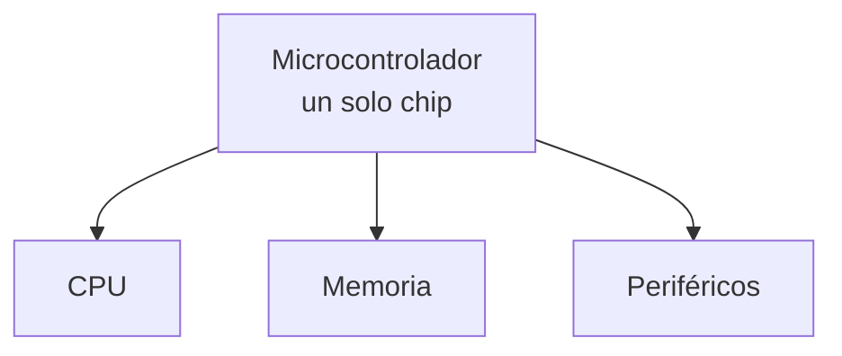

## 1. Sistema embebido

Aparato con un microcontrolador dentro, dedicado a una tarea fija.

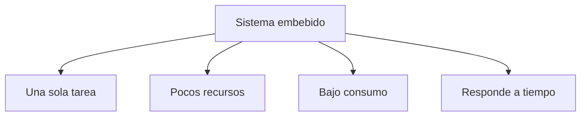

Ejemplos: lavadora, control remoto, router, termostato, alarma.

## 2. Microprocesador y microcontrolador

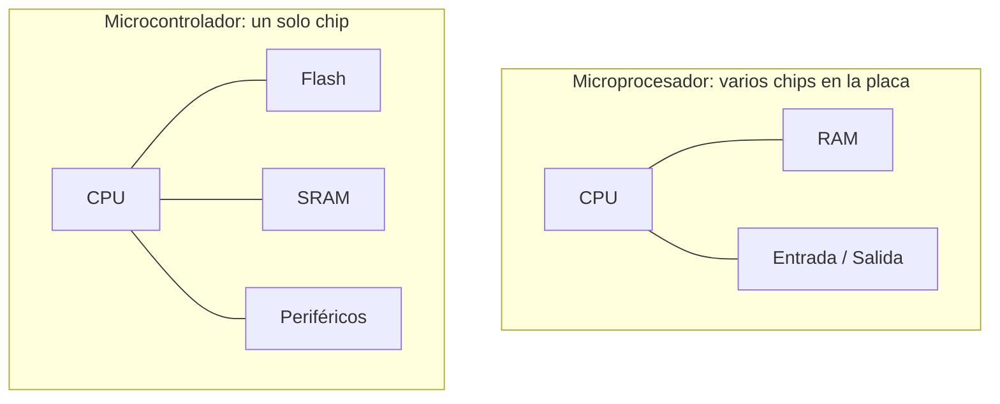

| | Microprocesador | Microcontrolador |
| --- | --- | --- |
| Contiene | Solo la CPU | CPU + memoria + periféricos |
| Uso | General (PC, laptop) | Una tarea |
| Costo y consumo | Mayor | Menor |

## 3. Las tres partes de un computador

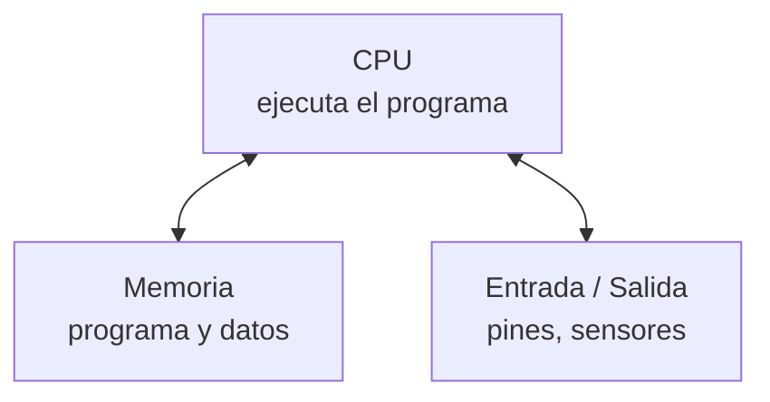

### Dentro de la CPU

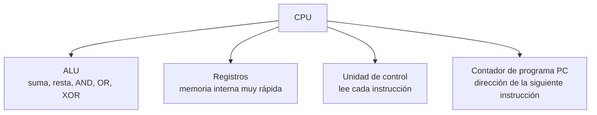

- El AVR tiene 32 registros: `r0` a `r31`.
- **Núcleo (core)** = una CPU completa. ATmega328P: 1 núcleo. ESP32: 2 núcleos.

### Ciclo de instrucción

La CPU repite tres pasos, uno por cada pulso de reloj.

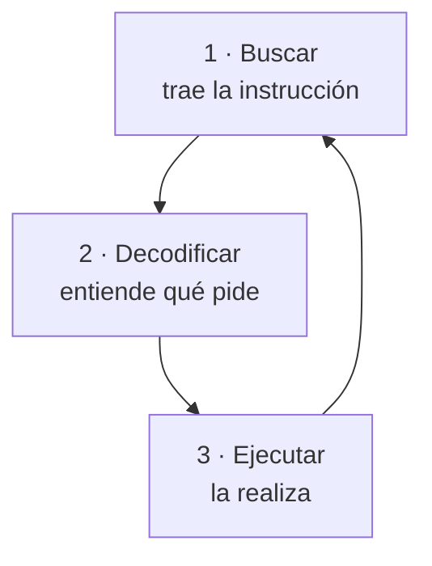

A **16 MHz** hay 16 millones de pulsos por segundo. Cada pulso dura 1 / 16 000 000 s = **62,5 ns**.

## 4. Los tres buses

Un **bus** son los cables que unen la CPU con la memoria y la E/S.

| Bus | Lleva | Sentido |
| --- | --- | --- |
| **Direcciones** | La posición a usar (ej. `0x25`) | De la CPU hacia afuera |
| **Datos** | El contenido (ej. `0010 0000`) | En los dos sentidos |
| **Control** | La orden: leer o escribir | De la CPU hacia afuera |

### Escribir y leer un byte

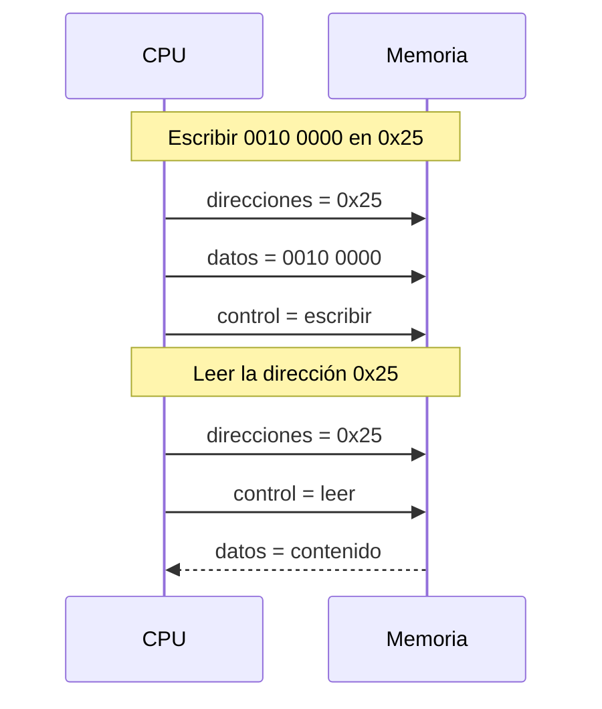

## 5. Von Neumann y Harvard

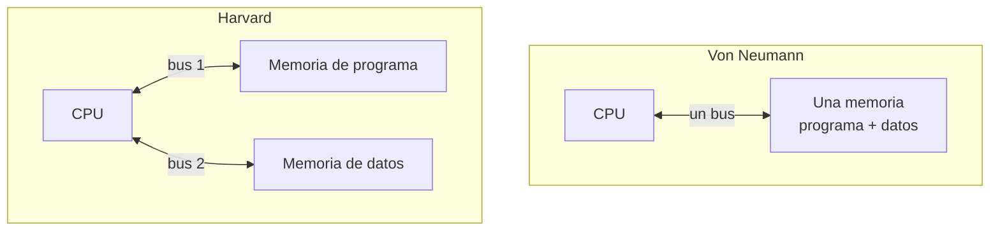

| | Von Neumann | Harvard |
| --- | --- | --- |
| Memorias | Una | Dos |
| Buses | Uno | Dos |
| Instrucción y dato | Se traen por turnos | Se traen a la vez |
| Ejemplo | PC clásico | **ATmega328P** |

## 6. Las tres memorias

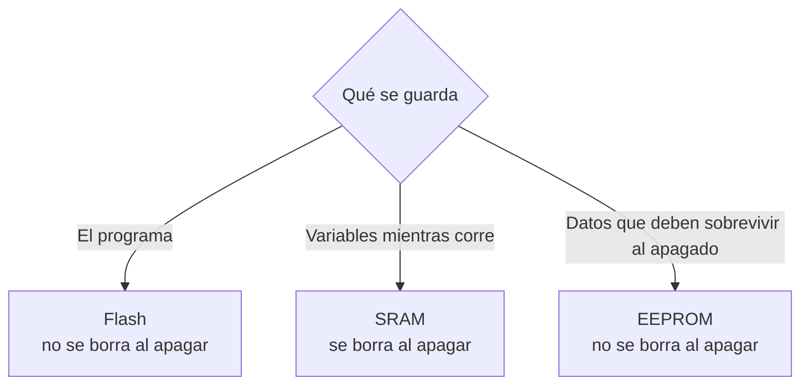

| Memoria | Se borra al apagar | Guarda |
| --- | --- | --- |
| **Flash** | No | El programa |
| **SRAM** | Sí | Las variables (rápida y pequeña) |
| **EEPROM** | No | Pocos datos que cambian y deben conservarse |

### Unidades

- 1 byte = 8 bits · 1 KB = 1 024 bytes · 1 MB = 1 024 KB.
- **Mb** (b minúscula) = megabits, no megabytes.

### Tamaños

| | ATmega328P | ESP32 |
| --- | --- | --- |
| Flash | 32 KB | 4 MB |
| SRAM | 2 KB | ≈ 520 KB |
| EEPROM | 1 KB | No tiene (se emula en la Flash) |

### Escribir desgasta

| Memoria | Escrituras garantizadas |
| --- | --- |
| Flash | 10 000 |
| EEPROM | 100 000 |
| SRAM | Sin límite |

- Leer no desgasta. Solo desgasta escribir.
- Error típico: escribir en la EEPROM dentro de `loop()`.

## 7. Periféricos

Circuitos dentro del chip que trabajan para la CPU.

| Periférico | Función | Semana |
| --- | --- | --- |
| GPIO | Poner un pin en 0/1 o leerlo | 1–2 |
| Timer | Contar pulsos para medir tiempo | 3 |
| Interrupción | Avisar a la CPU que algo pasó | 4 |
| ADC | Voltaje → número | 5 |
| UART | Comunicación serial (TX, RX) | 7 |
| I2C | Bus de 2 cables con direcciones | 7 |
| SPI | Bus rápido de 4 cables | 7 |
| PWM | Encender y apagar rápido | 12 |
| DAC | Número → voltaje | 12 |

## 8. ATmega328P y ESP32

| | ATmega328P | ESP32 |
| --- | --- | --- |
| Fabricante | Microchip (antes Atmel) | Espressif |
| Placa típica | Arduino Uno | ESP32 DevKit V1 |
| Bits · núcleos | 8 bits · 1 núcleo | 32 bits · 2 núcleos |
| Reloj | 16 MHz | Hasta 240 MHz |
| Voltaje de pines | 5 V | **3,3 V (no tolera 5 V)** |
| Wi-Fi y Bluetooth | No | Sí |

### Chip, módulo y placa

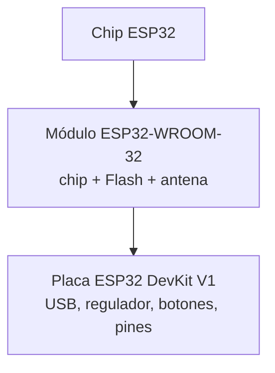

**Arduino no es un chip.** Es una plataforma: placas (como el Uno, con un ATmega328P), el Arduino IDE y funciones como `pinMode` y `digitalWrite`. El Arduino IDE también programa el ESP32.

## 9. Sostenibilidad: el MCU mínimo suficiente

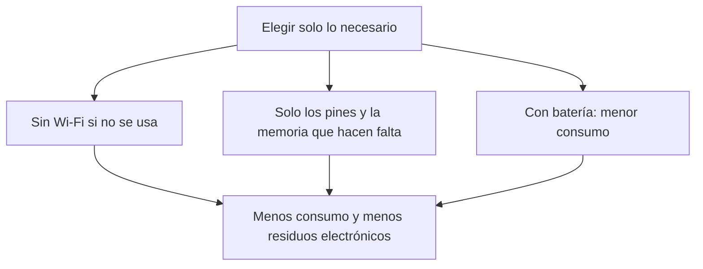

## Resumen

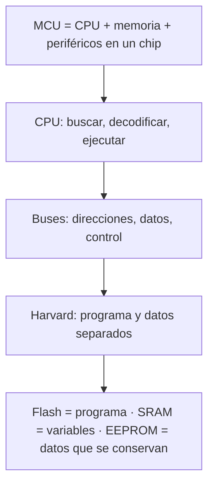
