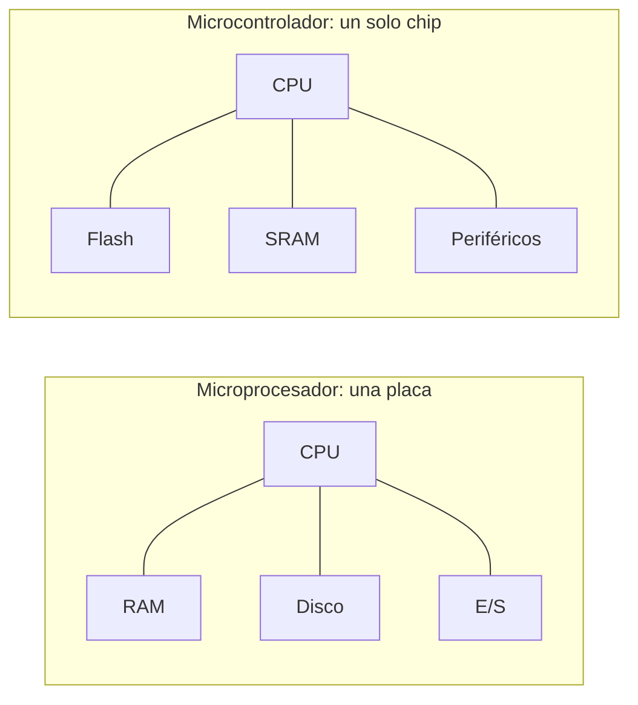
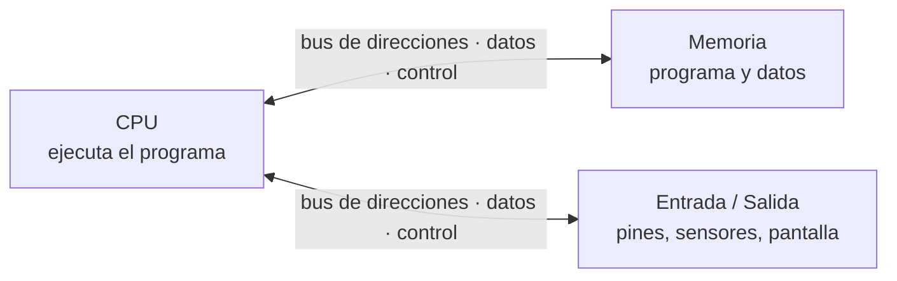
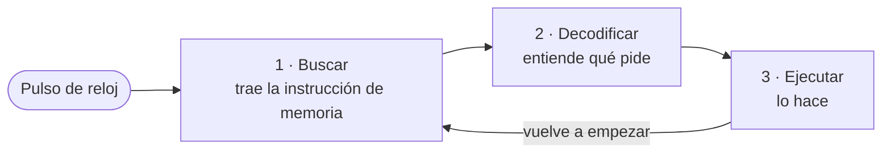
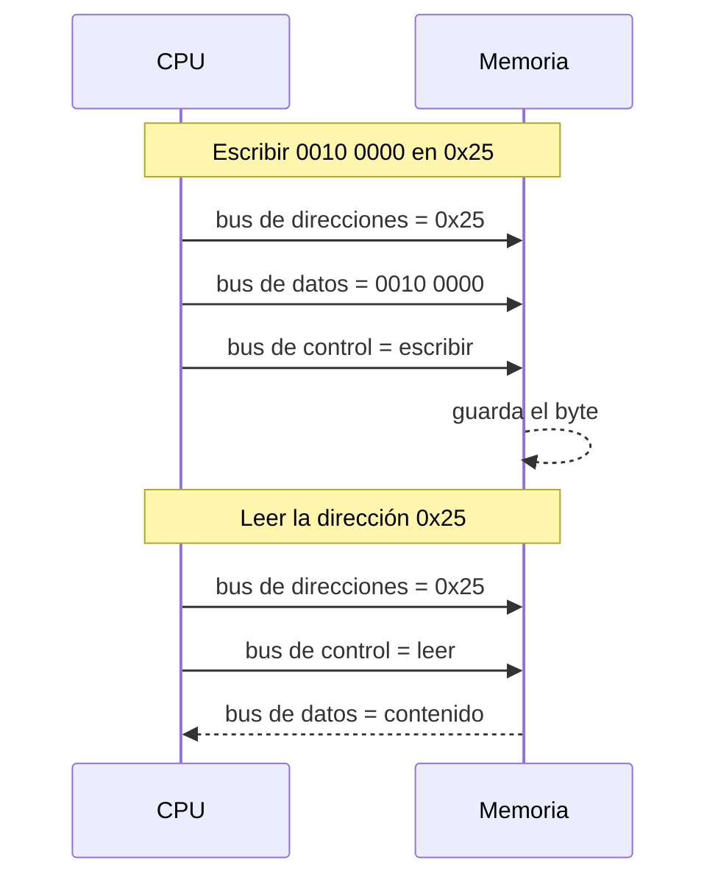
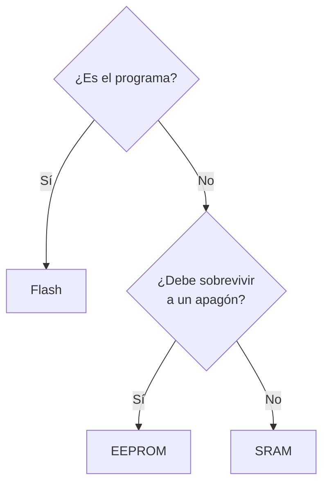
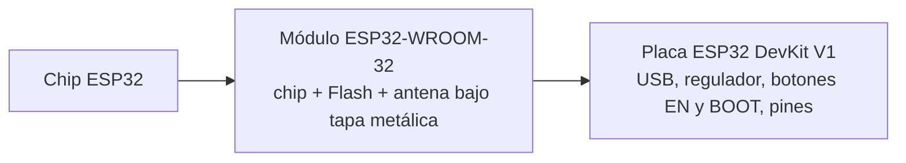

# S1 · Sesión 1 — Del computador al microcontrolador

> Semana 1 · Resultado de aprendizaje R1: diseña arquitectura de microcontroladores.
> Fuente: `S01_Sesion1_Del_computador_al_microcontrolador.pdf`.

## Idea central en una línea

Un **microcontrolador (MCU)** es un computador completo — CPU + memoria + periféricos — metido en **un solo chip** y dedicado a **una sola tarea**.

## 1. Sistema embebido

Aparato con un microcontrolador dentro, dedicado a una tarea fija.

- Hace **una sola cosa**, siempre la misma.
- **Recursos limitados**: poca memoria, bajo consumo.
- Funciona sin que el usuario lo note.
- Muchas veces debe **responder a tiempo**.

Ejemplos: lavadora, control remoto, router, termostato, automóvil, alarma.

## 2. Microprocesador vs. microcontrolador

| | Microprocesador | Microcontrolador |
| --- | --- | --- |
| Qué es | Solo la CPU | CPU + Flash + SRAM + periféricos |
| Memoria y E/S | En otros chips de la placa | Dentro del mismo chip |
| Uso | Propósito general (PC, laptop) | Una tarea (lavadora, sensor, alarma) |
| Costo / consumo | Mayor | Barato y de bajo consumo |

## 3. Las tres piezas de todo computador

### Dentro de la CPU

| Bloque | Qué hace |
| --- | --- |
| **ALU** | Unidad aritmético-lógica: suma, resta, AND, OR, XOR. |
| **Registros** | Casilleros internos muy rápidos. El AVR tiene 32: `r0` a `r31`. |
| **Unidad de control** | Lee cada instrucción y decide qué hacer. |
| **Contador de programa (PC)** | Guarda la dirección de la **siguiente** instrucción. |

**Núcleo (core)** = una CPU completa. ATmega328P: 1 núcleo. ESP32: 2 núcleos.

### El ciclo de instrucción

A **16 MHz** hay 16 millones de pulsos por segundo: cada pulso dura **62,5 ns** (1 / 16 000 000 s).

## 4. Los tres buses

| Bus | Lleva | Sentido | Ejemplo |
| --- | --- | --- | --- |
| **Direcciones** | *Qué* casillero | De la CPU hacia afuera | `0x25` |
| **Datos** | El contenido | En los dos sentidos | `0010 0000` |
| **Control** | Leer o escribir | Señales sueltas | "escribir" |

Analogía del correo: la **dirección** va en el sobre, la **carta** va dentro y el **sello** dice "entregar".

### Escribir y leer un byte

## 5. Von Neumann vs. Harvard

| | Von Neumann | Harvard |
| --- | --- | --- |
| Memorias | Una sola: programa + datos | Dos: programa y datos separados |
| Buses | Uno | Dos |
| Consecuencia | Instrucción y dato se traen **por turnos** | La siguiente instrucción llega **mientras** se usa un dato |
| Ejemplo | PC clásico | **ATmega328P** |

**Por qué Harvard puede ser más rápida:** con dos buses no hay que esperar turno; se trae instrucción y dato a la vez.

## 6. Las tres memorias

| Memoria | ¿Se borra al apagar? | Guarda | Analogía |
| --- | --- | --- | --- |
| **Flash** | No | El **programa**. Se reescribe al subir un sketch. | Libro |
| **SRAM** | **Sí** | Las **variables** mientras el programa corre. Rápida y pequeña. | Pizarra |
| **EEPROM** | No | Pocos datos que el programa cambia y deben **sobrevivir al apagado**. | Libreta |

Ejercicio de clase "¿dónde lo guardo?":

| Dato | Memoria |
| --- | --- |
| El programa de un semáforo | Flash |
| La lectura actual del sensor de temperatura | SRAM |
| Cuántas veces se abrió una puerta, aunque se vaya la luz | EEPROM |
| El contador `i` de un bucle `for` | SRAM |
| La temperatura límite que el usuario ajustó con botones | EEPROM |

### Tamaños

- 1 byte = 8 bits · 1 KB = 1 024 bytes · 1 MB = 1 024 KB.
- 1 024 = 2¹⁰: con **10 cables de dirección** hay justo 1 024 casilleros.
- Ojo: **Mb** (b minúscula) son megabits, no megabytes.

| | ATmega328P | ESP32 |
| --- | --- | --- |
| Flash | 32 KB | 4 MB |
| SRAM | 2 KB | ≈ 520 KB |
| EEPROM | 1 KB | No tiene (se emula en la Flash) |

2 KB de SRAM ≈ 2 000 letras: un `int[2000]` **no cabe** en un ATmega328P.

### Escribir desgasta

| Memoria | Ciclos de escritura garantizados |
| --- | --- |
| Flash | 10 000 |
| EEPROM | 100 000 |
| SRAM | Sin límite |

- Un ciclo = borrar y volver a escribir la misma celda. **Leer no desgasta.**
- Cada bit es carga atrapada en un transistor de **compuerta flotante**; escribir empuja electrones por un óxido muy delgado y lo daña un poco.
- **Error típico:** escribir en la EEPROM dentro de `loop()`. A ~300 escrituras/s se agota en ~6 minutos.

## 7. Periféricos

Circuitos que trabajan para la CPU.

| Periférico | Para qué | Semana |
| --- | --- | --- |
| GPIO | Poner un pin en 0/1 o leerlo | 1–2 |
| Timer | Contar pulsos para medir tiempo | 3 |
| Interrupción | Avisar a la CPU que algo pasó | 4 |
| ADC | Voltaje → número (sensor LM35) | 5 |
| UART | Serial por 2 cables (TX, RX) | 7 |
| I2C | Bus de 2 cables con direcciones | 7 |
| SPI | Bus rápido de 4 cables | 7 |
| PWM | Encender y apagar rápido (servo) | 12 |
| DAC | Número → voltaje | 12 |

## 8. ATmega328P vs. ESP32

| | ATmega328P | ESP32 |
| --- | --- | --- |
| Fabricante | Microchip (antes Atmel) | Espressif |
| Placa típica | Arduino Uno | ESP32 DevKit V1 |
| Bits y núcleos | 8 bits · 1 núcleo | 32 bits · 2 núcleos |
| Reloj | 16 MHz | Hasta 240 MHz |
| Voltaje de pines | 5 V | **3,3 V (no tolera 5 V)** |
| Wi-Fi y Bluetooth | No | Sí |

### Chip, módulo y placa

**Arduino no es un chip**: es una plataforma (placas como el Uno, que lleva un ATmega328P, el Arduino IDE y funciones como `pinMode` y `digitalWrite`). El Arduino IDE también programa el ESP32.

## 9. Sostenibilidad: el MCU mínimo suficiente

- ¿Necesito Wi-Fi? Si no, un MCU sin radio consume menos.
- ¿Cuántos pines y cuánta memoria? Sobredimensionar es gastar energía y material.
- ¿De dónde sale la energía? Con batería, cada miliamperio cuenta.

Menos recursos → menos consumo y menos residuos electrónicos (e-waste).

## Resumen

1. MCU = CPU + memoria + periféricos en un solo chip.
2. La CPU repite **buscar → decodificar → ejecutar** al ritmo del reloj.
3. Tres buses: **direcciones, datos y control**.
4. Harvard separa programa y datos; von Neumann los comparte.
5. **Flash**: programa · **SRAM**: variables · **EEPROM**: datos que sobreviven al apagado.

## Ticket de salida (resuelto)

¿Qué viaja por el bus de direcciones y qué por el bus de datos?

Por el de **direcciones**, *qué casillero* se quiere usar (sale de la CPU). Por el de **datos**, *el contenido* que se lee o escribe (va en los dos sentidos).

¿Dónde guardas un dato que debe sobrevivir a un apagón?

En la **EEPROM** (no volátil y pensada para datos que el programa cambia). La SRAM se borra al apagar.

¿Por qué Harvard puede ser más rápida que von Neumann?

Porque tiene **dos buses y dos memorias**: puede traer la siguiente instrucción mientras usa un dato. En von Neumann ambos comparten un bus y van por turnos.

