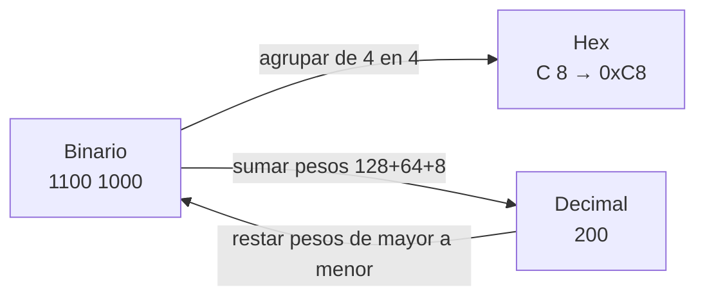
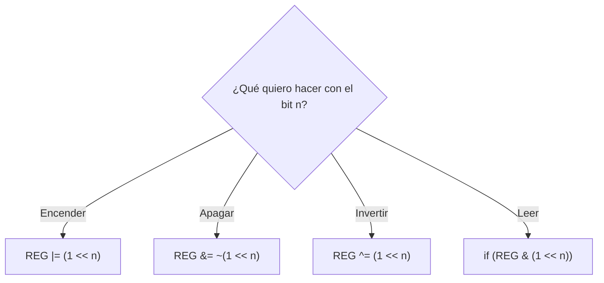
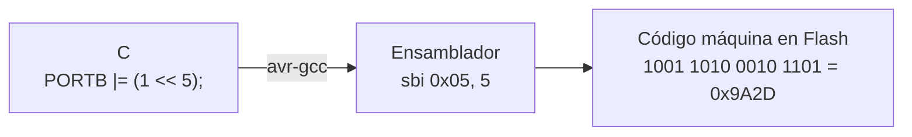
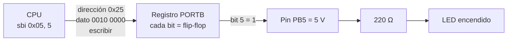
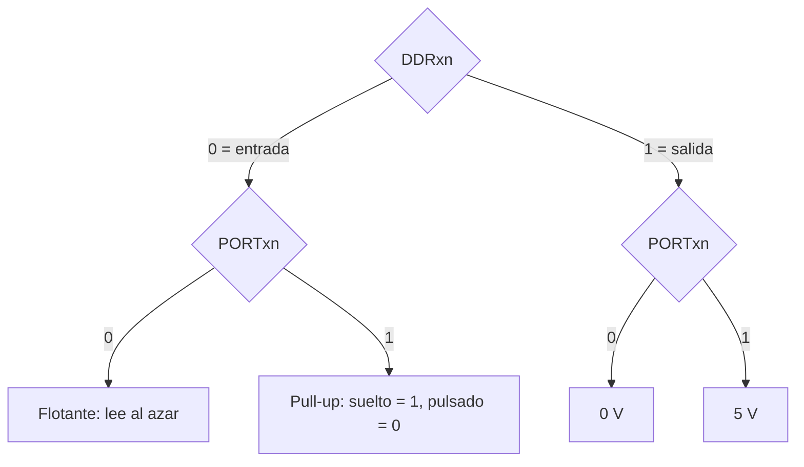

# S1 · Sesión 2 — Bits, operaciones bit a bit y E/S mapeada en memoria

> Semana 1 · Resultado de aprendizaje R1.
> Fuente: `S01_Sesion2_Bits_y_ES_mapeada_en_memoria.pdf`.

## Idea central en una línea

Para la CPU, encender un LED es **escribir un bit en una dirección de memoria**; para el pin, ese bit son **5 V** (AVR) o **3,3 V** (ESP32).

## 1. Un bit es un nivel de voltaje

| Nivel | Se escribe | Arduino Uno | ESP32 |
| --- | --- | --- | --- |
| Bajo | 0 | ≈ 0 V | ≈ 0 V |
| Alto | 1 | ≈ 5 V | ≈ 3,3 V |

Es el transistor como interruptor: en **corte** da 0, en **saturación** da 1.

## 2. Un byte: 8 bits con peso

| bit 7 | bit 6 | bit 5 | bit 4 | bit 3 | bit 2 | bit 1 | bit 0 |
| --- | --- | --- | --- | --- | --- | --- | --- |
| 128 | 64 | 32 | 16 | 8 | 4 | 2 | 1 |

- Se numeran de **derecha a izquierda**: bit 0 a la derecha, bit 7 a la izquierda.
- El valor es la **suma de los pesos** de los bits en 1.
  - `0010 0000` = 32 · `0000 0101` = 4 + 1 = 5.

## 3. Hexadecimal: 4 bits = 1 símbolo

| Bin | Hex | Bin | Hex | Bin | Hex | Bin | Hex |
| --- | --- | --- | --- | --- | --- | --- | --- |
| 0000 | 0 | 0100 | 4 | 1000 | 8 | 1100 | C |
| 0001 | 1 | 0101 | 5 | 1001 | 9 | 1101 | D |
| 0010 | 2 | 0110 | 6 | 1010 | A | 1110 | E |
| 0011 | 3 | 0111 | 7 | 1011 | B | 1111 | F |

- Prefijo `0x` = hexadecimal; prefijo `0b` = binario en C.
- `0010 0000` = `0x20` = `0b00100000`.



### Conversiones de clase (resueltas)

| Dato | Binario | Decimal | Hex |
| --- | --- | --- | --- |
| `1000 0001` | 1000 0001 | 129 | 0x81 |
| `0xFF` | 1111 1111 | 255 | 0xFF |
| `0x08` | 0000 1000 → **bit 3** en 1 | 8 | 0x08 |
| `200` | 1100 1000 | 200 | 0xC8 |
| `0x20 \| 0x01` | 0010 0001 → bits 5 y 0 | 33 | 0x21 |

## 4. Compuertas lógicas y operadores en C

| A | B | AND `&` | OR `\|` | XOR `^` | NOT A `~` |
| --- | --- | --- | --- | --- | --- |
| 0 | 0 | 0 | 0 | 0 | 1 |
| 0 | 1 | 0 | 1 | 1 | 1 |
| 1 | 0 | 0 | 1 | 1 | 0 |
| 1 | 1 | 1 | 1 | 0 | 0 |

- **AND**: 1 solo si ambos son 1. **OR**: 1 si alguno es 1. **XOR**: 1 si son distintos. **NOT**: invierte.
- **Bit a bit** = columna por columna; la CPU hace las 8 columnas en una sola instrucción.

```text
  0xCA = 1100 1010
& 0x0F = 0000 1111
  ----------------
  0x0A = 0000 1010
```

## 5. La máscara `1 << n`

Una **máscara** es un byte con 1 **solo en los bits que quiero tocar**.

`1 << 5` = correr un 1 cinco lugares a la izquierda = `0010 0000` = `0x20`.
Escribir `1 << 5` es más legible que `0x20`: dice "el bit 5".

## 6. Las cuatro recetas (¡de memoria!)

| Quiero | En C | Por qué funciona |
| --- | --- | --- |
| Poner el bit n en **1** | `REG \|= (1 << n);` | OR con 1 da 1; OR con 0 deja igual |
| Poner el bit n en **0** | `REG &= ~(1 << n);` | `~` invierte la máscara; AND con 0 da 0 |
| **Invertir** el bit n | `REG ^= (1 << n);` | XOR con 1 invierte; XOR con 0 deja igual |
| **Preguntar** por el bit n | `if (REG & (1 << n))` | Distinto de 0 solo si el bit está en 1 |

Donde la máscara tiene 0, **el bit no cambia**. `REG |= X` es la forma corta de `REG = REG | X`.



**Error clásico:** `REG = (1 << 2);` para encender el bit 2. Usa `=` en vez de `|=`: **borra todos los demás bits**. Lo correcto es `REG |= (1 << 2);`.

Encender los bits 0 y 1 sin tocar los demás: `REG |= (1 << 0) | (1 << 1);` (máscara `0x03`).

## 7. Instrucciones del AVR (RISC)

| Instrucción | Qué hace |
| --- | --- |
| `LDI r16, 0x20` | Carga el número 0x20 en el registro r16 |
| `ADD r16, r17` | Suma r17 a r16 |
| `AND`, `OR`, `EOR`, `COM` | AND, OR, XOR y NOT bit a bit |
| `SBI 0x05, 5` | Pone en 1 el bit 5 del registro de E/S 0x05 (PORTB) |
| `CBI 0x05, 5` | Pone en 0 ese mismo bit |
| `RJMP` | Salta a otra parte del programa |

### De C a bits



Una línea de C → **una sola instrucción de 2 bytes**.

### RISC vs. CISC · 8 vs. 32 bits

| RISC | CISC |
| --- | --- |
| Pocas instrucciones, simples; casi todas en 1 ciclo | Muchas instrucciones, algunas muy elaboradas |
| AVR, ARM, RISC-V, **Xtensa (ESP32)** | x86 (PC) |

8 o 32 bits = cuántos bits procesa la CPU de una vez. El ATmega328P necesita **4 sumas** para sumar dos números de 32 bits; el ESP32, **una**.

## 8. E/S mapeada en memoria

Los periféricos se controlan con **registros que tienen dirección**, igual que la memoria.



> `0x05` es la dirección de PORTB en el espacio de E/S (lo que usa `sbi`); `0x25` es la misma dirección vista en el mapa de memoria de datos (0x05 + 0x20).

### Tres registros por puerto (B, C y D en el ATmega328P)

| Registro | Para qué sirve | Bit en 1 significa |
| --- | --- | --- |
| **DDRx** | Dirección: entrada o salida | **Salida** |
| **PORTx** | Salida: el valor que sale. Entrada: activa la pull-up | 5 V en el pin, o pull-up activa |
| **PINx** | Leer el voltaje real del pin | El pin está en alto |

El **bit n** de cada registro corresponde al **pin n** del puerto.

### Los cuatro estados de un pin

| DDRxn | PORTxn | Estado del pin | Ejemplo |
| --- | --- | --- | --- |
| 0 | 0 | Entrada **flotante**: lee al azar | Nada conectado |
| 0 | 1 | Entrada con **pull-up** | Botón a GND |
| 1 | 0 | Salida en 0 (0 V) | LED apagado |
| 1 | 1 | Salida en 1 (5 V) | LED encendido |



**Con pull-up la lógica queda invertida:** botón suelto lee 1, pulsado lee 0.

### Predice el pin (resuelto)

| Caso | Configuración | Resultado |
| --- | --- | --- |
| A | DDRB5 = 1, PORTB5 = 1 | Salida en alto: **5 V** |
| B | DDRB5 = 1, PORTB5 = 0 | Salida en bajo: **0 V** |
| C | DDRD2 = 0, PORTD2 = 1, botón pulsado a GND | Pull-up, pulsado: **PIND2 = 0** |
| D | DDRD2 = 0, PORTD2 = 0, nada conectado | Flotante: **valor al azar** |

## 9. Arduino vs. registros

| Funciones de Arduino | Registros (lo que pasa por dentro) |
| --- | --- |
| `pinMode(13, OUTPUT);` | `DDRB \|= (1 << 5);` |
| `digitalWrite(13, HIGH);` | `PORTB \|= (1 << 5);` |
| `digitalWrite(13, LOW);` | `PORTB &= ~(1 << 5);` |
| `pinMode(2, INPUT_PULLUP);` | `DDRD &= ~(1 << 2); PORTD \|= (1 << 2);` |
| `int b = digitalRead(2);` | `int b = (PIND & (1 << 2)) != 0;` |

Pin 13 del Uno = PB5; pin 2 = PD2. Las funciones son más **legibles y portables**; los registros, más **rápidos** y muestran qué ocurre en el chip.

## Resumen

1. Un bit es un nivel de voltaje; un byte son 8 bits; un dígito hex son 4 bits.
2. Las operaciones bit a bit aplican AND, OR, XOR y NOT columna por columna.
3. Con una máscara `1 << n` se toca un solo bit sin cambiar los demás.
4. Los periféricos se controlan con registros que tienen dirección, como la memoria.
5. **DDR** elige entrada o salida, **PORT** pone el valor y **PIN** lee el pin.

## Ticket de salida (resuelto)

<details>
<summary>¿Cuánto es 0x81 en binario?</summary>

`0x81` = `8` `1` = `1000 0001` (decimal 129).
</details>

<details>
<summary>Escribe la línea que apaga el bit 4 de PORTB.</summary>

`PORTB &= ~(1 << 4);`
</details>

<details>
<summary>Con DDRD2 = 0 y PORTD2 = 1, ¿qué lee PIND2 con el botón pulsado a GND?</summary>

**0**. Es entrada con pull-up; el botón une el pin con GND, así que pulsado lee bajo.
</details>
