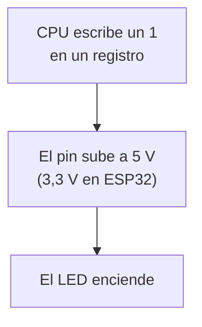
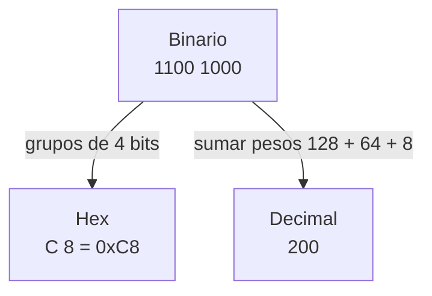
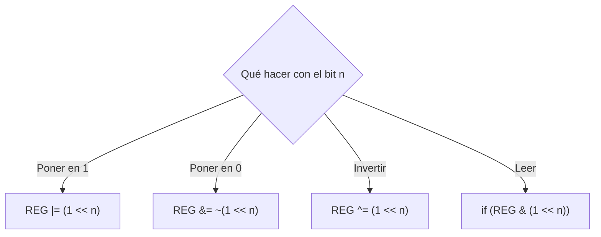
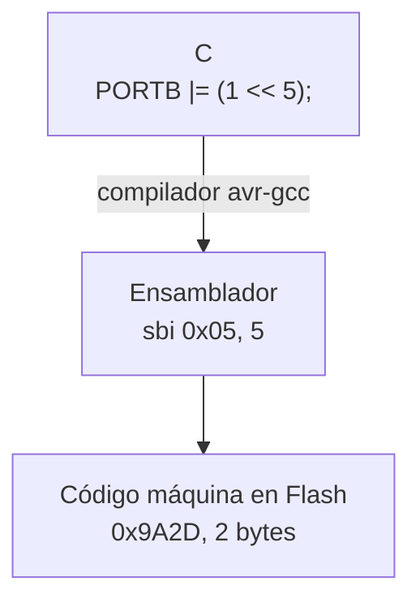
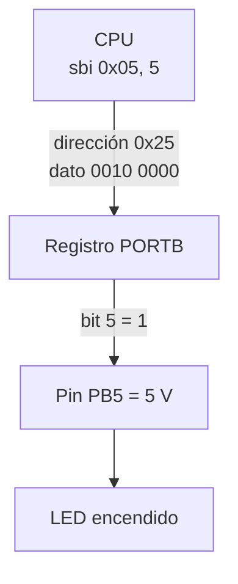
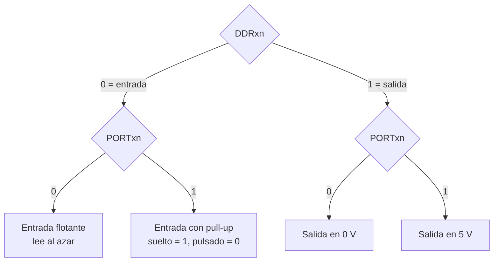
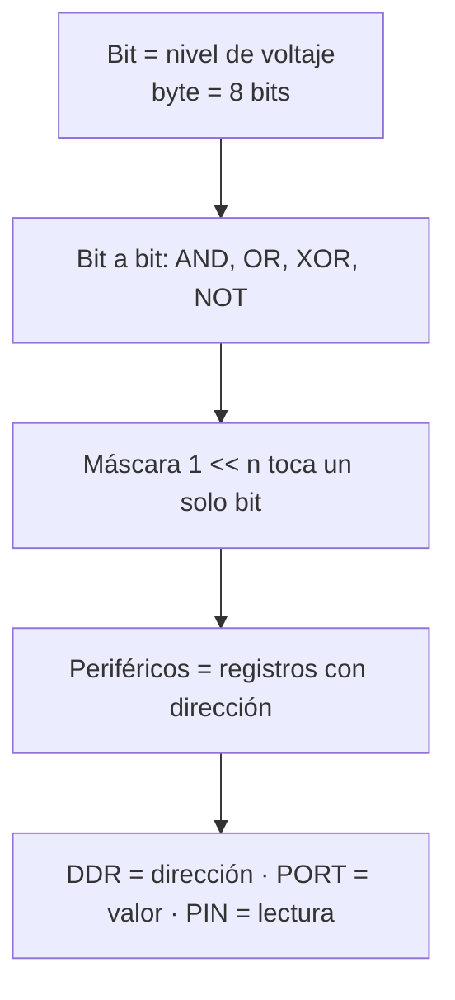

# S1 · Sesión 2 — Bits, operaciones bit a bit y E/S mapeada en memoria

> Semana 1 · Resultado de aprendizaje R1.
> Fuente: `S01_Sesion2_Bits_y_ES_mapeada_en_memoria.pdf`.

## Idea central

Para la CPU, encender un LED es **escribir un bit en una dirección de memoria**.



## 1. Un bit es un nivel de voltaje

| Bit | Nivel | Arduino Uno | ESP32 |
| --- | --- | --- | --- |
| 0 | Bajo | ≈ 0 V | ≈ 0 V |
| 1 | Alto | ≈ 5 V | ≈ 3,3 V |

## 2. Un byte: 8 bits con peso

| bit 7 | bit 6 | bit 5 | bit 4 | bit 3 | bit 2 | bit 1 | bit 0 |
| --- | --- | --- | --- | --- | --- | --- | --- |
| 128 | 64 | 32 | 16 | 8 | 4 | 2 | 1 |

- Los bits se numeran de **derecha a izquierda**.
- El valor es la **suma de los pesos** de los bits en 1.
- `0010 0000` = 32 · `0000 0101` = 4 + 1 = 5.

## 3. Hexadecimal

Un dígito hexadecimal representa **4 bits**.

| Bin | Hex | Bin | Hex | Bin | Hex | Bin | Hex |
| --- | --- | --- | --- | --- | --- | --- | --- |
| 0000 | 0 | 0100 | 4 | 1000 | 8 | 1100 | C |
| 0001 | 1 | 0101 | 5 | 1001 | 9 | 1101 | D |
| 0010 | 2 | 0110 | 6 | 1010 | A | 1110 | E |
| 0011 | 3 | 0111 | 7 | 1011 | B | 1111 | F |

- `0x` = prefijo hexadecimal. `0b` = prefijo binario en C.
- `0010 0000` = `0x20` = `0b00100000`.



## 4. Operaciones bit a bit

| A | B | AND `&` | OR `\|` | XOR `^` |
| --- | --- | --- | --- | --- |
| 0 | 0 | 0 | 0 | 0 |
| 0 | 1 | 0 | 1 | 1 |
| 1 | 0 | 0 | 1 | 1 |
| 1 | 1 | 1 | 1 | 0 |

- **AND**: 1 solo si los dos son 1.
- **OR**: 1 si alguno es 1.
- **XOR**: 1 si son distintos.
- **NOT `~`**: invierte el bit.
- **Bit a bit**: la operación se hace columna por columna.

```text
  0xCA = 1100 1010
& 0x0F = 0000 1111
  ----------------
  0x0A = 0000 1010
```

## 5. La máscara `1 << n`

Una **máscara** es un byte con 1 solo en los bits que se quieren tocar.

`1 << n` mueve un 1 a la izquierda n lugares.

| Expresión | Binario | Hex |
| --- | --- | --- |
| `1 << 0` | 0000 0001 | 0x01 |
| `1 << 3` | 0000 1000 | 0x08 |
| `1 << 5` | 0010 0000 | 0x20 |

## 6. Cuatro formas de tocar un bit



- Los bits donde la máscara vale 0 **no cambian**.
- `REG |= X` es la forma corta de `REG = REG | X`.
- Para tocar varios bits: `REG |= (1 << 0) | (1 << 1);` (máscara `0x03`).

**Error clásico:** `REG = (1 << 2);` usa `=` y **borra todos los demás bits**. Lo correcto es `REG |= (1 << 2);`.

## 7. Instrucciones del AVR

| Instrucción | Qué hace |
| --- | --- |
| `LDI r16, 0x20` | Carga 0x20 en el registro r16 |
| `ADD r16, r17` | Suma r17 a r16 |
| `AND`, `OR`, `EOR`, `COM` | AND, OR, XOR y NOT bit a bit |
| `SBI 0x05, 5` | Pone en 1 el bit 5 del registro 0x05 (PORTB) |
| `CBI 0x05, 5` | Pone en 0 ese bit |



- AVR es **RISC**: pocas instrucciones simples, casi todas de 1 ciclo.
- ATmega328P (8 bits) necesita 4 sumas para dos números de 32 bits. ESP32 (32 bits) necesita 1.

## 8. E/S mapeada en memoria

Los periféricos se controlan con **registros que tienen dirección**, igual que la memoria.



- `0x05` es la dirección de PORTB en el espacio de E/S (la usa `sbi`).
- `0x25` es la misma dirección en el mapa de memoria de datos (0x05 + 0x20).

### Tres registros por puerto

El ATmega328P tiene los puertos B, C y D.

| Registro | Función |
| --- | --- |
| **DDRx** | Dirección: bit en 1 = **salida**, en 0 = entrada |
| **PORTx** | Salida: valor que sale. Entrada: activa la pull-up |
| **PINx** | Lee el voltaje real del pin |

- El **bit n** de cada registro es el **pin n** del puerto.
- **Pull-up**: resistencia interna que mantiene el pin en 1 cuando nada lo baja.
- **Flotante**: entrada sin nada que fije su valor; lee al azar.

### Estados de un pin



| DDRxn | PORTxn | Estado |
| --- | --- | --- |
| 0 | 0 | Entrada flotante |
| 0 | 1 | Entrada con pull-up |
| 1 | 0 | Salida en 0 V |
| 1 | 1 | Salida en 5 V |

Con pull-up la lógica queda **invertida**: botón suelto lee 1, botón pulsado lee 0.

## 9. Funciones de Arduino y registros

| Arduino | Registros |
| --- | --- |
| `pinMode(13, OUTPUT);` | `DDRB \|= (1 << 5);` |
| `digitalWrite(13, HIGH);` | `PORTB \|= (1 << 5);` |
| `digitalWrite(13, LOW);` | `PORTB &= ~(1 << 5);` |
| `pinMode(2, INPUT_PULLUP);` | `DDRD &= ~(1 << 2); PORTD \|= (1 << 2);` |
| `int b = digitalRead(2);` | `int b = (PIND & (1 << 2)) != 0;` |

- Pin 13 del Uno = PB5. Pin 2 = PD2.
- Las funciones son más legibles y portables. Los registros son más rápidos.

## Resumen


