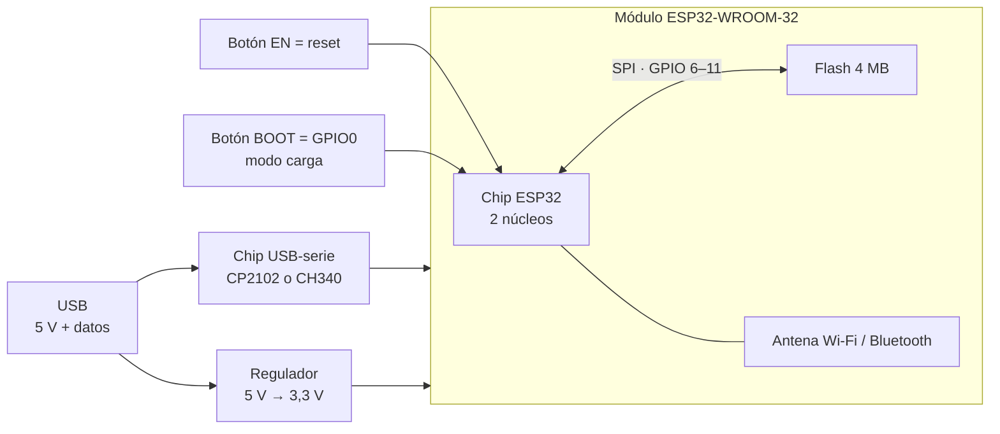
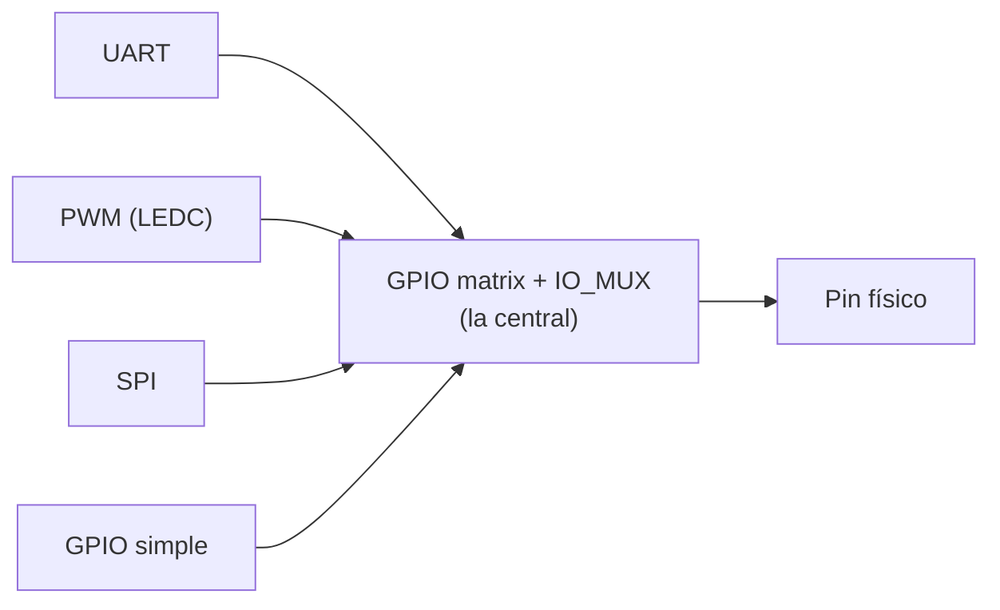
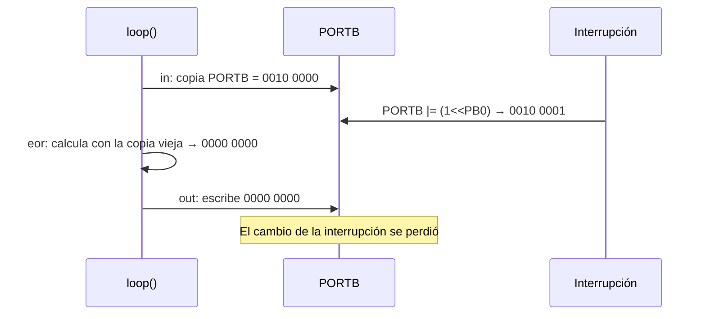
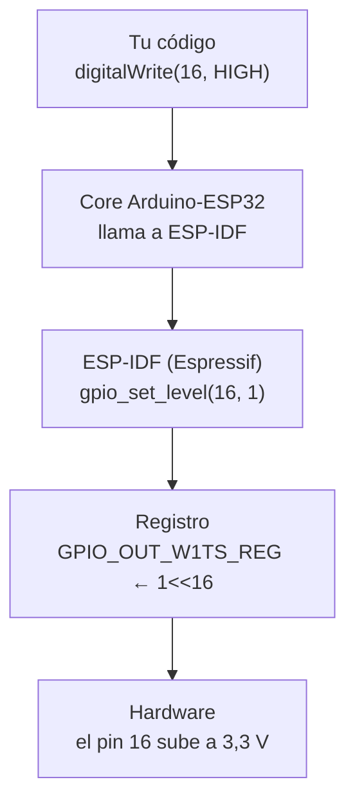
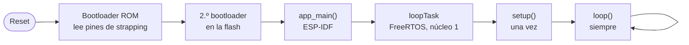
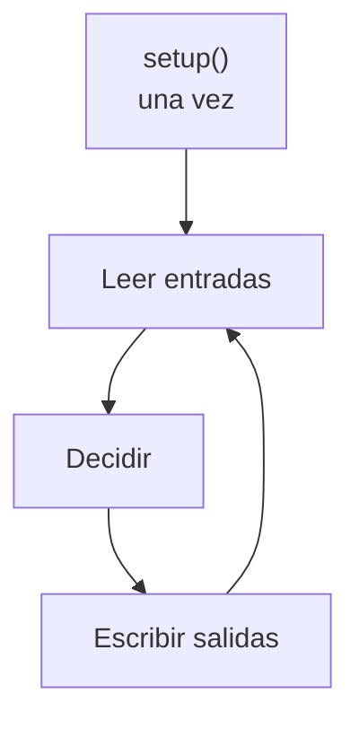

# S2 · Sesión 1 — Del AVR al ESP32: pines, registros y el programa que nunca termina

> Semana 2 · Resultado de aprendizaje R1.
> Fuente: `S2_Sesion1_Del_AVR_al_ESP32.pdf`.

## Idea central en una línea

El ESP32 no tiene DDRB, PORTB ni PINB, pero **la idea no cambia**: un pin se controla escribiendo bits en **registros mapeados en memoria**. Cambian los nombres, el ancho (32 bits) y aparece una "central" que conecta pines con periféricos.

## 1. ATmega328P vs. ESP32-WROOM-32

| | ATmega328P (semana 1) | ESP32-WROOM-32 |
| --- | --- | --- |
| Ancho de palabra | 8 bits | **32 bits** |
| Núcleos / reloj | 1 núcleo · 16 MHz | 2 núcleos **Xtensa LX6** · hasta 240 MHz |
| SRAM | 2 KB | 520 KB |
| Flash | 32 KB, dentro del chip | 4 MB, **chip aparte** en el módulo (SPI) |
| Tensión lógica | 5 V | **3,3 V** |
| Pin ↔ periférico | Fijo (PB5 = bit 5 de PORTB) | **Configurable** (GPIO matrix) |

Analogía: de la tienda de barrio al supermercado.

## 2. La placa DevKit V1 (30 pines) por dentro



Los clones cambian el orden de pines: **verificar la serigrafía**.

## 3. GPIO matrix + IO_MUX: la central

En el AVR cada pin está cableado a un bit fijo. En el ESP32 hay una **central configurable** entre pines y periféricos (UART, PWM/LEDC, SPI, GPIO simple).



Configurar un pin = 3 pasos, y **`pinMode()` hace los tres por nosotros**:

1. Elegir su función (IO_MUX).
2. Conectar la señal en la matrix.
3. Habilitar la salida.

## 4. Equivalencia de registros

| Función | AVR | ESP32 (GPIO 0–31) |
| --- | --- | --- |
| Dirección (entrada/salida) | `DDRB` | `GPIO_ENABLE_REG` |
| Escribir la salida | `PORTB` | `GPIO_OUT_W1TS_REG` / `GPIO_OUT_W1TC_REG` |
| Leer la entrada | `PINB` | `GPIO_IN_REG` |
| Pull-up interna | `PORTB` (con el pin como entrada) | Registro IO_MUX de cada pin |

GPIO 32–39 no caben en un registro de 32 bits: usan un **segundo banco** (`GPIO_OUT1_REG`, `GPIO_IN1_REG`).

## 5. El riesgo de leer-modificar-escribir

`PORTB |= (1 << PB5)` en realidad son **3 pasos**: leer (`in`), calcular, escribir (`out`). Si una interrupción cambia el registro **entre medio**, su cambio se pierde.



Con **dos núcleos** el riesgo es mayor.

## 6. W1TS y W1TC: escritura atómica

| Registro | Bits en 1 | Bits en 0 |
| --- | --- | --- |
| **W1TS** (*write 1 to set*) | Se **encienden** | No se tocan |
| **W1TC** (*write 1 to clear*) | Se **apagan** | No se tocan |

```text
GPIO_OUT antes    0 1 0 1
escribo en W1TS   0 0 1 0
GPIO_OUT después  0 1 1 1
```

Una sola escritura, **sin leer antes** → la operación es **atómica**: nada se pierde.

### Blink con registros del ESP32

```cpp
#include "soc/gpio_reg.h"

constexpr uint8_t PIN_LED = 16;
constexpr uint32_t MASK_LED = 1UL << PIN_LED;

void setup() {
  pinMode(PIN_LED, OUTPUT);                   // configura
}

void loop() {
  REG_WRITE(GPIO_OUT_W1TS_REG, MASK_LED);     // como PORTB |=
  delay(500);
  REG_WRITE(GPIO_OUT_W1TC_REG, MASK_LED);     // como PORTB &= ~
  delay(500);
}
```

Montaje: LED en GPIO16 con 330 Ω a GND · Placa "ESP32 Dev Module" · core Espressif 3.x.
**`pinMode()` configura; los registros leen y escriben.**

## 7. Capas de abstracción



Arriba: **más fácil**. Abajo: **más control y velocidad**. La API cuesta tiempo (Parte D de la AP1).

## 8. Mapa de pines: qué usar y qué evitar

| Grupo | Pines | Regla |
| --- | --- | --- |
| **Seguros** para LEDs y pulsadores | 16, 17, 18, 19, 21, 22, 23, 25, 26, 27, 32, 33 | Usar estos |
| **Strapping** (el chip los lee al arrancar) | 0, 2, 5, 12, 15 | No conectar entradas |
| **Solo entrada**, sin pull-up interna | 34, 35, 36 (VP), 39 (VN) | Solo lectura; pull-up externa |
| **UART0** (carga y Monitor Serie) | 1 (TX0), 3 (RX0) | No usar |
| **Flash** | 6–11 | No salen en esta placa |
| Alimentación y reset | 3V3, GND, VIN, EN | — |

AP2: LEDs en 16, 17, 18, 19 y pulsador en 21.

### Pines de strapping

| Pin | Qué pasa al arrancar |
| --- | --- |
| **GPIO0** | En BAJO → modo de carga. Es el botón **BOOT**. |
| **GPIO2** | Debe estar en bajo o al aire para cargar. Suele tener el LED azul de la placa. |
| **GPIO12** | En ALTO → la flash se configura a 1,8 V → **la placa no arranca**. |
| GPIO5, GPIO15 | También se leen al arrancar. |

**Wokwi NO reproduce estas fallas**: solo aparecen con la placa real.

## 9. Límites eléctricos a 3,3 V

```text
R = (3,3 V − Vf) / I
LED rojo con 330 Ω → (3,3 − 2,0) / 330 ≈ 4 mA
```

- Diseño: **≤ 10 mA por pin**.
- **No toleran 5 V**: un sensor de 5 V conectado directo puede dañar el pin.
- LEDs recomendados: rojo, verde o amarillo con 220–330 Ω. Azul y blanco casi no encienden a 3,3 V con resistencia (a un LED azul le quedan ~0,3 V).

### Actividad "¿dónde lo conecto?" (resuelta)

| Caso | ¿Sirve? | Por qué |
| --- | --- | --- |
| LED en GPIO18 | ✔ | Pin seguro de salida. |
| Pulsador en GPIO35 con `INPUT_PULLUP` | ✘ | 34–39 no tienen pull-up interna: queda flotando. Usar pull-up externa de 10 kΩ. |
| Pulsador entre GPIO12 y 3,3 V | ✘ | Strapping: si está presionado al arrancar, GPIO12 en alto → no arranca. |
| Sensor que entrega 5 V en GPIO4 | ✘ | El ESP32 no tolera 5 V: usar divisor o adaptador de nivel. |
| LED en GPIO2 | ⚠ | Strapping y ya tiene el LED de la placa; puede interferir con la carga. Mejor evitar. |
| LED en GPIO1 | ✘ | Es TX0 de UART0: interfiere con la carga y el Monitor Serie. |

## 10. El programa que nunca termina

| Programa de PC (el visitante) | Programa embebido (el guardia nocturno) |
| --- | --- |
| Lo lanza el sistema operativo | Arranca con la alimentación |
| Hace su trabajo | Configura una vez |
| `main()` termina con `return 0` | Repite su ronda para siempre |
| El SO recupera el control | Solo termina si se corta la energía |

En un microcontrolador **no existe un "fin del programa"**.

### Del reset a `loop()`



- Antes de `setup()`, las globales inicializadas se copian de la flash a la SRAM.
- **Todo sketch del ESP32 ya corre sobre FreeRTOS** (Unidad 2).

### El superlazo

Lo que Arduino esconde (AVR):

```cpp
int main() {
  init();          // timers, ADC...
  setup();
  for (;;) {
    loop();
  }
}
```



En el ESP32, `loopTask` hace lo mismo.

### Predicción: ¿qué imprime en la 3.ª pasada?

```cpp
int contadorGlobal = 0;
void setup() { Serial.begin(115200); }
void loop() {
  int contadorLocal = 0;
  static int contadorStatic = 0;
  contadorGlobal++; contadorLocal++; contadorStatic++;
  // imprime los tres...
  delay(1000);
}
```

<details>
<summary>Respuesta</summary>

`global=3 local=1 static=3`.
La **local** se crea de nuevo en cada vuelta (vale 1 siempre). La **global** y la **static** se crean una sola vez y conservan su valor.
</details>

### Lo que cuesta un `loop()` vacío

- **Activo** a 240 MHz: la CPU ejecuta instrucciones sin parar → **decenas de mA**, aunque `loop()` no haga nada.
- **Deep sleep**: casi todo se apaga y un temporizador lo despierta → **del orden de µA**.

## 11. Herramientas: Arduino IDE 2.x + core Espressif 3.x


URL: `https://espressif.github.io/arduino-esp32/package_esp32_index.json`
**No** es "Arduino ESP32 Boards".

### Cuando el programa no sube

| Síntoma | Causa probable | Solución |
| --- | --- | --- |
| No aparece ningún puerto | Cable solo de carga o falta driver | Otro cable · driver CP210x/CH340 |
| *Wrong boot mode* / *Timed out* | No entró en modo de carga | Mantener **BOOT** en "Connecting…" |
| *Access denied* | Puerto ocupado por otra ventana | Cerrar el otro Monitor Serie |
| Caracteres basura | Velocidad distinta | 115200 en `Serial.begin` y en el Monitor |
| *Brownout detector* | Alimentación débil | Otro puerto USB o cable |
| No arranca con el circuito | Pin de strapping forzado | Mover a un pin seguro |

## Resumen

| Tema | Lo esencial |
| --- | --- |
| Registros | DDR / PORT / PIN → ENABLE / OUT (W1TS, W1TC) / IN |
| Pines | Seguros · strapping · solo entrada · UART0 · 3,3 V |
| Atomicidad | W1TS y W1TC escriben sin leer: nada se pierde |
| Programa | `setup()` una vez, `loop()` siempre, sobre FreeRTOS |
