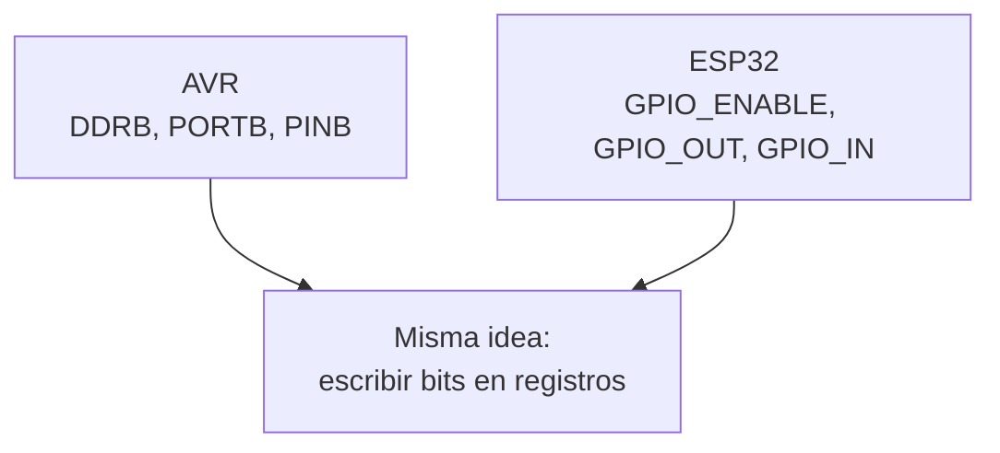
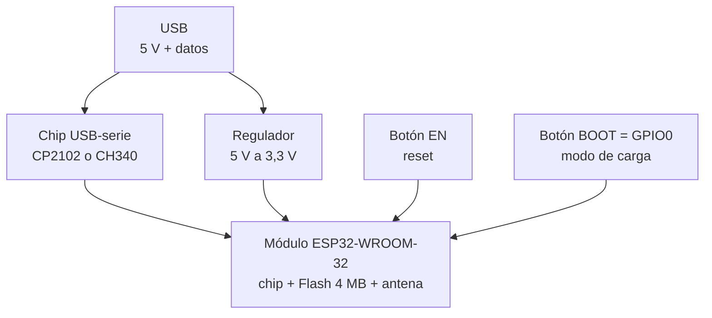
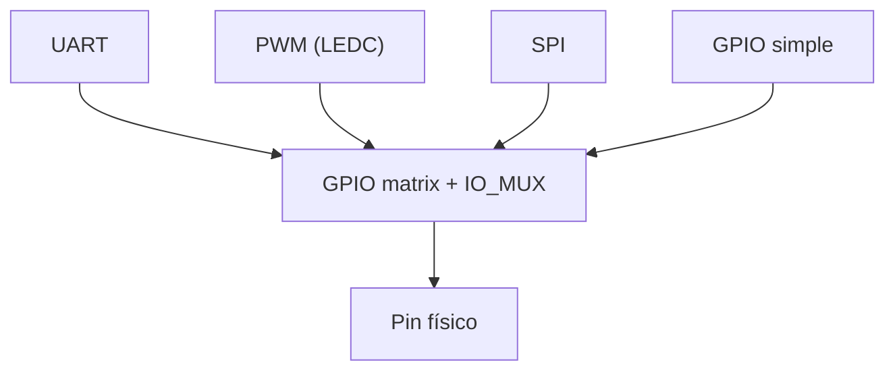
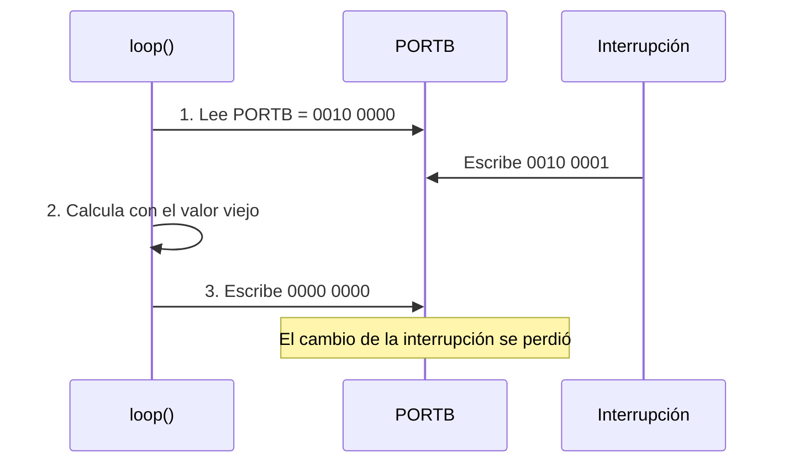
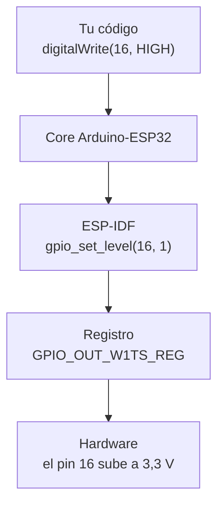
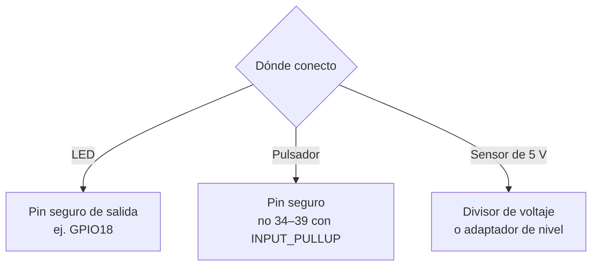
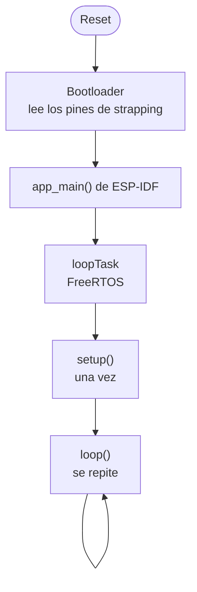
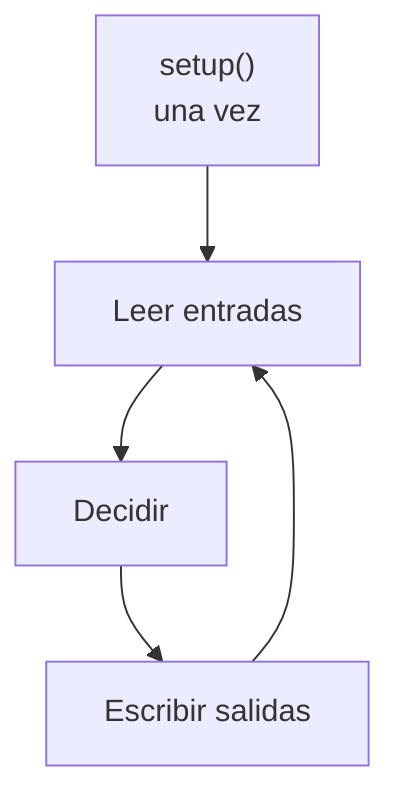
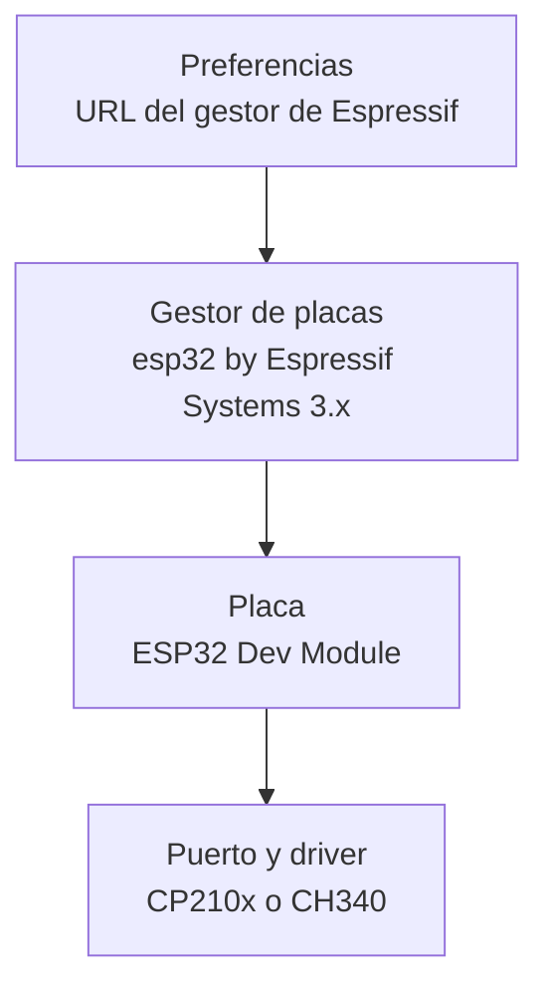
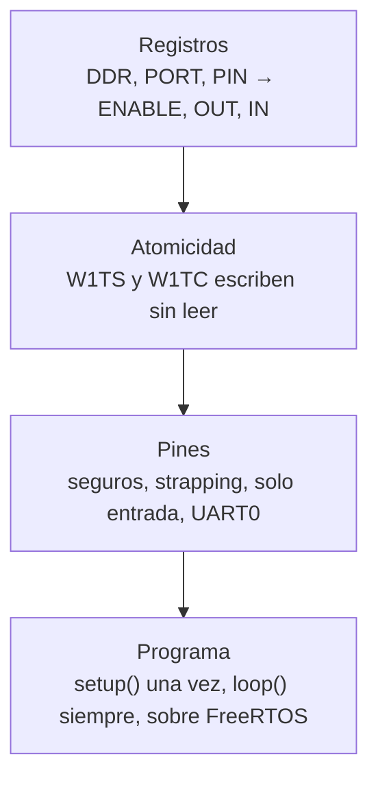

# S2 · Sesión 1 — Del AVR al ESP32: pines, registros y el programa que nunca termina

> Semana 2 · Resultado de aprendizaje R1.
> Fuente: `S2_Sesion1_Del_AVR_al_ESP32.pdf`.

## Idea central

En el ESP32 un pin también se controla escribiendo bits en **registros mapeados en memoria**, igual que en el AVR. Cambian los nombres de los registros, el ancho (32 bits) y aparece una **matriz** que conecta pines con periféricos.



## 1. ATmega328P y ESP32-WROOM-32

| | ATmega328P | ESP32-WROOM-32 |
| --- | --- | --- |
| Ancho de palabra | 8 bits | **32 bits** |
| Núcleos · reloj | 1 · 16 MHz | 2 (Xtensa LX6) · hasta 240 MHz |
| SRAM | 2 KB | 520 KB |
| Flash | 32 KB, dentro del chip | 4 MB, chip aparte en el módulo |
| Tensión lógica | 5 V | **3,3 V** |
| Pin ↔ periférico | Fijo | **Configurable** (GPIO matrix) |

## 2. La placa DevKit V1 (30 pines)



Los clones pueden cambiar el orden de los pines: verificar la serigrafía de la placa.

## 3. GPIO matrix e IO_MUX

En el AVR cada pin está fijo a un bit. En el ESP32, la **GPIO matrix** y el **IO_MUX** conectan cada pin con el periférico que se elija.



Configurar un pin tiene 3 pasos. **`pinMode()` los hace todos:**

1. Elegir su función (IO_MUX).
2. Conectar la señal en la matrix.
3. Habilitar la salida.

## 4. Equivalencia de registros

| Función | AVR | ESP32 (GPIO 0–31) |
| --- | --- | --- |
| Dirección | `DDRB` | `GPIO_ENABLE_REG` |
| Escribir la salida | `PORTB` | `GPIO_OUT_W1TS_REG` / `GPIO_OUT_W1TC_REG` |
| Leer la entrada | `PINB` | `GPIO_IN_REG` |
| Pull-up interna | `PORTB` (pin como entrada) | Registro IO_MUX del pin |

Los GPIO 32–39 usan un segundo banco de registros (`GPIO_OUT1_REG`, `GPIO_IN1_REG`).

## 5. Problema de leer-modificar-escribir

`PORTB |= (1 << PB5)` son **3 pasos**: leer, calcular, escribir. Si una interrupción cambia el registro entre los pasos, ese cambio se pierde.



Con dos núcleos el riesgo es mayor.

## 6. W1TS y W1TC: escritura atómica

Una operación **atómica** se hace en un solo paso, sin que nada se pierda.

| Registro | Bit escrito en 1 | Bit escrito en 0 |
| --- | --- | --- |
| **W1TS** (write 1 to set) | Se enciende | No cambia |
| **W1TC** (write 1 to clear) | Se apaga | No cambia |

```text
GPIO_OUT antes    0 1 0 1
escribo en W1TS   0 0 1 0
GPIO_OUT después  0 1 1 1
```

No se lee antes de escribir, por eso no hay pérdida.

### Blink con registros del ESP32

```cpp
#include "soc/gpio_reg.h"

constexpr uint8_t PIN_LED = 16;
constexpr uint32_t MASK_LED = 1UL << PIN_LED;

void setup() {
  pinMode(PIN_LED, OUTPUT);                   // configura
}

void loop() {
  REG_WRITE(GPIO_OUT_W1TS_REG, MASK_LED);     // como PORTB |=
  delay(500);
  REG_WRITE(GPIO_OUT_W1TC_REG, MASK_LED);     // como PORTB &= ~
  delay(500);
}
```

- Montaje: LED en GPIO16 con 330 Ω a GND.
- Placa "ESP32 Dev Module" · core Espressif 3.x.
- `pinMode()` configura; los registros escriben.

## 7. Capas de abstracción



- Arriba: más fácil de usar.
- Abajo: más control y más velocidad.

## 8. Mapa de pines

| Grupo | Pines | Regla |
| --- | --- | --- |
| **Seguros** | 16, 17, 18, 19, 21, 22, 23, 25, 26, 27, 32, 33 | Usar para LEDs y pulsadores |
| **Strapping** | 0, 2, 5, 12, 15 | No conectar entradas |
| **Solo entrada** | 34, 35, 36 (VP), 39 (VN) | Sin pull-up interna |
| **UART0** | 1 (TX0), 3 (RX0) | No usar |
| **Flash** | 6–11 | No salen en esta placa |

AP2: LEDs en 16, 17, 18, 19 y pulsador en 21.

### Pines de strapping

Un pin de **strapping** es leído por el chip al arrancar para decidir cómo iniciar.

| Pin | Efecto al arrancar |
| --- | --- |
| **GPIO0** | En BAJO → modo de carga (botón **BOOT**) |
| **GPIO2** | Debe estar en bajo o al aire para cargar |
| **GPIO12** | En ALTO → la placa no arranca |
| GPIO5, GPIO15 | También se leen al arrancar |

Wokwi **no** reproduce estas fallas: solo aparecen con la placa real.

## 9. Límites eléctricos a 3,3 V

```text
R = (3,3 V − Vf) / I
LED rojo con 330 Ω: (3,3 − 2,0) / 330 ≈ 4 mA
```

- Máximo de diseño: **10 mA por pin**.
- Los pines **no toleran 5 V**: un sensor de 5 V conectado directo puede dañarlos.
- LEDs recomendados: rojo, verde o amarillo con 220–330 Ω.



## 10. El programa que nunca termina

| Programa de PC | Programa embebido |
| --- | --- |
| Lo lanza el sistema operativo | Arranca al recibir energía |
| `main()` termina con `return 0` | Repite para siempre |

En un microcontrolador **no existe el fin del programa**.

### Del reset a `loop()`



Todo sketch del ESP32 corre sobre **FreeRTOS** (se ve en la Unidad 2).

### El superlazo

Lo que Arduino esconde (AVR):

```cpp
int main() {
  init();          // timers, ADC...
  setup();
  for (;;) {
    loop();
  }
}
```



### Variables local, global y `static` en `loop()`

```cpp
int contadorGlobal = 0;
void loop() {
  int contadorLocal = 0;
  static int contadorStatic = 0;
  contadorGlobal++; contadorLocal++; contadorStatic++;
}
```

| Variable | Vuelta 3 | Comportamiento |
| --- | --- | --- |
| Local | 1 | Se crea de nuevo en cada vuelta |
| Global | 3 | Se crea una vez y conserva su valor |
| `static` | 3 | Se crea una vez y conserva su valor |

## 11. Herramientas: Arduino IDE 2.x y core Espressif 3.x



URL: `https://espressif.github.io/arduino-esp32/package_esp32_index.json`

### Si el programa no sube

| Síntoma | Solución |
| --- | --- |
| No aparece el puerto | Cambiar el cable o instalar el driver CP210x/CH340 |
| *Wrong boot mode* / *Timed out* | Mantener **BOOT** mientras dice "Connecting…" |
| *Access denied* | Cerrar el otro Monitor Serie |
| Caracteres basura | Usar 115200 en `Serial.begin` y en el Monitor |

## Resumen


