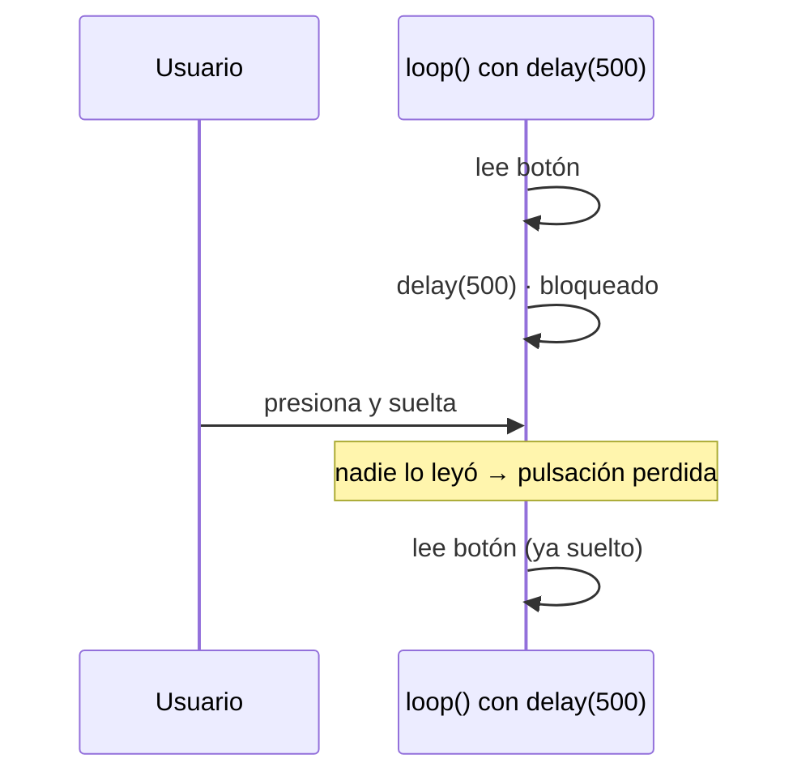
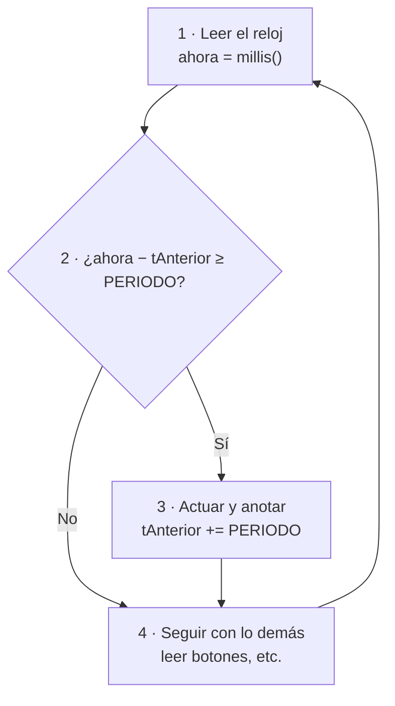
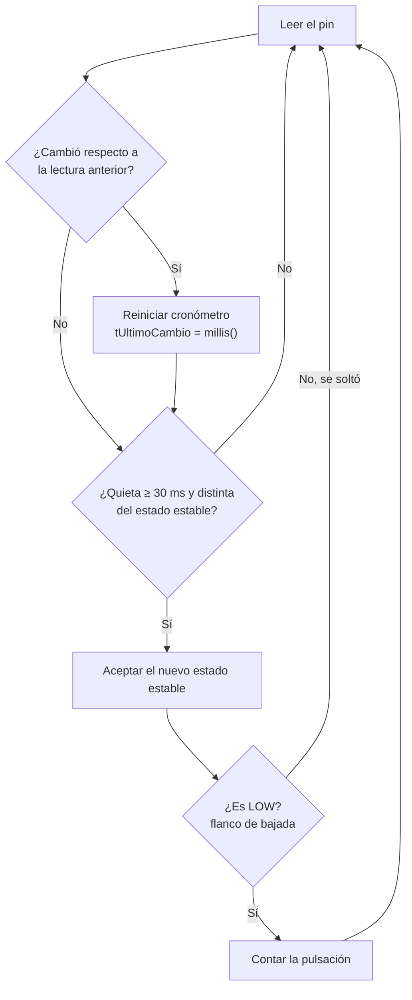

# S2 · Sesión 2 — Programar para el hardware: tipos de datos, tiempo sin bloquear y pulsadores

> Semana 2 · Resultado de aprendizaje R1. Todo esto se usa en la AP2 (juego de luces).
> Fuente: `S2_Sesion2_Tipos_Tiempo_Pulsadores.pdf`.

## Idea central en una línea

En embebidos el **tamaño real** de cada tipo importa, el tiempo se mide **sin bloquear** (`millis()` + resta) y un pulsador se lee con **pull-up + antirrebote + flanco**.

## Parte 1 · Tipos de datos

Una variable es una **caja en la SRAM**. El tipo define:

- el **tamaño** de la caja;
- **cómo se leen** sus bits.

El mismo byte `1100 1100` vale **204** como `uint8_t` y **−52** como `int8_t` (el bit alto es el signo).

### `int` no mide lo mismo en todas partes (bytes)

| Tipo | AVR (Uno) | ESP32 | Ojo |
| --- | --- | --- | --- |
| `char` | 1 · con signo | 1 · sin signo | Usar `int8_t` / `uint8_t` |
| `short` | 2 | 2 | — |
| `int` | **2** | **4** | ¡Cambia! |
| `long` | 4 | 4 | — |
| `float` | 4 | 4 (FPU) | Rápido en el ESP32 |
| `double` | 4 (= float) | 8 (software) | Lento en el ESP32 |
| puntero | 2 | 4 | ¡Cambia de tamaño! |

### `stdint.h`: el tamaño va en el nombre

| Tipo | Rango |
| --- | --- |
| `int8_t` / `uint8_t` | −128 … 127 / 0 … 255 |
| `int16_t` / `uint16_t` | −32 768 … 32 767 / 0 … 65 535 |
| `int32_t` / `uint32_t` | ≈ ±2,1 × 10⁹ / 0 … ≈ 4,29 × 10⁹ |

Lectura del nombre: **u** = sin signo · **número** = bits · **_t** = tipo.
Usarlos para registros y máscaras, protocolos y tramas, arreglos grandes y **tiempos (`uint32_t`)**.

### Desbordamiento: el odómetro que da la vuelta

```cpp
uint8_t c = 253;   // c++ cinco veces → 253 254 255 0 1
```

| | Sin signo | Con signo |
| --- | --- | --- |
| Al pasarse del máximo | **Da la vuelta** a 0 | — |
| ¿Está definido? | Sí, comportamiento definido | **No**: comportamiento indefinido, no confiar |

`int t = millis();` falla: en el **Uno** (int de 16 bits) a los **~32 s**; en el **ESP32** (int de 32 bits) a los **~24,8 días**. → **Usar `uint32_t`**.

### Promoción a `int`

Antes de operar, los tipos pequeños (`uint8_t`, `char`) se **convierten a `int`**.

```cpp
uint8_t a = 0xCC;                      // 1100 1100
Serial.println(~a, BIN);               // ESP32: 11111111111111111111111100110011
Serial.println((uint8_t)~a, BIN);      // 110011  (= 0011 0011, sin ceros a la izquierda)
```

`~a` se calcula como `int` (32 bits en el ESP32, 16 en el Uno), así que los bits altos salen en 1. El **cast `(uint8_t)`** lo devuelve a 8 bits.

### Máscaras: el 1 también tiene tipo

| ✘ Riesgoso | ✔ Correcto |
| --- | --- |
| `uint32_t m = 1 << 31;` → el `1` es `int` con signo y desborda | `uint32_t m = 1UL << 31;` → literal de 32 bits sin signo |
| `~a` sin cast → da 32 bits | `(uint8_t)~a` → vuelve a 8 bits |

Literales: `0x` hex · `0b` binario · `U` sin signo · `UL` unsigned long.

### Constantes con tipo

| Forma | Qué es | ¿Tipo? | Uso |
| --- | --- | --- | --- |
| `#define LED 16` | Reemplazo de texto | No | Solo por compatibilidad |
| `const uint8_t LED = 16;` | Constante verificada | Sí | — |
| `constexpr uint8_t LED = 16;` | Calculada al compilar | Sí | **La usaremos** |
| `enum Modo { LENTO, RAPIDO };` | Estados con nombre | Sí | Modos del juego |

En el ESP32 una `const` global se queda en la flash; en el AVR se copia a la SRAM (salvo `PROGMEM` o `F()`).

### `volatile` y `static`

| `volatile` | `static` |
| --- | --- |
| "Este valor puede cambiar sin que lo veas". | Dentro de una función: **conserva su valor** entre llamadas. |
| Para variables que modifica una **interrupción** o el hardware. | En un archivo: **privada** de ese archivo. |
| **No** significa atómico. | — |

Las variables locales viven en la **pila de `loopTask` (8 KB)**: un arreglo local grande la desborda y el ESP32 se reinicia.

### Actividad "encuentra el bug" (resuelta)

| Código | Bug | Corrección |
| --- | --- | --- |
| `for (uint8_t i = 0; i < 256; i++)` | `uint8_t` nunca llega a 256 (255 → 0): **bucle infinito** | `uint16_t i` |
| `int t0 = millis();` | `millis()` devuelve `uint32_t`: el `int` desborda | `uint32_t t0` |
| `uint32_t m = 1 << 31;` | El `1` es `int` con signo: desborda | `1UL << 31` |
| `void loop() { int veces = 0; veces++; }` | Local: vuelve a 0 en cada vuelta | `static int veces = 0;` |

## Parte 2 · El tiempo sin bloquear

### `delay()`: el cocinero que mira el horno



`delay()` **bloquea**: mientras espera, el programa no hace nada más. En el juego de luces el botón "no responde".

### `millis()`: mirar el reloj de pared

```cpp
uint32_t ahora = millis();
if (ahora - tAnterior >= PERIODO) {
  tAnterior += PERIODO;
  // hacer algo
}
// el loop sigue: hay tiempo para leer botones
```



Un temporizador de hardware cuenta siempre; `millis()` solo lo mira (timers: semana 3).

### ¿Y cuando `millis()` da la vuelta?

**Restar** funciona aunque el contador dé la vuelta. Ejemplo con reloj de 8 bits:

```text
tAnterior = 250, el reloj pasa 255 → 0, ahora = 4
ahora − tAnterior = 4 − 250 = 10   (módulo 256)  ✔ es justo el tiempo que pasó
```

✘ **Sumar y comparar** — `millis() > tAnterior + PERIODO` — falla: la suma da la vuelta y la condición se cumple antes de tiempo.

> Regla de oro: **`ahora − tAnterior >= PERIODO`**, siempre con `uint32_t`.

### Ejemplo: dos LEDs a ritmos distintos

```cpp
constexpr uint8_t LED_A = 16, LED_B = 17;
constexpr uint32_t PERIODO_A = 500, PERIODO_B = 130;   // ms
uint32_t tA = 0, tB = 0;
bool estadoA = false, estadoB = false;

void setup() { pinMode(LED_A, OUTPUT); pinMode(LED_B, OUTPUT); }

void loop() {
  uint32_t ahora = millis();
  if (ahora - tA >= PERIODO_A) {
    tA += PERIODO_A; estadoA = !estadoA; digitalWrite(LED_A, estadoA);
  }
  if (ahora - tB >= PERIODO_B) {
    tB += PERIODO_B; estadoB = !estadoB; digitalWrite(LED_B, estadoB);
  }
}
```

**El estado vive en variables, no en el pin.**

## Parte 3 · Leer un pulsador bien

### Pull-up

| Pulsador | Lectura |
| --- | --- |
| Suelto | HIGH (1) — la pull-up interna (decenas de kΩ) lleva el pin a 3,3 V |
| Presionado | LOW (0) — el botón une el pin con GND |

GPIO 34–39: **sin pull-up interna**.

### Rebote

Un botón mecánico produce **varios cambios falsos** en pocos ms al presionarse.
**Antirrebote:** aceptar el cambio solo si la señal se queda **quieta entre 20 y 50 ms**.
✘ Solución tentadora pero mala: `delay(200)` después de leer → vuelve a bloquear.

### Nivel vs. flanco

- Un toque humano dura ~200 ms → el **nivel LOW** dura miles de vueltas de `loop()`.
- ✘ `if (digitalRead(BTN) == LOW) contador++;` cuenta por **nivel**: suma miles.
- ✔ Actuar **solo en el flanco**: cuando el estado pasa de HIGH a LOW (una vez).

### Código: antirrebote + flanco

```cpp
constexpr uint8_t PIN_BTN = 21;
constexpr uint32_t T_REBOTE = 30;   // ms
bool lecturaAnterior = HIGH, estadoEstable = HIGH;
uint32_t tUltimoCambio = 0; uint16_t pulsaciones = 0;

void setup() { Serial.begin(115200); pinMode(PIN_BTN, INPUT_PULLUP); }

void loop() {
  bool lectura = digitalRead(PIN_BTN);
  if (lectura != lecturaAnterior) {          // se movió: reiniciar
    tUltimoCambio = millis(); lecturaAnterior = lectura;
  }
  if (millis() - tUltimoCambio >= T_REBOTE && lectura != estadoEstable) {
    estadoEstable = lectura;                 // cambio real
    if (estadoEstable == LOW) {              // flanco de bajada
      pulsaciones++; Serial.println(pulsaciones);
    }
  }
}
```



### Todo junto: estructura de un juego de luces

```cpp
void loop() {
  // 1) Entradas
  if (botonPresionado()) velocidad = (velocidad + 1) % N_VEL;
  // 2) Lógica temporizada
  uint32_t ahora = millis();
  if (ahora - tPaso >= PERIODOS[velocidad]) {
    tPaso = ahora;
    posicion = (posicion + 1) % N_LEDS;
  }
  // 3) Salidas
  for (uint8_t i = 0; i < N_LEDS; i++)
    digitalWrite(LEDS[i], i == posicion);
}
```


## Resumen

| Tema | Lo esencial |
| --- | --- |
| Tipos | `int` cambia de tamaño: usar `uint8_t`, `uint32_t`… |
| Literales y máscaras | `1UL << n` · cast tras `~` · desbordamiento sin signo da la vuelta |
| Tiempo | `millis()` + resta: `ahora − tAnterior >= PERIODO` |
| Pulsador | `INPUT_PULLUP` · antirrebote 30 ms · actuar en el flanco |
