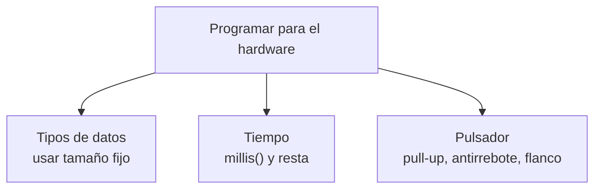
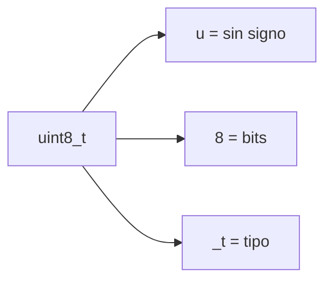
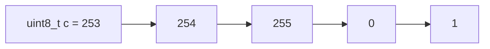
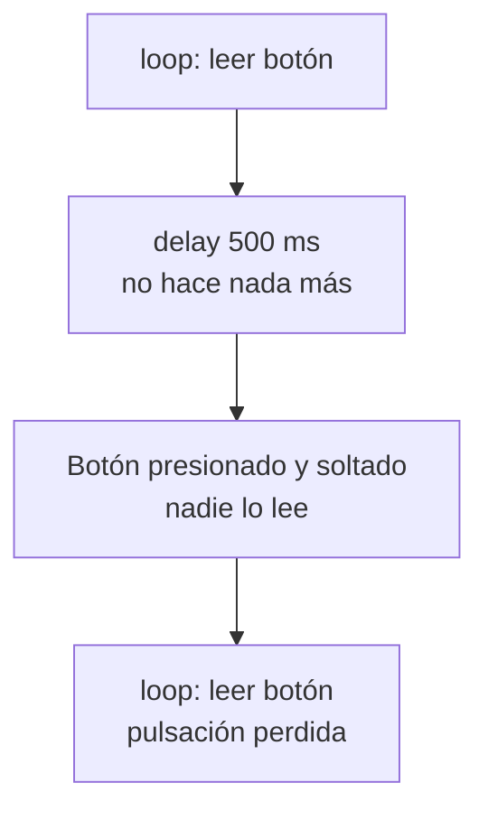
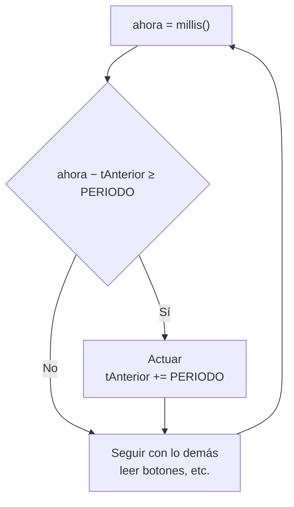
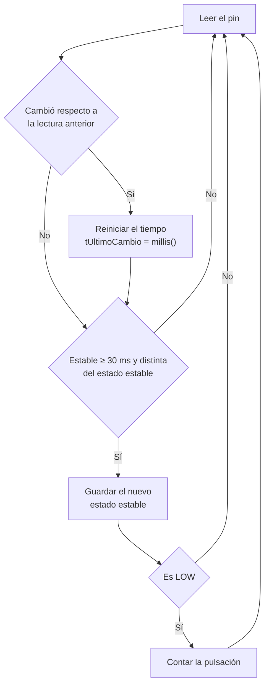

# S2 · Sesión 2 — Tipos de datos, tiempo sin bloquear y pulsadores

> Semana 2 · Resultado de aprendizaje R1. Se usa en la AP2 (juego de luces).

## Idea central



## Parte 1 · Tipos de datos

Una **variable** es un espacio de la SRAM. Su **tipo** define cuántos bytes ocupa y cómo se leen sus bits.

El mismo byte `1100 1100` vale **204** como `uint8_t` y **−52** como `int8_t`.

### El tamaño de `int` cambia según el chip

| Tipo | AVR (Uno) | ESP32 |
| --- | --- | --- |
| `int` | 2 bytes | 4 bytes |
| `long` | 4 bytes | 4 bytes |
| `float` | 4 bytes | 4 bytes |
| `double` | 4 bytes | 8 bytes |
| puntero | 2 bytes | 4 bytes |

Por eso se usan los tipos de `stdint.h`, que llevan el tamaño en el nombre.



| Tipo | Rango |
| --- | --- |
| `int8_t` / `uint8_t` | −128 … 127 / 0 … 255 |
| `int16_t` / `uint16_t` | −32 768 … 32 767 / 0 … 65 535 |
| `int32_t` / `uint32_t` | ≈ ±2,1 × 10⁹ / 0 … ≈ 4,29 × 10⁹ |

Se usan para registros, máscaras y **tiempos (`uint32_t`)**.

### Desbordamiento

**Desbordamiento:** el valor se pasa del máximo del tipo.



- **Sin signo** (`uint`): vuelve a 0. Es un comportamiento definido.
- **Con signo** (`int`): comportamiento indefinido. No confiar en él.

`millis()` devuelve `uint32_t`. Si se guarda en un `int` se desborda: en el Uno a los ~32 s y en el ESP32 a los ~24,8 días. Por eso: **`uint32_t t = millis();`**

### Máscaras y literales

El número `1` es un `int` con signo. Para desplazarlo hasta el bit 31 se usa el literal `1UL`.

| Incorrecto | Correcto |
| --- | --- |
| `uint32_t m = 1 << 31;` | `uint32_t m = 1UL << 31;` |
| `~a` (se calcula como `int`, sale de 32 bits) | `(uint8_t)~a` (vuelve a 8 bits) |

Literales: `0x` hexadecimal · `0b` binario · `U` sin signo · `UL` unsigned long.

### Constantes

| Forma | Qué es |
| --- | --- |
| `constexpr uint8_t LED = 16;` | Constante con tipo, calculada al compilar. **La usaremos.** |
| `enum Modo { LENTO, RAPIDO };` | Nombres para estados o modos. |

### `volatile` y `static`

| `volatile` | `static` |
| --- | --- |
| La variable puede cambiar sin que el código lo note (la cambia una interrupción o el hardware). | Dentro de una función: **conserva su valor** entre llamadas. |
| Fuerza a leerla de la memoria cada vez. | Sin `static`, una variable local vuelve a su valor inicial en cada llamada. |

```cpp
void loop() {
  static int veces = 0;   // se inicializa una sola vez
  veces++;
}
```

### Errores comunes con tipos

| Código | Problema | Corrección |
| --- | --- | --- |
| `for (uint8_t i = 0; i < 256; i++)` | `i` nunca llega a 256: bucle infinito | `uint16_t i` |
| `int t0 = millis();` | Se desborda | `uint32_t t0` |
| `uint32_t m = 1 << 31;` | El `1` es `int` | `1UL << 31` |

## Parte 2 · El tiempo sin bloquear

### `delay()` bloquea

`delay()` **bloquea**: mientras espera, el programa no hace nada más. Si se presiona un botón en ese tiempo, la pulsación se pierde.



### `millis()`: tiempo sin bloquear

`millis()` devuelve los milisegundos desde el arranque. El programa lo consulta y calcula cuánto tiempo pasó con una **resta**. Mientras tanto, `loop()` sigue ejecutando otras tareas.



```cpp
uint32_t ahora = millis();
if (ahora - tAnterior >= PERIODO) {
  tAnterior += PERIODO;
  // hacer algo
}
```

### Por qué se resta

Cuando `millis()` llega al máximo vuelve a 0. La **resta** sigue dando el tiempo correcto (con 8 bits: `4 − 250 = 10` módulo 256). Sumar y comparar (`millis() > tAnterior + PERIODO`) falla al dar la vuelta.

> Regla: **`ahora − tAnterior >= PERIODO`**, siempre con `uint32_t`.

### Ejemplo: dos LEDs a ritmos distintos

```cpp
constexpr uint8_t LED_A = 16, LED_B = 17;
constexpr uint32_t PERIODO_A = 500, PERIODO_B = 130;   // ms
uint32_t tA = 0, tB = 0;
bool estadoA = false, estadoB = false;

void setup() { pinMode(LED_A, OUTPUT); pinMode(LED_B, OUTPUT); }

void loop() {
  uint32_t ahora = millis();
  if (ahora - tA >= PERIODO_A) {
    tA += PERIODO_A; estadoA = !estadoA; digitalWrite(LED_A, estadoA);
  }
  if (ahora - tB >= PERIODO_B) {
    tB += PERIODO_B; estadoB = !estadoB; digitalWrite(LED_B, estadoB);
  }
}
```

Cada LED tiene su propio `tAnterior` y su propio estado, guardados en variables.

## Parte 3 · Leer un pulsador

### Pull-up

Con `INPUT_PULLUP` el pin se conecta por dentro a 3,3 V mediante una resistencia (pull-up).

| Pulsador | Lectura |
| --- | --- |
| Suelto | HIGH (1) |
| Presionado | LOW (0), el botón une el pin con GND |

Los GPIO 34–39 no tienen pull-up interna.

### Rebote

**Rebote:** al presionar, un botón mecánico produce varios cambios falsos durante unos pocos ms.

**Antirrebote:** aceptar el cambio solo si la señal se mantiene estable entre 20 y 50 ms. Usar `delay(200)` para esto no sirve, porque bloquea.

### Nivel y flanco

- **Nivel:** el estado actual de la señal (HIGH o LOW).
- **Flanco:** el instante en que la señal cambia. El de bajada es de HIGH a LOW.

Un toque dura ~200 ms, y en ese tiempo `loop()` da miles de vueltas. Si se cuenta por **nivel**, una pulsación suma miles de veces. Se debe actuar **solo en el flanco de bajada**.


### Antirrebote + flanco



```cpp
constexpr uint8_t PIN_BTN = 21;
constexpr uint32_t T_REBOTE = 30;   // ms
bool lecturaAnterior = HIGH, estadoEstable = HIGH;
uint32_t tUltimoCambio = 0; uint16_t pulsaciones = 0;

void setup() { Serial.begin(115200); pinMode(PIN_BTN, INPUT_PULLUP); }

void loop() {
  bool lectura = digitalRead(PIN_BTN);
  if (lectura != lecturaAnterior) {          // cambió: reiniciar el tiempo
    tUltimoCambio = millis(); lecturaAnterior = lectura;
  }
  if (millis() - tUltimoCambio >= T_REBOTE && lectura != estadoEstable) {
    estadoEstable = lectura;                 // cambio real
    if (estadoEstable == LOW) {              // flanco de bajada
      pulsaciones++; Serial.println(pulsaciones);
    }
  }
}
```

### Estructura de un juego de luces


```cpp
void loop() {
  // 1) Entradas
  if (botonPresionado()) velocidad = (velocidad + 1) % N_VEL;
  // 2) Lógica temporizada
  uint32_t ahora = millis();
  if (ahora - tPaso >= PERIODOS[velocidad]) {
    tPaso = ahora;
    posicion = (posicion + 1) % N_LEDS;
  }
  // 3) Salidas
  for (uint8_t i = 0; i < N_LEDS; i++)
    digitalWrite(LEDS[i], i == posicion);
}
```

## Resumen

| Tema | Lo esencial |
| --- | --- |
| Tipos | `int` cambia de tamaño: usar `uint8_t`, `uint32_t`… |
| Literales y máscaras | `1UL << n` · cast tras `~` |
| Tiempo | `millis()` y resta: `ahora − tAnterior >= PERIODO` |
| Pulsador | `INPUT_PULLUP` · antirrebote 30 ms · actuar en el flanco |
