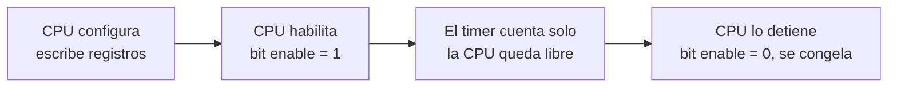
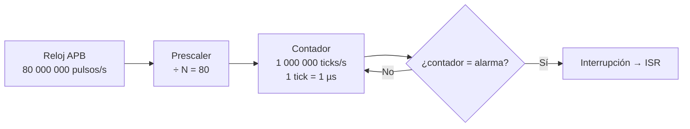
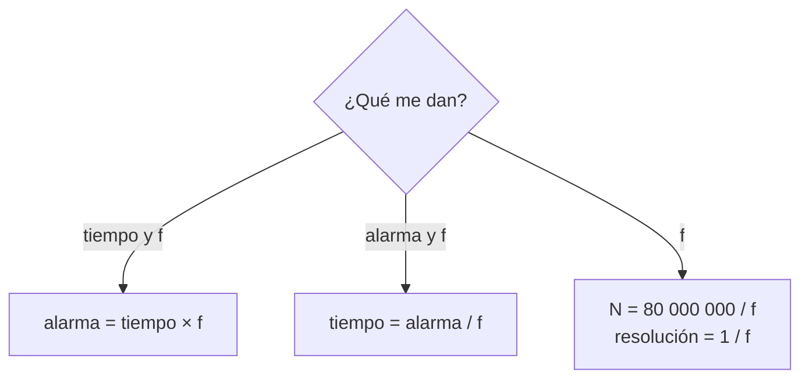
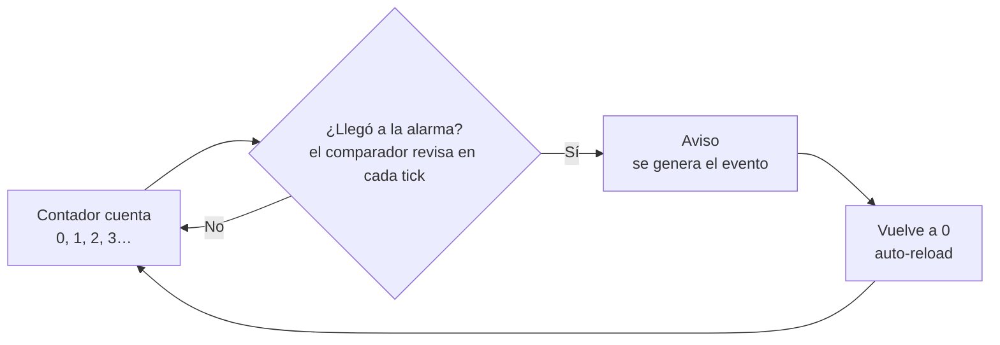
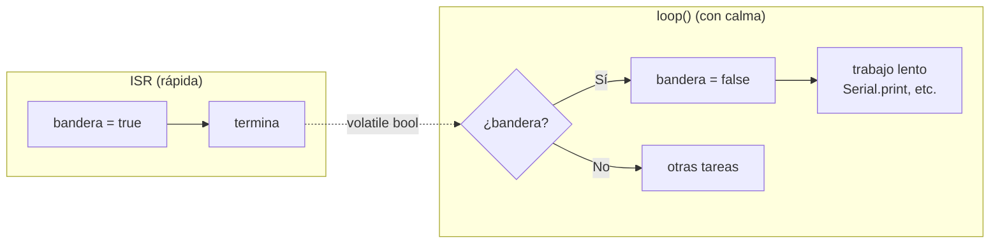

# S3 — Temporizadores de hardware en el ESP32

> Semana 3 · Resultado de aprendizaje R1. Se usa en la AP3.
> Fuente: `S3_Temporizadores_ESP32.pdf`.

## Idea central en una línea

Un **temporizador** es un circuito que cuenta pulsos de reloj por su cuenta; cuando el contador llega a la **alarma**, dispara una **interrupción** y la CPU ejecuta una **ISR** corta que solo levanta una **bandera**.

## 0. Repaso de la semana 2 (entra en la prueba)

- **El número de GPIO es un nombre, no una posición:** GPIO18 es una señal del chip, no "el pin 18 de la placa". La numeración tiene huecos (no existen GPIO20, 24, 28–31). Buscar siempre el rótulo impreso.
- **GPIO 34, 35, 36 (VP), 39 (VN) solo son entrada:** no tienen driver de salida ni pull-up interna. Un LED en GPIO34 **nunca enciende**, aunque compile.
- **Local vs. `static`:** local = vaso desechable (vuelve a su valor inicial en cada vuelta); `static` = taza en el escritorio (conserva su valor).
- **Promoción a `int`:**

```cpp
uint8_t x = 200, y = 100;
uint8_t r = x + y;          // r = 44, no 300 (300 − 256)
if (-1 < 1u) { ... }        // FALSO: -1 se convierte a 4 294 967 295
```

## 1. ¿Qué es un temporizador?

**Temporizador (timer):** circuito dentro del MCU que **cuenta pulsos de reloj**. Como cada pulso dura un tiempo conocido, sirve para medir tiempo y avisar cuando ha pasado un tiempo determinado.

- Es **hardware**, no un programa.
- Es un **periférico**: bloque del chip con función específica, aparte de la CPU.

### ¿Por qué no basta con `delay()` o `millis()`?

| `delay(1000)` | `millis()` | Temporizador |
| --- | --- | --- |
| La CPU se queda esperando sin hacer nada más. | La CPU pregunta "¿ya pasó?" en cada vuelta de `loop()`. Si `loop()` está ocupado 40 ms, hasta 40 ms de retraso. | Un circuito aparte cuenta y **avisa a la hora exacta**. |

### El contador

- Es un **registro** del temporizador con un **sumador pegado**: le suma 1 en cada tick, sin que nadie se lo pida.
- A diferencia de una celda de RAM (que solo guarda lo que le escriben), **el contador cambia solo**.
- Cuenta en binario, empezando normalmente en 0. Suma en cada pulso que sale del **prescaler**, no en cada pulso del reloj.

### Quién lo controla: la CPU



La CPU **no ejecuta ninguna instrucción por cada conteo**: solo configura, arranca y detiene.

## 2. Reloj, prescaler y fórmulas

### Reloj APB: 80 MHz

- **APB** = bus de periféricos del ESP32; su reloj de **80 MHz** llega a los temporizadores.
- 80 000 000 pulsos/s → cada pulso dura **12,5 ns**.
- Sin dividir, para medir 1 s el contador tendría que llegar a 80 000 000.

### Prescaler

**Prescaler:** divisor que deja pasar al contador **1 de cada N pulsos**. **Tick** = cada pulso que sale del prescaler (cuando el contador suma 1).



| N | Ticks | Efecto |
| --- | --- | --- |
| Pequeño | Cortos | Más precisión, el contador se llena antes |
| Grande | Largos | Cubre más tiempo, menos precisión |

Usos: elegir una **unidad cómoda** (N = 80 → ticks de 1 µs, uso principal en el ESP32) y **medir tiempos largos** (clave en el AVR, contadores pequeños). **Regla de la clase: ticks de 1 µs (1 MHz).**

### Las fórmulas (¡de memoria!)

| Magnitud | Fórmula |
| --- | --- |
| Frecuencia de tick | `f = 80 000 000 / N` |
| Prescaler | `N = 80 000 000 / f` |
| **Resolución** (lo que dura un tick) | `resolución = 1 / f` |
| **Tiempo** hasta el aviso | `tiempo = alarma × resolución = alarma / f` |
| **Alarma** para un tiempo | `alarma = tiempo × f` |
| Avisos por segundo | `f / alarma` |

| f (ticks/s) | Resolución |
| --- | --- |
| 1 000 000 (1 MHz) | 1 µs |
| 10 000 (10 kHz) | 100 µs |

Analogía de la **escalera**: altura de un peldaño = resolución; número de peldaños = alarma. Con f = 1 MHz, **la alarma se escribe directamente en microsegundos**.



### Ejemplos resueltos

**1. Un aviso cada medio segundo** — f = 1 000 000, tiempo = 0,5 s

- Resolución = 1 / 1 000 000 s = **1 µs**
- Alarma = 0,5 × 1 000 000 = **500 000**
- Comprobación: 500 000 × 1 µs = 0,5 s
- Prescaler: N = 80 000 000 / 1 000 000 = **80**

**2. Otra frecuencia de tick** — f = 10 000, alarma = 2 500

- Resolución = 1 / 10 000 s = **100 µs**
- Tiempo = 2 500 × 100 µs = **0,25 s** (4 avisos por segundo)
- Prescaler: N = 80 000 000 / 10 000 = **8 000** (válido)

### Actividad en parejas (resuelta)

<details>
<summary>A · f = 1 000 000 y alarma = 2 000. ¿Cada cuánto ocurre el aviso?</summary>

tiempo = 2 000 / 1 000 000 = **0,002 s = 2 ms** (500 avisos por segundo).
</details>

<details>
<summary>B · Quiero un aviso cada 10 ms con f = 1 000 000. ¿Qué alarma uso?</summary>

alarma = 0,010 × 1 000 000 = **10 000**.
</details>

<details>
<summary>C · f = 40 000 y alarma = 40 000. ¿Cada cuánto? ¿Qué prescaler?</summary>

tiempo = 40 000 / 40 000 = **1 s**. N = 80 000 000 / 40 000 = **2 000**.
</details>

## 3. Autorrecarga y desbordamiento



**Autorrecarga (auto-reload):** al alcanzar la alarma, el contador vuelve solo a 0 → el aviso se repite a intervalos iguales sin que el programa haga nada.

| | Alarma con autorrecarga | Desbordamiento |
| --- | --- | --- |
| Valor que lo provoca | Uno que **tú eliges** (ej. 500 000) | El **máximo** que cabe en los bits |
| Qué pasa | Aviso y el contador vuelve a 0 | El contador "da la vuelta" a 0 |
| ¿Intencional? | Sí: uso normal | Casi nunca: límite físico |

Pista de atletismo: la alarma es la línea que tú pintas en el metro 400; el desbordamiento es el final de la pista.

### Límite del contador: 2ⁿ − 1

| Contador | Máximo | Con ticks de 1 µs se llena en… |
| --- | --- | --- |
| 8 bits (Timer0 del AVR) | 255 | 0,26 ms |
| 16 bits (Timer1 del AVR) | 65 535 | 65,5 ms |
| **64 bits (ESP32)** | 18 446 744 073 709 551 615 | ≈ 584 000 años |

En el ESP32 el desbordamiento prácticamente no ocurre: se trabaja siempre con la **alarma**.

## 4. Los temporizadores del ESP32

4 temporizadores de propósito general en **2 grupos** (TIMG0 y TIMG1, con Timer 0 y Timer 1 cada uno). Cada uno: contador de **64 bits**, prescaler de **16 bits**, cuenta arriba o abajo, autorrecarga. Funcionan **en paralelo**: hasta 4 avisos periódicos independientes.

| | ESP32 (WROOM-32) | ATmega328P (Uno) |
| --- | --- | --- |
| Temporizadores de uso general | **4** | 3 (Timer0, Timer1, Timer2) |
| Tamaño del contador | 64 bits | 8 o 16 bits |
| Reloj de entrada | 80 MHz | 16 MHz |
| Prescaler | Cualquier N de 2 a 65 535 | Solo 1, 8, 64, 256 o 1024 |
| Se llena (sin prescaler) | Prácticamente nunca | Timer1: en 4,1 ms |

## 5. API y core

- **API** = el menú del restaurante: funciones ya programadas que se usan sin saber cómo están hechas (`pinMode()`, `digitalWrite()`, `delay()`, `millis()`…). La API calcula el prescaler y la alarma y **escribe los registros por nosotros**.
- **Core** = paquete que enseña al Arduino IDE a programar una placa concreta (compilador + API). Para el ESP32: **"esp32 by Espressif Systems"**.
- **Versión 3.x** cambió los nombres y parámetros de las funciones de temporizadores: un código de la versión 2 **no compila** en la 3. La mayoría de tutoriales de internet usan la versión 2.

> Complemento (no está en la diapositiva): forma típica con el core 3.x.
>
> ```cpp
> hw_timer_t *timer = nullptr;
> volatile bool tick = false;
>
> void IRAM_ATTR onTimer() { tick = true; }      // ISR: solo la bandera
>
> void setup() {
>   timer = timerBegin(1000000);                  // f = 1 MHz → 1 tick = 1 µs
>   timerAttachInterrupt(timer, &onTimer);        // registra el callback
>   timerAlarm(timer, 500000, true, 0);           // alarma 500 000 µs, autorrecarga
> }
> ```
>
> En la 2.x era `timerBegin(0, 80, true)`, `timerAlarmWrite(...)` y `timerAlarmEnable(...)`: por eso los tutoriales viejos no compilan.

## 6. ¿Cómo se entera la CPU? Interrupción, callback, IRAM_ATTR, volatile y bandera

### Interrupción e ISR

**Interrupción:** señal que un periférico envía a la CPU: "detente, pasó algo". La CPU ejecuta una función especial y **vuelve exactamente adonde estaba**.
**ISR** (*Interrupt Service Routine*): la función que se ejecuta cuando llega la interrupción.


| | Del temporizador (semana 3) | Externa (semana 4) |
| --- | --- | --- |
| Quién la dispara | Periférico interno: el timer llega a la alarma | Un pin que cambia por algo de afuera |
| Cuándo | Cada cierto tiempo, **predecible** | Cuando pasa algo, **sin aviso** |
| Ejemplo | Encender un LED cada 2 s | Detectar que presionaron un botón |

Lo de hoy (ISR, callback, IRAM_ATTR, volatile, bandera) **sirve para las dos**.

### Las cuatro piezas

| Pieza | Qué es | Analogía |
| --- | --- | --- |
| **Callback** | Función que tú escribes pero **no llamas**: se la entregas a otro (el timer) para que la llame cuando ocurra algo. | "Llámeme cuando el auto esté listo": tu número es el callback. |
| **`IRAM_ATTR`** | Etiqueta delante del nombre de la ISR: pide copiarla a la **IRAM** (RAM interna rápida para instrucciones), no dejarla en la flash (lenta y a veces ocupada). | El extintor colgado en la pared, no en el sótano con llave. |
| **`volatile`** | Obliga a leer la variable **de la memoria cada vez**. Sin ella, el compilador (que no ve la ISR) guarda una copia y `loop()` nunca ve el cambio. | — |
| **Patrón bandera** | La ISR solo pone `bandera = true` y termina; `loop()` revisa, la baja y hace el trabajo lento. | Buzón rural: el cartero levanta la banderita; el dueño la baja y lee con calma. |

**Regla:** toda variable que comparten la ISR y `loop()` se declara **`volatile`**.


