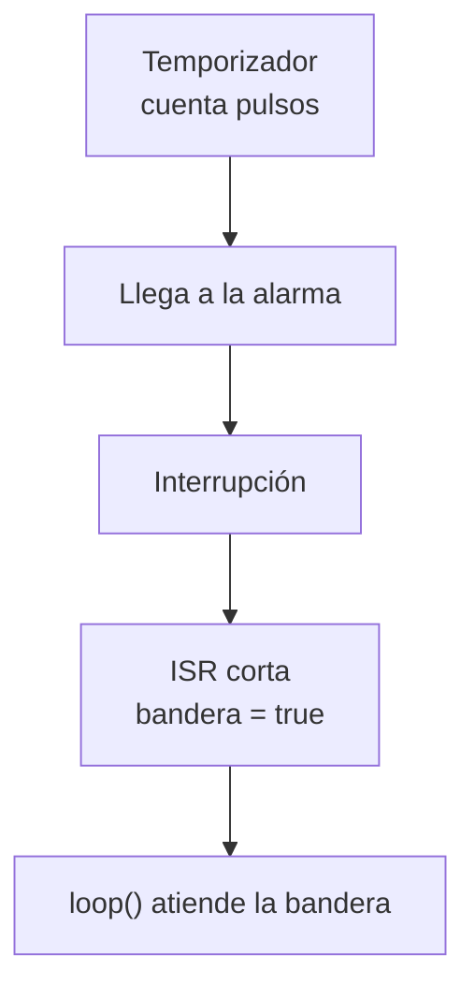
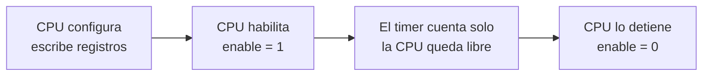
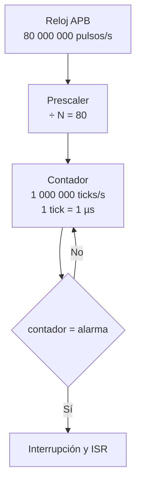
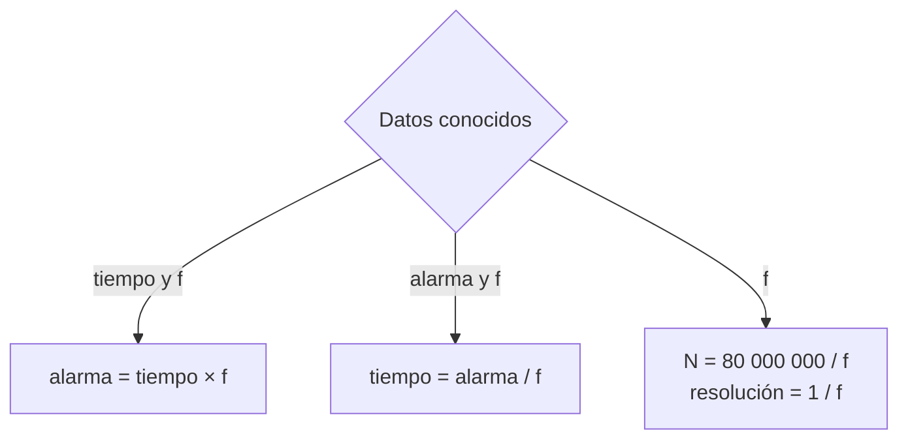
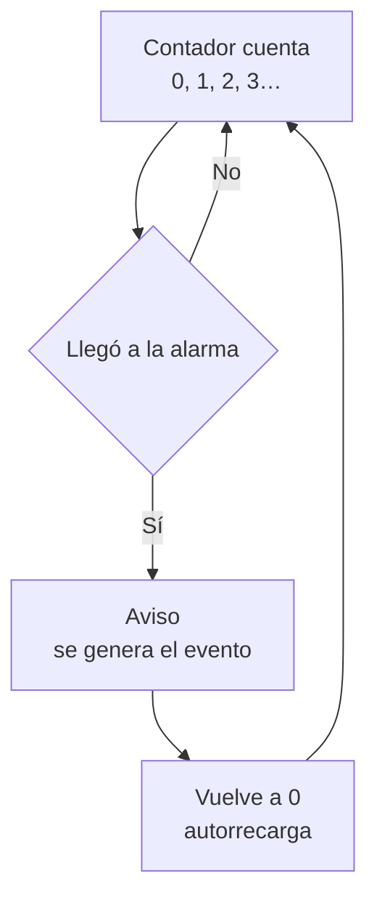
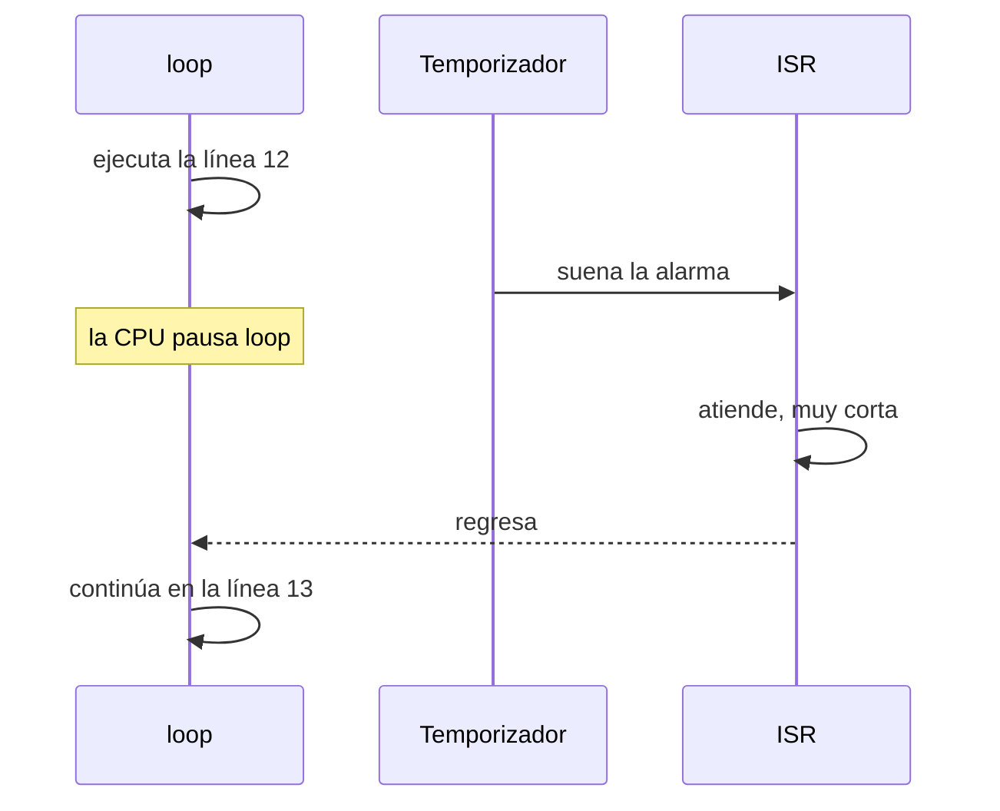
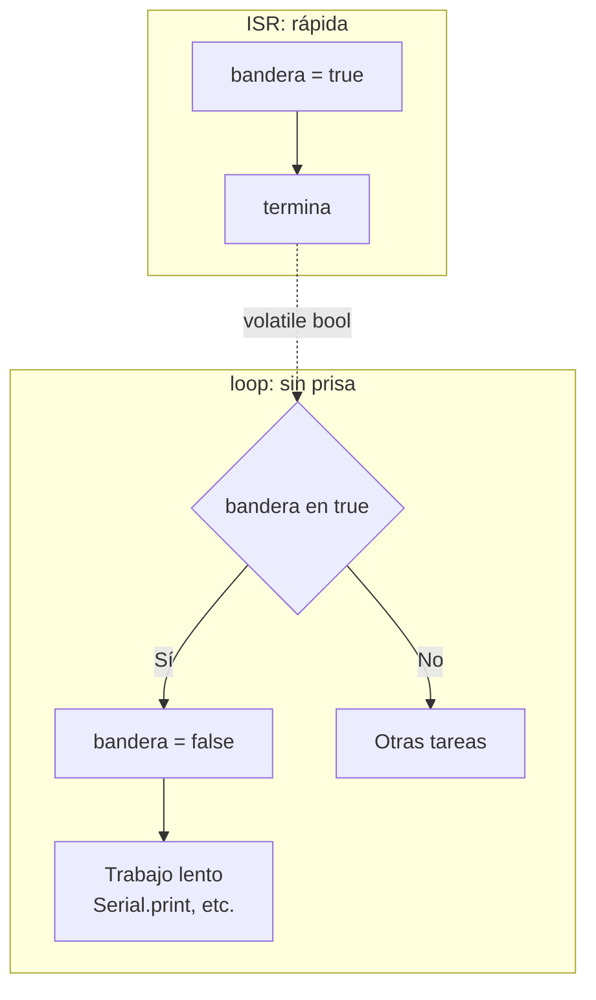

# S3 — Temporizadores de hardware en el ESP32

> Semana 3 · Resultado de aprendizaje R1. Se usa en la AP3.

## Idea central

Un **temporizador** cuenta pulsos de reloj por su cuenta. Cuando el contador llega a la **alarma**, avisa con una **interrupción** y la CPU ejecuta una **ISR** corta que solo levanta una **bandera**.



## 0. Repaso de la semana 2

- **GPIO es un nombre, no una posición.** GPIO18 es una señal del chip, no "el pin 18" de la placa. Hay que usar el rótulo impreso en la placa.
- **GPIO 34, 35, 36 y 39 son solo entrada.** No tienen salida ni pull-up interna. Un LED en GPIO34 nunca enciende.
- **Variable local y `static`:** la local vuelve a su valor inicial en cada llamada; la `static` conserva su valor.
- **Los tipos pequeños se convierten a `int` antes de operar:**

```cpp
uint8_t x = 200, y = 100;
uint8_t r = x + y;          // r = 44, no 300 (300 − 256)
```

## 1. Qué es un temporizador

**Temporizador (timer):** circuito del microcontrolador que **cuenta pulsos de reloj**. Como cada pulso dura un tiempo conocido, sirve para medir tiempo y avisar cuando ya pasó.

Es **hardware**: un **periférico** (bloque del chip aparte de la CPU).

### Comparación de métodos

| Método | Cómo funciona |
| --- | --- |
| `delay(1000)` | La CPU espera sin hacer nada más. |
| `millis()` | La CPU revisa el tiempo en cada vuelta de `loop()`. Si `loop()` tarda 40 ms, el aviso llega hasta 40 ms tarde. |
| Temporizador | Un circuito aparte cuenta y **avisa a la hora exacta**. |

### El contador

**Contador:** registro del temporizador que suma 1 en cada tick, sin que la CPU lo pida. Cuenta en binario, desde 0.



La CPU solo configura, arranca y detiene. No ejecuta instrucciones por cada conteo.

## 2. Reloj, prescaler y fórmulas

### Reloj APB

El **reloj APB** (bus de periféricos) del ESP32 da **80 MHz** a los temporizadores: 80 000 000 pulsos por segundo, cada uno de 12,5 ns.

### Prescaler

**Prescaler:** divisor que deja pasar al contador **1 de cada N pulsos**. Cada pulso que pasa se llama **tick**.



| N | Efecto |
| --- | --- |
| Pequeño | Ticks cortos: más precisión, pero el contador se llena antes. |
| Grande | Ticks largos: cubre más tiempo, pero con menos precisión. |

**Regla de la clase:** N = 80 → ticks de 1 µs (1 MHz). Así la alarma se escribe directamente en microsegundos.

### Fórmulas

| Magnitud | Fórmula |
| --- | --- |
| Frecuencia de tick | `f = 80 000 000 / N` |
| Prescaler | `N = 80 000 000 / f` |
| Resolución (duración de un tick) | `resolución = 1 / f` |
| Tiempo hasta el aviso | `tiempo = alarma / f` |
| Alarma para un tiempo | `alarma = tiempo × f` |



### Ejemplos

**1. Un aviso cada 0,5 s** con f = 1 000 000

- Resolución = 1 / 1 000 000 = **1 µs**
- Alarma = 0,5 × 1 000 000 = **500 000**
- Prescaler: N = 80 000 000 / 1 000 000 = **80**

**2. f = 10 000 y alarma = 2 500**

- Resolución = 1 / 10 000 = **100 µs**
- Tiempo = 2 500 × 100 µs = **0,25 s**
- Prescaler: N = 80 000 000 / 10 000 = **8 000**

**3. Aviso cada 10 ms** con f = 1 000 000

- Alarma = 0,010 × 1 000 000 = **10 000**

## 3. Autorrecarga y desbordamiento

**Autorrecarga (auto-reload):** al llegar a la alarma, el contador vuelve solo a 0. El aviso se repite a intervalos iguales sin que el programa haga nada.



| | Alarma con autorrecarga | Desbordamiento |
| --- | --- | --- |
| Valor que lo provoca | El que se elige (ej. 500 000) | El máximo que cabe en los bits |
| Uso | Normal e intencional | Casi nunca; es un límite físico |

### Límite del contador

El máximo de un contador de n bits es **2ⁿ − 1**.

| Contador | Máximo | Con ticks de 1 µs se llena en |
| --- | --- | --- |
| 8 bits (Timer0 del AVR) | 255 | 0,26 ms |
| 16 bits (Timer1 del AVR) | 65 535 | 65,5 ms |
| 64 bits (ESP32) | ≈ 1,8 × 10¹⁹ | ≈ 584 000 años |

En el ESP32 el desbordamiento prácticamente no ocurre: se trabaja con la **alarma**.

## 4. Los temporizadores del ESP32

El ESP32 tiene **4 temporizadores** de uso general en 2 grupos. Cada uno tiene contador de 64 bits, prescaler de 16 bits, cuenta hacia arriba o abajo y autorrecarga. Funcionan en paralelo e independientes.

| | ESP32 | ATmega328P (Uno) |
| --- | --- | --- |
| Temporizadores | 4 | 3 (Timer0, Timer1, Timer2) |
| Contador | 64 bits | 8 o 16 bits |
| Reloj de entrada | 80 MHz | 16 MHz |
| Prescaler | Cualquier N de 2 a 65 535 | Solo 1, 8, 64, 256 o 1024 |

## 5. API y core

- **API:** funciones ya programadas que se usan sin saber cómo están hechas (`pinMode()`, `digitalWrite()`, `millis()`…). Calculan el prescaler y la alarma y escriben los registros.
- **Core:** paquete que permite al Arduino IDE programar una placa concreta. Para el ESP32: "esp32 by Espressif Systems".
- La versión 3.x del core cambió las funciones de temporizadores: el código de la versión 2 no compila en la 3.

Forma típica con el core 3.x:

```cpp
hw_timer_t *timer = nullptr;
volatile bool tick = false;

void IRAM_ATTR onTimer() { tick = true; }      // ISR: solo la bandera

void setup() {
  timer = timerBegin(1000000);                  // f = 1 MHz → 1 tick = 1 µs
  timerAttachInterrupt(timer, &onTimer);        // registra el callback
  timerAlarm(timer, 500000, true, 0);           // alarma 500 000 µs, autorrecarga
}
```

## 6. Interrupción, callback, IRAM_ATTR, volatile y bandera

**Interrupción:** señal de un periférico a la CPU que indica que pasó algo. La CPU pausa lo que hace, ejecuta una función y **vuelve al mismo punto**.

**ISR** (*Interrupt Service Routine*): la función que se ejecuta cuando llega la interrupción.



| | Del temporizador (semana 3) | Externa (semana 4) |
| --- | --- | --- |
| La dispara | El timer llega a la alarma | Un pin que cambia desde afuera |
| Cuándo | Cada cierto tiempo, predecible | Cuando ocurre el evento |
| Ejemplo | Encender un LED cada 2 s | Detectar un botón presionado |

Las cuatro piezas siguientes sirven para ambas.

| Pieza | Qué es |
| --- | --- |
| **Callback** | Función que escribes pero no llamas: se la entregas al timer para que la llame cuando ocurra el evento. |
| **`IRAM_ATTR`** | Etiqueta antes del nombre de la ISR. Copia la ISR a la **IRAM** (memoria interna rápida), no a la flash. |
| **`volatile`** | Obliga a leer la variable de la memoria cada vez. Sin ella, `loop()` puede no ver el cambio hecho por la ISR. |
| **Patrón bandera** | La ISR solo pone `bandera = true` y termina. `loop()` la revisa, la baja y hace el trabajo lento. |

**Regla:** toda variable que comparten la ISR y `loop()` se declara `volatile`.


