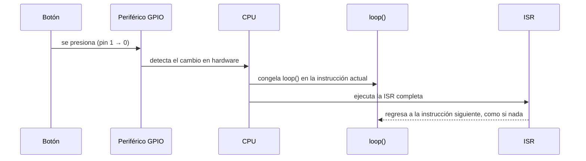
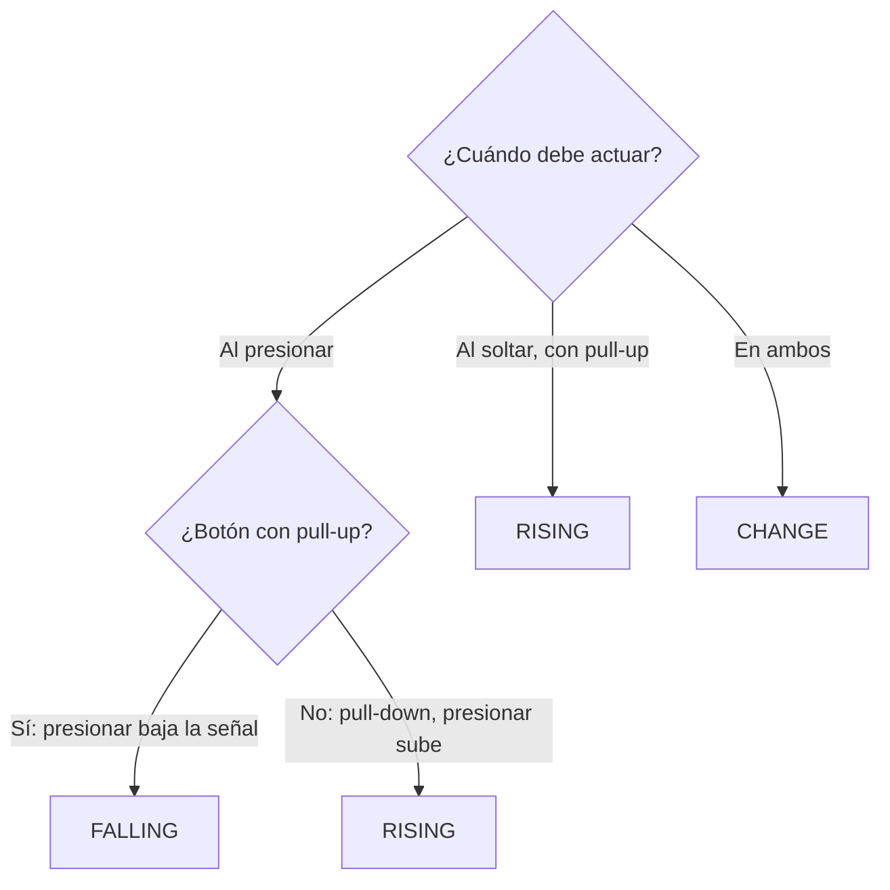
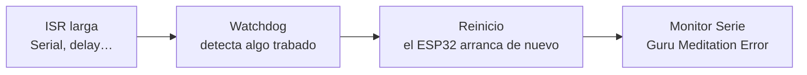
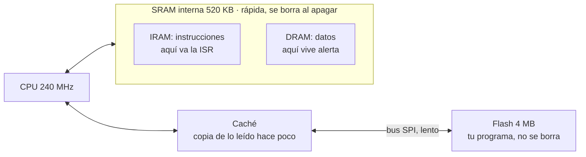
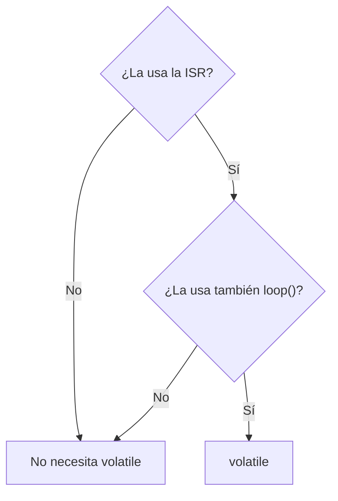
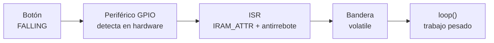

# S4 — Interrupciones externas en el ESP32

> Semana 4 · Resultado de aprendizaje R1. Se usa en la AP4 (sistema de alerta doméstica).
> Fuente: `S4_Interrupciones_Externas_ESP32.pdf`.

## Idea central en una línea

Un botón (como en la AP2) que **avisa solo** por interrupción (como el timer de la AP3): la ISR debe ser **corta, estar en IRAM, usar variables `volatile` y el patrón bandera**, para que **ningún evento se pierda**.

## Glosario

| Término | Qué significa |
| --- | --- |
| **Sondeo (polling)** | Preguntar una y otra vez, en `loop()`, si algo ya pasó. |
| **Interrupción** | Aviso del hardware que pausa el programa para atender algo urgente. |
| **Interrupción externa** | Interrupción cuyo aviso llega desde fuera del chip, por un pin. |
| **ISR** | *Interrupt Service Routine*: la función que se ejecuta al llegar el aviso. |
| **Flanco** | El instante en que una señal cambia de 0 a 1 o de 1 a 0. |
| **Rebote** | Varios cambios falsos y rapidísimos que produce un botón mecánico. |
| **Compilador** | Traduce tu C a instrucciones del chip; intenta ahorrar pasos. |
| **Registro de la CPU** | Casillas muy rápidas dentro de la CPU donde trabaja con copias de datos. |
| **Flash** | Memoria grande y lenta, fuera del núcleo, donde se guarda el programa. |
| **SRAM / IRAM** | Memoria rápida dentro del chip. IRAM es la parte para instrucciones. |
| **Caché** | Copia pequeña y rápida de lo que la CPU leyó hace poco de la flash. |
| **Watchdog** | "Perro guardián": reinicia el chip si algo se queda trabado mucho tiempo. |

## Bloque 1 · Sondeo vs. interrupción

| Sondeo | Interrupción |
| --- | --- |
| Mirar por la ventana cada 5 min: "¿ya llegó el paquete?" | Instalar un **timbre**: el aviso llega solo. |
| `loop()` lee el pin en cada vuelta. | El **periférico GPIO** vigila el pin en hardware. |
| Si `loop()` está ocupado (`delay(2000)`), **el toque se pierde**. | El aviso llega **aunque `loop()` esté en un `delay()`**. |

```cpp
void loop() {
  if (digitalRead(21) == LOW) {   // ¿ya presionaron? (sondeo)
    encenderAlarma();
  }
  // ...otras tareas...
}
```

En un juego de luces perder un toque da igual; en una alarma de puerta, no.

### Qué hace el hardware cuando llega el aviso



**Mientras corre la ISR, `loop()` está congelado.**

### Semana 3 vs. semana 4: el mismo mecanismo

| | Semana 3: temporizador | Semana 4: externa |
| --- | --- | --- |
| ¿Quién toca el timbre? | El temporizador, dentro del chip | Algo de afuera, por un pin |
| ¿Cuándo? | Cada cierto tiempo, fijo | Cuando ocurre el evento |
| Se configura con | `timerBegin`, `timerAlarm`… | `attachInterrupt()` |
| Pausa, ISR, regreso | Igual | Igual |
| ISR, IRAM_ATTR, volatile, bandera | Igual | Igual |

## Bloque 2 · Flancos

- **Nivel:** "la puerta está abierta" — un estado que dura.
- **Flanco:** "la puerta se acaba de abrir" — un instante.

Con **`INPUT_PULLUP` la lógica es invertida**: suelto = 1, presionado = 0.

| Modo | Cambio | Con pull-up ocurre… |
| --- | --- | --- |
| **FALLING** | 1 → 0 | Al **presionar** |
| **RISING** | 0 → 1 | Al **soltar** |
| **CHANGE** | Ambos | Presionar y soltar: la ISR corre **dos veces por toque** |



**Pregunta típica:** botón en `INPUT_PULLUP`, la alarma debe sonar al presionar → **FALLING**, porque presionar une el pin con GND y la señal **cae** de 1 a 0.

## Bloque 3 · Pines que admiten interrupción

| Pines | ¿Sirven? | Cuidado |
| --- | --- | --- |
| 16, 17, 18, 19, 21, 22, 23, 25, 26, 27, 32, 33 | **Sí** | Los recomendados (AP4: botón en GPIO21) |
| 34, 35, 36, 39 (solo entrada) | Sí, con cuidado | **No tienen pull-up interna** |
| 0, 2, 5, 12, 15 (strapping) | Evitar | Si están presionados al encender, arranca mal |
| 6 a 11 (flash) | **No** | Los usa la memoria del programa |

En el Arduino Uno solo **D2 y D3** podían; en el ESP32, casi todos.

**Pines 34–39: pull-up externa.** Sin ella el pin queda **flotando**: capta ruido y aparecen alarmas sin que nadie toque. Con una **10 kΩ a 3,3 V**: suelto = 1 seguro.

## Bloque 4 · `attachInterrupt()`: instalar el timbre

```cpp
attachInterrupt(digitalPinToInterrupt(21), isrBoton, FALLING);
```

| Parámetro | Pregunta | Valor |
| --- | --- | --- |
| `digitalPinToInterrupt(21)` | ¿Qué pin vigilar? | El GPIO21 |
| `isrBoton` | ¿A quién llamar? | El **nombre** de la ISR, **sin paréntesis** (no la llamas) |
| `FALLING` | ¿Qué cambio? | FALLING, RISING o CHANGE |

En español: "cuando el pin 21 caiga de 1 a 0, llama a `isrBoton`".

- Va **una sola vez, en `setup()`**.
- **Orden:** primero `pinMode(21, INPUT_PULLUP)`, después `attachInterrupt(...)`.
- `detachInterrupt(pin)` desinstala el timbre.

## Bloque 5 · La ISR a fondo

| Función normal | ISR |
| --- | --- |
| Tú la llamas, en el punto que decides. | **Tú nunca la llamas.** La llama el hardware, en cualquier momento. |

Analogía del taller: dejas tu número (`attachInterrupt`), sigues con tu vida (`loop()`), el taller te llama (el hardware ejecuta `isrBoton`). Llamar cada hora "¿ya está?" sería sondeo. En la semana 3 la llamamos **callback**.

### Regla 1: la ISR debe ser corta

| ✔ Sí va en la ISR | ✘ No va en la ISR |
| --- | --- |
| Subir una bandera | `Serial.print` / `println` |
| Guardar el tiempo: `millis()` | `delay()` |
| Sumar 1 a un contador | Cálculos largos |
| `digitalWrite` (es rápido) | Esperar a que algo pase |

Como el extintor: apagas el fuego y sales; nada de limpiar la cocina.

### Si la ISR tarda demasiado: el watchdog



Síntoma típico: **"el ESP32 se reinicia de vez en cuando"**.

## Bloque 6 · IRAM: dónde vive la ISR



Ojo: en el ESP32, **DRAM = *Data RAM***, no la DRAM de los computadores.

### El problema: a veces la caché se apaga


Es raro pero real, y casi no se puede reproducir: "a veces falla y no sé por qué".

```cpp
void IRAM_ATTR isrBoton() {   // IRAM_ATTR va entre el tipo y el nombre
  // código corto de emergencia
}
```

**Regla: toda ISR lleva `IRAM_ATTR`. Siempre.** Si la omites, funciona casi siempre y falla muy de vez en cuando. (Extintor en la pared de la cocina, no en la bodega cerrada.)

## Bloque 7 · `volatile`

Dos lugares donde puede estar un dato:

- **RAM → el pizarrón:** donde vive la variable `alerta`; la ISR y `loop()` la ven.
- **Registro de la CPU → tu cuaderno:** la CPU copia el dato aquí para trabajar. (No son los registros de periféricos `GPIO_OUT`, `GPIO_IN`.)

El compilador es "ahorrativo":

```cpp
while (alerta == false) {
  // nada aquí adentro cambia alerta
}
```

Piensa: "nadie cambia `alerta` aquí; la copio una vez a mi cuaderno y no vuelvo al pizarrón". **No sabe que existe la ISR** (nadie la llama desde el código).

| Momento | RAM (pizarrón) | Copia en la CPU (cuaderno) | ¿Qué ve el loop? |
| --- | --- | --- | --- |
| Arranca el loop | `alerta = false` | false | false |
| La ISR escribe | `alerta = true` | false | false |
| Siguen las vueltas | true | false | **false para siempre** |

El LED nunca enciende y **no hay error de compilación**.

```cpp
volatile bool alerta = false;
```

"Puede cambiar a tus espaldas: ve a la RAM cada vez que la uses." **Solo hace eso**: no la hace más rápida ni más segura (ni atómica).

### La prueba: ¿la tocan la ISR **y** el loop?

| Variable | ¿ISR? | ¿loop? | ¿`volatile`? |
| --- | --- | --- | --- |
| `alerta` | escribe | lee | **Sí** |
| `pulsos` | escribe | lee | **Sí** |
| `tUltimo` | lee y escribe | — | No |
| `total` | — | lee y escribe | No |

No importa dónde se escribe, sino **cuántas partes del programa la tocan**.



**Error traicionero:** con un `Serial.println` en el loop, el compilador suele volver a leer la RAM y "parece que `volatile` no hacía falta". Quitas el println o cambias la optimización y deja de funcionar. Si cumple la regla, **va `volatile`**.

## Bloque 8 · Patrón bandera

| Cartero = ISR | Banderita = variable | Tú = `loop()` |
| --- | --- | --- |
| Deja la carta y levanta la banderita; tarda 5 s y se va. | `volatile bool alerta`. Arriba = "pasó algo". | Ves la banderita, la bajas y lees con calma. |

| ISR (rápida) | `loop()` (con calma) |
| --- | --- |
| 1. Sube la bandera: `alerta = true` | 1. ¿Bandera arriba? |
| 2. Sale. Nada más. | 2. La baja: `alerta = false` |
| | 3. Trabajo pesado: imprimir, sirena, WiFi, LCD… |

**En el loop: primero bajar la bandera, después trabajar.** El aviso puede atenderse un poco tarde, **pero no se pierde**.

```cpp
volatile bool alerta = false;          // 1. la bandera

void IRAM_ATTR isrBoton() {            // 2. la ISR
  alerta = true;                       //    sube la bandera
}

void loop() {                          // 3. el loop
  if (alerta) {                        //    ¿arriba?
    alerta = false;                    //    la baja
    Serial.println("¡Alerta!");        //    trabajo pesado
  }
}
```

### Limitación: la bandera no cuenta

| Bandera (`bool`) | Contador (`uint32_t`) |
| --- | --- |
| Dice "pasó algo". | Dice "cuántas veces". |
| 3 toques mientras el loop está ocupado = **1 aviso**. | La ISR suma 1; el loop lo lee. |

```cpp
volatile uint32_t pulsos = 0;
void IRAM_ATTR isrBoton() { pulsos++; }
```

## Bloque 9 · Rebote dentro de la ISR

Un toque produce **varios flancos de bajada** en milisegundos → la ISR corre 3 o 5 veces.

| Con sondeo (AP2) | Con interrupción |
| --- | --- |
| El `loop()` filtraba el rebote. | Cada rebote dispara la ISR: un toque cuenta como 3 o 5. |

Solución: ignorar flancos a menos de **50 ms** del último aceptado (el patrón `ahora − tAnterior` de la semana 2).

```cpp
uint32_t tUltimo = 0;                  // solo la ISR → no volatile

void IRAM_ATTR isrBoton() {
  uint32_t ahora = millis();
  if (ahora - tUltimo >= 50) {         // ¿toque nuevo?
    alerta = true;
    tUltimo = ahora;
  }                                    // si no: es rebote
}
```

## Bloque 10 · Todo junto



- Si olvidas **`volatile`** → falla el paso **bandera → loop()**: el loop nunca ve el cambio.
- Si olvidas **`IRAM_ATTR`** → falla el paso **ISR**: si la caché está apagada, la CPU no la encuentra y el chip se cae (de vez en cuando).

### Programa completo (AP4)

```cpp
const uint8_t PIN_BOTON = 21;
const uint8_t PIN_LED   = 19;
const uint32_t T_REBOTE = 50;           // ms

volatile bool alerta = false;           // ISR y loop
uint32_t tUltimo = 0;                   // solo la ISR

void IRAM_ATTR isrBoton() {
  uint32_t ahora = millis();
  if (ahora - tUltimo >= T_REBOTE) {
    alerta = true;
    tUltimo = ahora;
  }
}

void setup() {
  Serial.begin(115200);
  pinMode(PIN_LED, OUTPUT);
  pinMode(PIN_BOTON, INPUT_PULLUP);
  attachInterrupt(digitalPinToInterrupt(PIN_BOTON), isrBoton, FALLING);
}

void loop() {
  if (alerta) {
    alerta = false;
    digitalWrite(PIN_LED, !digitalRead(PIN_LED));
    Serial.println("¡Alerta! Puerta abierta");
  }
  delay(2000);                          // loop ocupado: el aviso NO se pierde
}
```

## Control de aprendizaje (resuelto)

<details>
<summary>1 · Pulsador con INPUT_PULLUP; la alarma debe activarse al presionar. ¿RISING, FALLING o CHANGE?</summary>

**FALLING.** Con pull-up el pin está en 1 suelto; al presionar se une a GND y la señal **cae** de 1 a 0. RISING ocurriría al soltar y CHANGE dispararía dos veces por toque.
</details>

<details>
<summary>2 · ¿Cuáles necesitan volatile? <code>pulsos</code> (ISR suma, loop lee), <code>tUltimo</code> (solo ISR), <code>total</code> (solo loop)</summary>

Solo **`pulsos`**, porque la tocan la ISR **y** el loop. `tUltimo` y `total` las usa una sola parte del programa.
</details>

<details>
<summary>3 · <code>Serial.println("toque")</code> dentro de la ISR; el ESP32 se reinicia con "Guru Meditation Error". ¿Qué pasa?</summary>

La ISR es **demasiado larga** (Serial es lento) y el **watchdog** reinicia el chip. Corrección: **patrón bandera** — la ISR solo hace `alerta = true` y el `Serial.println` va en `loop()`.
</details>

<details>
<summary>4 · Sin antirrebote (T_REBOTE = 0) se presiona 10 veces. ¿Exactamente 10, menos o más?</summary>

**Más de 10.** Cada toque mecánico rebota y produce varios flancos de bajada; cada uno dispara la ISR.
</details>

<details>
<summary>5 · Timer a 1 MHz, alarma 500 000 con autorrecarga. ¿Cada cuánto corre la ISR? ¿Cuántas veces por segundo?</summary>

tiempo = 500 000 / 1 000 000 = **0,5 s** → **2 veces por segundo**.
</details>
