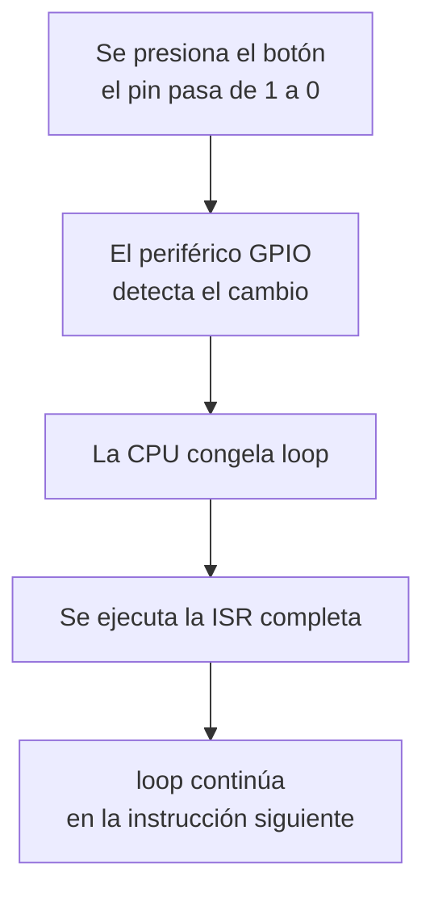
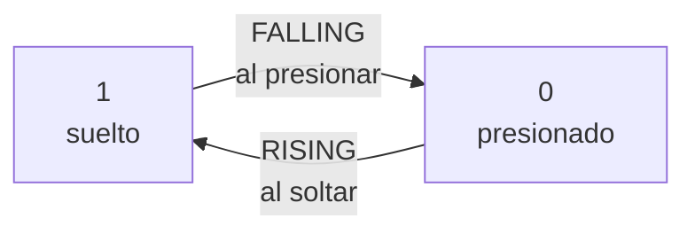
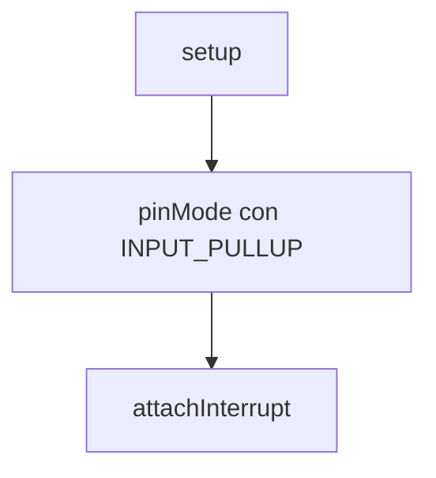
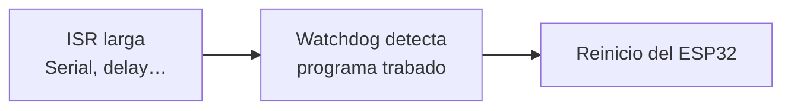
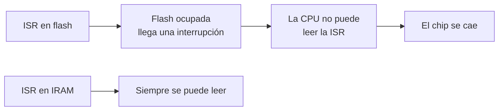
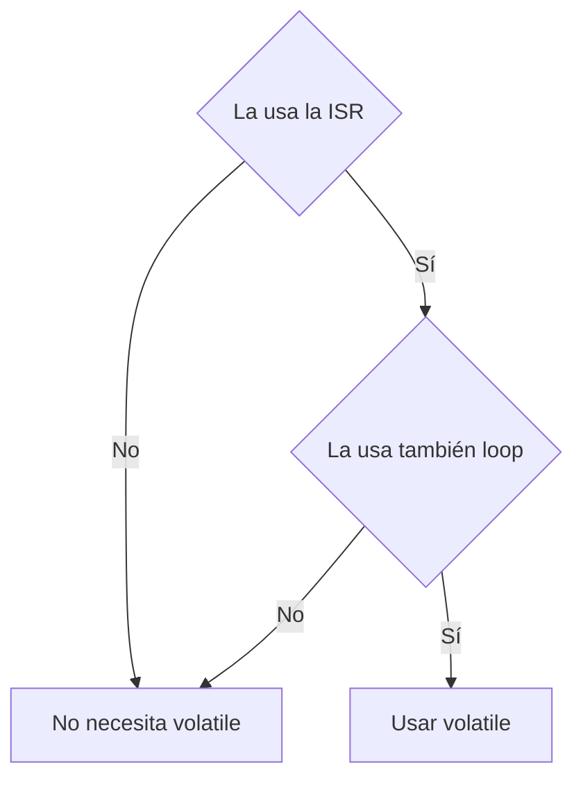
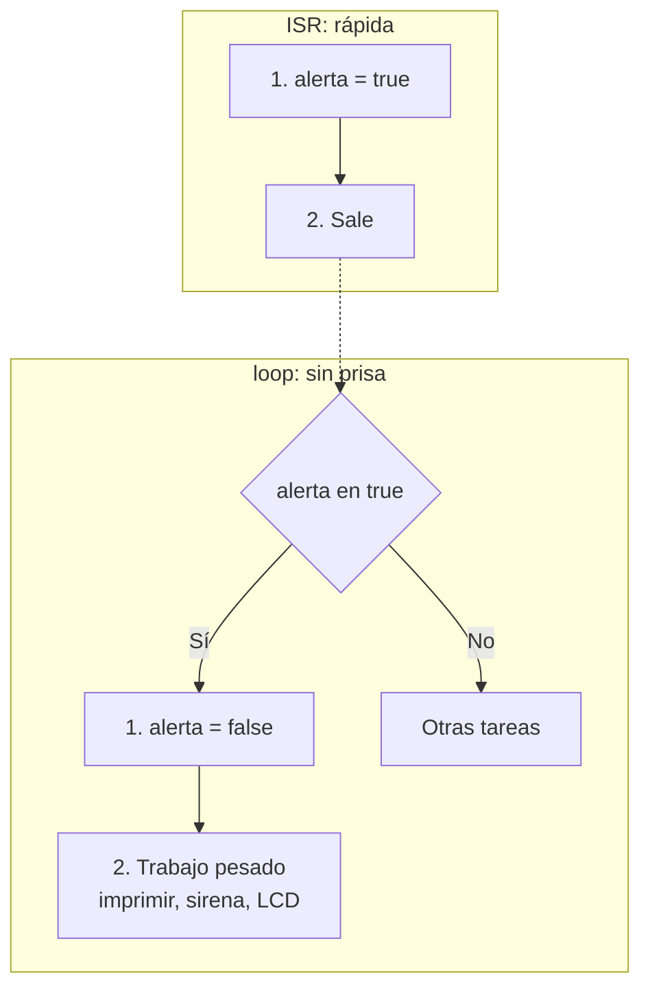
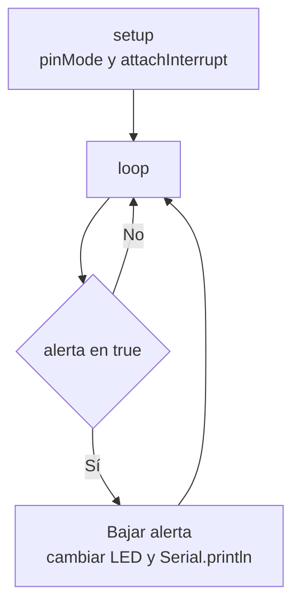

# S4 — Interrupciones externas en el ESP32

> Semana 4 · Resultado de aprendizaje R1. Se usa en la AP4 (sistema de alerta doméstica).

## Idea central

Un botón que **avisa solo** por interrupción. La ISR debe ser **corta, estar en IRAM, usar variables `volatile` y el patrón bandera** para que ningún evento se pierda.


## Glosario

| Término | Significado |
| --- | --- |
| **Sondeo (polling)** | Leer el pin una y otra vez en `loop()` para ver si algo cambió. |
| **Interrupción** | Aviso del hardware que pausa el programa para atender un evento. |
| **Interrupción externa** | Interrupción cuyo aviso llega por un pin. |
| **ISR** | Función que se ejecuta al llegar el aviso. |
| **Flanco** | Instante en que una señal cambia de 0 a 1 o de 1 a 0. |
| **Rebote** | Cambios falsos y muy rápidos de un botón mecánico. |
| **Watchdog** | Mecanismo que reinicia el chip si el programa se queda trabado. |

## 1. Sondeo e interrupción

| Sondeo | Interrupción |
| --- | --- |
| `loop()` lee el pin en cada vuelta. | El periférico GPIO vigila el pin en hardware. |
| Si `loop()` está ocupado (`delay(2000)`), el toque se pierde. | El aviso llega aunque `loop()` esté en un `delay()`. |

```cpp
void loop() {
  if (digitalRead(21) == LOW) {   // sondeo
    encenderAlarma();
  }
}
```

### Qué pasa cuando llega el aviso



Mientras corre la ISR, `loop()` está congelado.

### Semana 3 y semana 4

| | Semana 3: temporizador | Semana 4: externa |
| --- | --- | --- |
| Origen del aviso | El timer, dentro del chip | Un pin, desde afuera |
| Se configura con | `timerBegin`, `timerAlarm`… | `attachInterrupt()` |
| Pausa, ISR, regreso | Igual | Igual |
| `IRAM_ATTR`, `volatile`, bandera | Igual | Igual |

## 2. Flancos

- **Nivel:** estado que dura (el pin está en 0).
- **Flanco:** instante del cambio (el pin acaba de pasar a 0).

Con `INPUT_PULLUP` la lógica es invertida: suelto = 1, presionado = 0.



| Modo | Cambio | Con pull-up ocurre |
| --- | --- | --- |
| **FALLING** | 1 → 0 | Al presionar |
| **RISING** | 0 → 1 | Al soltar |
| **CHANGE** | Ambos | Al presionar y al soltar: la ISR corre dos veces por toque |

**Caso típico:** botón con `INPUT_PULLUP` y alarma al presionar → **FALLING**.

## 3. Pines que admiten interrupción

| Pines | Uso |
| --- | --- |
| 16, 17, 18, 19, 21, 22, 23, 25, 26, 27, 32, 33 | Recomendados (AP4: botón en GPIO21). |
| 34, 35, 36, 39 | Sirven, pero no tienen pull-up interna. |
| 0, 2, 5, 12, 15 (strapping) | Evitar: si están presionados al encender, el arranque falla. |
| 6 a 11 | No usar: los ocupa la flash. |

En el Arduino Uno solo D2 y D3 admiten interrupción.

**Pines 34–39:** se necesita una pull-up externa (10 kΩ a 3,3 V). Sin ella el pin queda flotando, capta ruido y genera alarmas falsas.

## 4. `attachInterrupt()`

```cpp
attachInterrupt(digitalPinToInterrupt(21), isrBoton, FALLING);
```

| Parámetro | Qué indica |
| --- | --- |
| `digitalPinToInterrupt(21)` | El pin que se vigila |
| `isrBoton` | El nombre de la ISR, **sin paréntesis** |
| `FALLING` | El tipo de cambio: FALLING, RISING o CHANGE |



- Se llama una sola vez, en `setup()`.
- Primero `pinMode(21, INPUT_PULLUP)`, después `attachInterrupt(...)`.
- `detachInterrupt(pin)` la desactiva.

## 5. La ISR

Una función normal la llama el programa. **Una ISR no se llama nunca desde el código:** la ejecuta el hardware cuando ocurre el evento.

### Debe ser corta

| Va en la ISR | No va en la ISR |
| --- | --- |
| Subir una bandera | `Serial.print` / `println` |
| Guardar `millis()` | `delay()` |
| Sumar 1 a un contador | Cálculos largos |
| `digitalWrite` | Esperar a que algo pase |

Si la ISR tarda demasiado, el watchdog reinicia el ESP32. Síntoma: "el ESP32 se reinicia de vez en cuando" y aparece *Guru Meditation Error* en el Monitor Serie.



## 6. `IRAM_ATTR`

El programa está en la **flash** (lenta). La **IRAM** es memoria interna rápida para instrucciones. A veces la flash queda inaccesible por un momento (por ejemplo, al escribir en ella). Si una interrupción llega entonces y la ISR está en la flash, la CPU no puede leerla y el chip se cae.



```cpp
void IRAM_ATTR isrBoton() {   // IRAM_ATTR va entre el tipo y el nombre
  // código corto
}
```

**Regla: toda ISR lleva `IRAM_ATTR`.** Sin ella funciona casi siempre y falla de vez en cuando.

## 7. `volatile`

El compilador, para ahorrar pasos, puede guardar una copia de una variable en un registro de la CPU y no volver a leerla de la RAM. Como no ve que la ISR la cambia, `loop()` puede quedarse con el valor viejo.

```cpp
while (alerta == false) {
  // nada aquí cambia alerta
}
```

| Momento | `alerta` en RAM | Copia en la CPU | Lo que ve loop |
| --- | --- | --- | --- |
| Arranca loop | false | false | false |
| La ISR escribe | true | false | false |
| Siguen las vueltas | true | false | false para siempre |

El LED nunca enciende y no hay error de compilación.

```cpp
volatile bool alerta = false;
```

`volatile` obliga a leer la variable de la RAM cada vez. Solo eso: no la hace más rápida ni atómica.

### Cuándo usarla



| Variable | ISR | loop | `volatile` |
| --- | --- | --- | --- |
| `alerta` | escribe | lee | Sí |
| `pulsos` | escribe | lee | Sí |
| `tUltimo` | lee y escribe | no la usa | No |
| `total` | no la usa | lee y escribe | No |

## 8. Patrón bandera



En `loop()`: **primero bajar la bandera, después trabajar.** El aviso puede atenderse un poco tarde, pero no se pierde.

```cpp
volatile bool alerta = false;          // la bandera

void IRAM_ATTR isrBoton() {            // la ISR
  alerta = true;                       // sube la bandera
}

void loop() {
  if (alerta) {                        // está arriba
    alerta = false;                    // la baja
    Serial.println("Alerta");          // trabajo pesado
  }
}
```

### La bandera no cuenta

| Bandera (`bool`) | Contador (`uint32_t`) |
| --- | --- |
| Dice que pasó algo. | Dice cuántas veces. |
| 3 toques con el loop ocupado = 1 aviso. | La ISR suma 1 y el loop lo lee. |

```cpp
volatile uint32_t pulsos = 0;
void IRAM_ATTR isrBoton() { pulsos++; }
```

## 9. Rebote dentro de la ISR

Un toque produce varios flancos de bajada en pocos ms, y cada uno ejecuta la ISR: un toque cuenta como 3 o 5.

**Solución:** ignorar los flancos que lleguen a menos de 50 ms del último aceptado (el patrón `ahora − tAnterior` de la semana 2).

```cpp
uint32_t tUltimo = 0;                  // solo la ISR la usa: sin volatile

void IRAM_ATTR isrBoton() {
  uint32_t ahora = millis();
  if (ahora - tUltimo >= 50) {         // toque nuevo
    alerta = true;
    tUltimo = ahora;
  }                                    // si no: es rebote
}
```

## 10. Programa completo (AP4)



```cpp
const uint8_t PIN_BOTON = 21;
const uint8_t PIN_LED   = 19;
const uint32_t T_REBOTE = 50;           // ms

volatile bool alerta = false;           // ISR y loop
uint32_t tUltimo = 0;                   // solo la ISR

void IRAM_ATTR isrBoton() {
  uint32_t ahora = millis();
  if (ahora - tUltimo >= T_REBOTE) {
    alerta = true;
    tUltimo = ahora;
  }
}

void setup() {
  Serial.begin(115200);
  pinMode(PIN_LED, OUTPUT);
  pinMode(PIN_BOTON, INPUT_PULLUP);
  attachInterrupt(digitalPinToInterrupt(PIN_BOTON), isrBoton, FALLING);
}

void loop() {
  if (alerta) {
    alerta = false;
    digitalWrite(PIN_LED, !digitalRead(PIN_LED));
    Serial.println("Alerta: puerta abierta");
  }
  delay(2000);                          // loop ocupado: el aviso no se pierde
}
```

Si falta una pieza:

- Sin `volatile`: `loop()` nunca ve el cambio de la bandera.
- Sin `IRAM_ATTR`: de vez en cuando la CPU no encuentra la ISR y el chip se cae.

## Ideas para recordar

1. Botón con `INPUT_PULLUP` que actúa al presionar → **FALLING**. RISING ocurre al soltar; CHANGE dispara dos veces por toque.
2. `volatile` solo para variables que tocan la ISR **y** el loop (`pulsos` sí; `tUltimo` y `total` no).
3. Nada lento dentro de la ISR: el watchdog reinicia el chip. Usar el patrón bandera.
4. Sin antirrebote se cuentan más toques de los reales.
5. Timer a 1 MHz con alarma 500 000 y autorrecarga: la ISR corre cada 0,5 s (2 veces por segundo).
