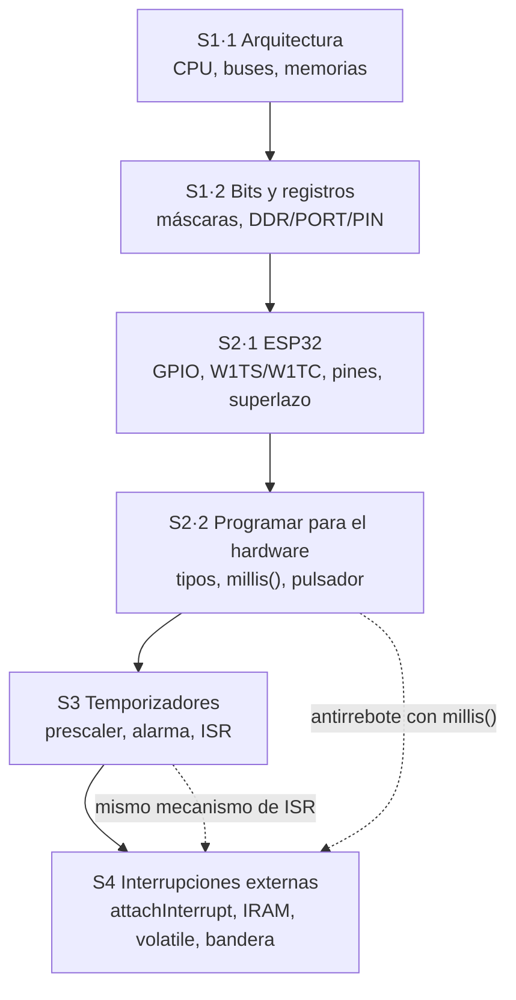
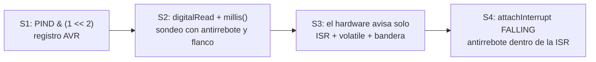

# Repaso para la prueba — Unidad 1 (semanas 1 a 4)

Hoja de una pasada: lo que más se pregunta, las fórmulas y ejercicios con respuesta oculta. Si algo no queda claro, vuelve al apunte de la sesión indicada entre corchetes.

## Mapa de la unidad

## La evolución de "leer un botón" (el hilo de toda la unidad)

## Chuleta (de memoria)

### Bits [02]

| Quiero | Código |
| --- | --- |
| Encender bit n | `REG \|= (1 << n);` |
| Apagar bit n | `REG &= ~(1 << n);` |
| Invertir bit n | `REG ^= (1 << n);` |
| Leer bit n | `if (REG & (1 << n))` |

Pesos: 128 64 32 16 8 4 2 1 · 1 dígito hex = 4 bits · `0x20` = bit 5.

### Pines AVR [02]

| DDR | PORT | Estado |
| --- | --- | --- |
| 0 | 0 | Entrada flotante |
| 0 | 1 | Entrada con pull-up (suelto 1, pulsado 0) |
| 1 | 0 | Salida 0 V |
| 1 | 1 | Salida 5 V |

### ESP32 [03]

- DDR → `GPIO_ENABLE_REG` · PORT → `GPIO_OUT_W1TS_REG` / `W1TC` · PIN → `GPIO_IN_REG`.
- **W1TS/W1TC = atómico** (escriben sin leer) → no hay riesgo de leer-modificar-escribir.
- **Seguros:** 16–19, 21–23, 25–27, 32, 33 · **Strapping:** 0, 2, 5, 12, 15 · **Solo entrada (sin pull-up):** 34, 35, 36, 39 · **UART0:** 1, 3 · **Flash:** 6–11.
- **3,3 V, no tolera 5 V** · ≤ 10 mA por pin · `R = (3,3 − Vf) / I`.
- Arranque: ROM → 2.º bootloader → `app_main` → loopTask (FreeRTOS) → `setup()` → `loop()` para siempre.

### Memorias [01]

Flash = programa (no se borra) · SRAM = variables (se borra) · EEPROM = datos que sobreviven (desgaste: 100 000 ciclos; nunca escribir en `loop()`).

### Tipos y tiempo [04]

- `int`: 2 bytes en el Uno, 4 en el ESP32 → usar `uint8_t`, `uint32_t`.
- Tiempos siempre `uint32_t`; patrón: `if (ahora - tAnterior >= PERIODO)`.
- `1UL << 31`, no `1 << 31` · `(uint8_t)~a` para volver a 8 bits.
- Sin signo da la vuelta (definido); con signo desborda (indefinido).
- Pulsador: `INPUT_PULLUP` + antirrebote 20–50 ms + actuar en el **flanco**.

### Temporizadores [05]

| Fórmula | |
| --- | --- |
| `f = 80 000 000 / N` | frecuencia de tick |
| `resolución = 1 / f` | lo que dura un tick |
| `tiempo = alarma / f` | cada cuánto avisa |
| `alarma = tiempo × f` | qué alarma poner |

Con N = 80 → f = 1 MHz → 1 tick = 1 µs → **alarma en µs**. ESP32: 4 timers de 64 bits, prescaler de 16 bits (2–65 535). AVR: 3 timers de 8/16 bits, prescaler 1/8/64/256/1024.

### Interrupciones [05][06]

- `attachInterrupt(digitalPinToInterrupt(pin), isr, FALLING);` en `setup()`, **después** de `pinMode`. Nombre de la ISR **sin paréntesis**.
- Pull-up + "al presionar" = **FALLING**. CHANGE = dos veces por toque.
- ISR: ✔ bandera, `millis()`, contador, `digitalWrite` · ✘ `Serial`, `delay`, cálculos largos (→ **watchdog**, *Guru Meditation Error*).
- `volatile` solo si la tocan **ISR y loop**. No es atómico ni más rápido.
- Sin `IRAM_ATTR`: si la caché está apagada (escritura en flash), la ISR no se puede leer y el chip se cae.
- La bandera no cuenta: para contar, `volatile uint32_t pulsos` y `pulsos++` en la ISR.

## Errores que se preguntan siempre

| Error | Por qué está mal | Correcto |
| --- | --- | --- |
| `REG = (1 << 2);` | Borra los demás bits | `REG \|= (1 << 2);` |
| `int t = millis();` | Desborda | `uint32_t t = millis();` |
| `millis() > t + P` | La suma da la vuelta | `millis() - t >= P` |
| `for (uint8_t i = 0; i < 256; i++)` | Bucle infinito | `uint16_t i` |
| `delay(200)` como antirrebote | Bloquea el programa | Antirrebote con `millis()` |
| `if (digitalRead(B) == LOW) n++;` | Cuenta por nivel | Detectar el flanco |
| LED en GPIO34 | Solo entrada | Pin seguro (16–19…) |
| `INPUT_PULLUP` en GPIO35 | No tiene pull-up interna | Pull-up externa 10 kΩ |
| Sensor de 5 V directo al ESP32 | No tolera 5 V | Divisor o adaptador de nivel |
| EEPROM escrita en `loop()` | Se desgasta en minutos | Escribir solo cuando cambia |
| `Serial.println` en la ISR | Watchdog reinicia | Patrón bandera |
| Variable compartida sin `volatile` | El loop nunca ve el cambio | `volatile` |
| ISR sin `IRAM_ATTR` | Falla de vez en cuando | `void IRAM_ATTR isr()` |
| Código de timers de la versión 2.x | No compila en el core 3.x | API 3.x (`timerBegin(freq)`, `timerAlarm`) |

## Practica (respuestas ocultas)

1. Convierte 0xC8 a binario y decimal.

`1100 1000` = 128 + 64 + 8 = **200**.

2. ¿Qué vale 0xCA & 0x0F?

`1100 1010 & 0000 1111 = 0000 1010` = **0x0A**.

3. Escribe la línea que invierte el bit 3 de PORTB.

`PORTB ^= (1 << 3);`

4. DDRD2 = 0, PORTD2 = 0, nada conectado. ¿Qué lee PIND2?

Un valor **al azar**: entrada flotante.

5. ¿Por qué W1TS/W1TC son más seguros que <code>GPIO_OUT |= mask</code>?

Porque escriben **sin leer antes**: una sola escritura, atómica. Con leer-modificar-escribir, una interrupción (u otro núcleo) entre la lectura y la escritura pierde su cambio.

6. ¿Por qué un pulsador entre GPIO12 y 3,3 V puede impedir que la placa arranque?

GPIO12 es de **strapping**: si está en alto al arrancar, la flash se configura a 1,8 V y el chip no arranca.

7. Resistencia para un LED rojo (Vf = 2,0 V) a 4 mA en el ESP32.

R = (3,3 − 2,0) / 0,004 ≈ **325 Ω** → 330 Ω.

8. <code>uint8_t c = 253;</code> y se imprime <code>c++</code> cinco veces. ¿Qué sale?

`253 254 255 0 1` (sin signo da la vuelta).

9. <code>uint8_t x = 200, y = 100; uint8_t r = x + y;</code> ¿Cuánto vale r?

**44**: se calcula como `int` (300) y al guardar en 8 bits queda 300 − 256.

10. ¿Qué imprime la 3.ª vuelta de un loop con una global, una local y una static que se incrementan?

`global=3 local=1 static=3`.

11. Quiero un aviso cada 250 ms con ticks de 1 µs. ¿Prescaler y alarma?

N = 80 000 000 / 1 000 000 = **80**; alarma = 0,25 × 1 000 000 = **250 000**.

12. f = 10 000 y alarma = 5 000. ¿Cada cuánto? ¿Qué N?

tiempo = 5 000 / 10 000 = **0,5 s**; N = 80 000 000 / 10 000 = **8 000**.

13. ¿Cuánto tarda en llenarse un contador de 16 bits con ticks de 1 µs?

65 535 µs ≈ **65,5 ms**. (64 bits: ≈ 584 000 años.)

14. Diferencia entre autorrecarga y desbordamiento.

Autorrecarga: el contador vuelve a 0 al llegar a la **alarma que tú eliges** (uso normal). Desbordamiento: vuelve a 0 al llegar al **máximo físico** de bits (casi nunca intencional).

15. Diferencia entre interrupción del temporizador y externa.

Temporizador: la dispara un periférico interno, de forma **predecible**. Externa: la dispara un **pin** por algo de afuera, **sin aviso**. Ambas usan ISR, IRAM_ATTR, volatile y bandera.

16. Tres toques llegan mientras el loop está en un <code>delay(2000)</code>, con patrón bandera <code>bool</code>. ¿Cuántos avisos procesa el loop?

**Uno**: la bandera dice "pasó algo", no cuántas veces. Para contar, usar `volatile uint32_t pulsos`.

17. ¿Qué falla si olvidas volatile? ¿Y si olvidas IRAM_ATTR?

Sin `volatile`: el compilador usa una copia y el loop **nunca ve** la bandera. Sin `IRAM_ATTR`: si la caché está apagada cuando llega la interrupción, la CPU no puede leer la ISR desde la flash y el chip **se cae** de vez en cuando.

18. ¿Por qué Harvard puede ser más rápida que von Neumann?

Dos memorias y dos buses: trae la siguiente instrucción mientras usa un dato. Von Neumann comparte un bus y va por turnos.

