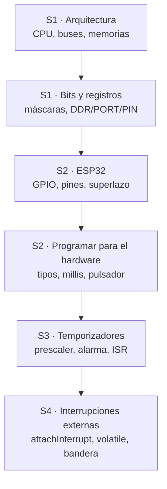
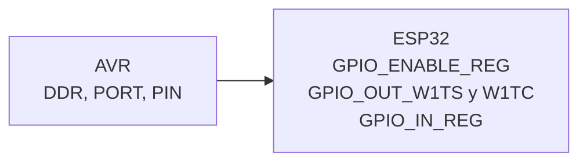
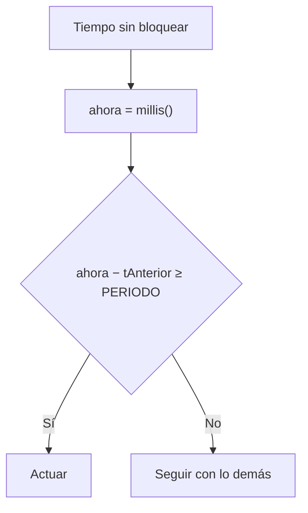

# Resumen de la unidad — Unidad 1 (semanas 1 a 4)

Las ideas principales de la unidad en una hoja. Entre corchetes está el apunte donde se explica cada tema.

## Mapa de la unidad

## Cómo se lee un botón

## Bits [02]

| Quiero | Código |
| --- | --- |
| Encender bit n | `REG \|= (1 << n);` |
| Apagar bit n | `REG &= ~(1 << n);` |
| Invertir bit n | `REG ^= (1 << n);` |
| Leer bit n | `if (REG & (1 << n))` |

Pesos: 128 64 32 16 8 4 2 1 · 1 dígito hexadecimal = 4 bits · `0x20` = bit 5.

## Pines AVR [02]

| DDR | PORT | Estado |
| --- | --- | --- |
| 0 | 0 | Entrada flotante |
| 0 | 1 | Entrada con pull-up |
| 1 | 0 | Salida 0 V |
| 1 | 1 | Salida 5 V |

## ESP32 [03]

- Con **W1TS/W1TC** se escribe sin leer antes: es atómico.
- **Seguros:** 16–19, 21–23, 25–27, 32, 33.
- **Strapping:** 0, 2, 5, 12, 15.
- **Solo entrada (sin pull-up):** 34, 35, 36, 39.
- **UART0:** 1, 3 · **Flash:** 6–11.
- Trabaja a **3,3 V** y no tolera 5 V · máximo 10 mA por pin · `R = (3,3 − Vf) / I`.

## Memorias [01]

| Memoria | Guarda | Al apagar |
| --- | --- | --- |
| Flash | El programa | Se conserva |
| SRAM | Las variables | Se borra |
| EEPROM | Datos que deben sobrevivir | Se conserva |

La EEPROM se desgasta (100 000 ciclos): no escribirla en `loop()`.

## Tipos y tiempo [04]

- `int` mide 2 bytes en el Uno y 4 en el ESP32: usar `uint8_t`, `uint32_t`.
- Los tiempos siempre son `uint32_t`.
- `1UL << 31`, no `1 << 31` · `(uint8_t)~a` para volver a 8 bits.
- Pulsador: `INPUT_PULLUP`, antirrebote de 20–50 ms y actuar en el **flanco**.

## Temporizadores [05]

| Fórmula | Significado |
| --- | --- |
| `f = 80 000 000 / N` | Frecuencia de tick |
| `resolución = 1 / f` | Duración de un tick |
| `tiempo = alarma / f` | Cada cuánto avisa |
| `alarma = tiempo × f` | Alarma a configurar |

Con N = 80: f = 1 MHz, 1 tick = 1 µs y la alarma se escribe en µs.

| | ESP32 | AVR (Uno) |
| --- | --- | --- |
| Temporizadores | 4 de 64 bits | 3 de 8 o 16 bits |
| Prescaler | 2 a 65 535 | 1, 8, 64, 256 o 1024 |

## Interrupciones [05][06]

- `attachInterrupt(digitalPinToInterrupt(pin), isr, FALLING);` en `setup()`, después de `pinMode`. La ISR va sin paréntesis.
- Pull-up y actuar al presionar → **FALLING**. CHANGE dispara dos veces por toque.
- En la ISR: bandera, `millis()`, contador, `digitalWrite`. No `Serial`, `delay` ni cálculos largos (el watchdog reinicia el chip).
- `volatile` solo si la usan la ISR y `loop()`.
- `IRAM_ATTR` en toda ISR: así la CPU siempre puede leerla.
- La bandera no cuenta: para contar, `volatile uint32_t pulsos` y `pulsos++` en la ISR.
- Antirrebote en la ISR: ignorar flancos a menos de 50 ms del último.
- El código de timers de la versión 2.x del core no compila en la 3.x.

## Errores frecuentes

| Error | Correcto |
| --- | --- |
| `REG = (1 << 2);` borra los demás bits | `REG \|= (1 << 2);` |
| `int t = millis();` | `uint32_t t = millis();` |
| `millis() > t + P` | `millis() - t >= P` |
| `delay(200)` como antirrebote | Antirrebote con `millis()` |
| LED en GPIO34 | Pin seguro (16–19…) |
| `Serial.println` en la ISR | Patrón bandera |
| Variable compartida sin `volatile` | `volatile` |
| ISR sin `IRAM_ATTR` | `void IRAM_ATTR isr()` |
