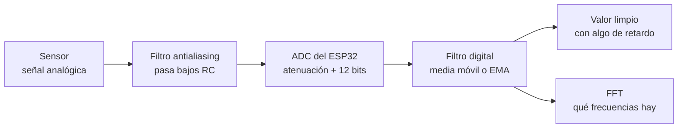
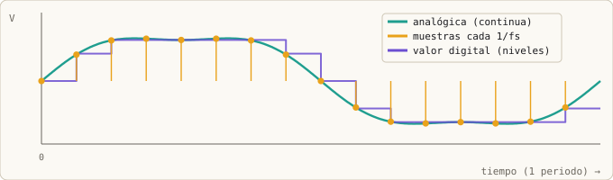
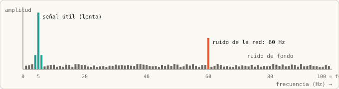
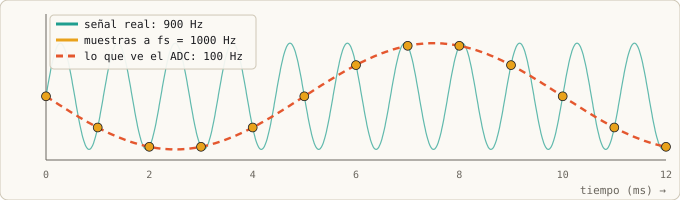
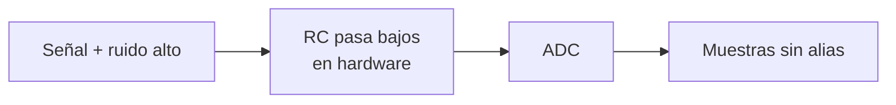
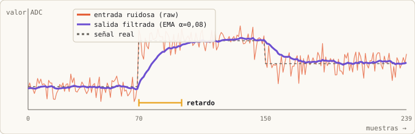
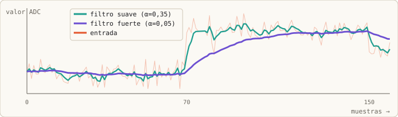

# Clase del 24 de noviembre — Señales, ADC y filtrado en el ESP32

> Unidad 2 · Apunte armado a partir de las [notas sueltas de la clase](notas-originales.txt) · [Guía PDF](senales-adc-y-filtros.pdf).

[← Volver a los apuntes](../README.md)

## Idea central

El mundo es **analógico** y el microcontrolador es **digital**. Para leer un sensor hay que **muestrear** la señal con el **ADC**, cuidando de no muestrear tan lento que aparezca **aliasing**, y después **filtrar** el ruido. Filtrar limpia la lectura, pero **la retrasa**.



## Glosario

| Término | Significado |
| --- | --- |
| **Señal analógica** | Toma cualquier valor dentro de un rango y varía de forma continua en el tiempo. |
| **Señal digital** | Solo toma valores discretos (por ejemplo 0 y 1, o un número entero de 0 a 4095). |
| **Muestreo** | Leer la señal cada cierto tiempo. La frecuencia de muestreo `fs` es cuántas lecturas por segundo. |
| **ADC** | Conversor analógico-digital: convierte un voltaje en un número. |
| **Resolución** | Cantidad de bits del ADC. Con 12 bits hay 2¹² = 4096 niveles (0 a 4095). |
| **Atenuación** | Divisor interno del ADC del ESP32 que define qué rango de voltaje puede medir. |
| **Ruido** | Variaciones no deseadas que se suman a la señal real. |
| **Aliasing** | Error que aparece al muestrear demasiado lento: una frecuencia alta se "disfraza" de una más baja. |
| **Fourier** | Idea de que toda señal se puede escribir como suma de senoidales de distintas frecuencias. |
| **FFT** | *Fast Fourier Transform*: algoritmo rápido para calcular qué frecuencias tiene una señal muestreada. |
| **Filtro** | Algo (circuito o código) que deja pasar unas frecuencias y atenúa otras. |

## 1. Señal analógica y señal digital

| | Analógica | Digital |
| --- | --- | --- |
| Valores | Infinitos dentro de un rango | Finitos (niveles) |
| Tiempo | Continuo | Discreto (muestras) |
| Ejemplo | Voltaje de un potenciómetro o un micrófono | Lo que devuelve `analogRead()`: un entero de 0 a 4095 |
| Ruido | Se suma y no se puede separar fácil | Se puede reducir con filtros en código |

Pasar de una a otra tiene **dos pasos**: muestrear en el tiempo (cada `1/fs` segundos) y cuantizar el valor (redondearlo al nivel más cercano del ADC).



*La onda continua se mide solo en las muestras; cada muestra se redondea a un nivel del ADC.*

## 2. Fourier y la FFT

**Fourier:** cualquier señal es una suma de senoidales. Una señal "ruidosa" es la señal útil (frecuencias bajas, cambia lento) más ruido (frecuencias altas, cambia rápido).


| Dato de la FFT | Fórmula | Ejemplo con `fs = 1000 Hz`, `N = 256` |
| --- | --- | --- |
| Frecuencia máxima que se ve | `fs / 2` | 500 Hz |
| Resolución en frecuencia (ancho de cada "casilla") | `fs / N` | ≈ 3,9 Hz |
| Tiempo que tarda en juntar las muestras | `N / fs` | 0,256 s |

- `N` suele ser potencia de 2 (128, 256, 512…), porque así la FFT es más rápida.
- Sirve para **ver** dónde está el ruido (por ejemplo un pico en 60 Hz de la red eléctrica) y decidir qué filtrar.



*Espectro que entrega la FFT: la señal útil es un pico en baja frecuencia; el ruido aparece como otros picos y como fondo.*

## 3. Aliasing y filtro antialiasing

**Teorema de Nyquist:** para no perder información hay que muestrear a **más del doble** de la frecuencia más alta de la señal.

```text
fs > 2 · fmax
```

Si no se cumple, una frecuencia alta aparece como una falsa frecuencia baja (alias):

```text
f_alias = | f − k · fs |   (k entero que deja el resultado entre 0 y fs/2)
```

**Ejemplo:** `fs = 1000 Hz` y entra un ruido de 900 Hz → `|900 − 1000| = 100 Hz`. En las muestras parece una señal de 100 Hz que **no existe**, y ya no se puede quitar en código.



*Las muestras de una onda de 900 Hz, tomadas a 1000 Hz, caen sobre una onda de 100 Hz que no existe.*

Por eso el **filtro antialiasing** va **antes** del ADC, en hardware: un pasa bajos (por ejemplo un RC) que corta todo lo que esté por encima de `fs/2`.

| Filtro RC pasa bajos | Fórmula | Ejemplo |
| --- | --- | --- |
| Frecuencia de corte | `fc = 1 / (2π · R · C)` | R = 10 kΩ, C = 100 nF → fc ≈ 159 Hz |



## 4. El ADC del ESP32

| Característica | ADC1 | ADC2 |
| --- | --- | --- |
| Canales | 8 | 10 |
| Pines (ESP32-WROOM-32) | GPIO 32 a 39 (32, 33, 34, 35, 36, 39) | GPIO 0, 2, 4, 12, 13, 14, 15, 25, 26, 27 |
| Con Wi-Fi encendido | Funciona | **No se puede usar** (el Wi-Fi lo ocupa) |

> Regla práctica: si el proyecto usa Wi-Fi, los sensores analógicos van en **ADC1**.
> En la DevKit V1 los GPIO 37 y 38 no salen a pines; GPIO 34 a 39 son **solo entrada**.

- Resolución por defecto: **12 bits** → `analogRead()` devuelve de **0 a 4095**.
- Conversión aproximada a voltaje: `V ≈ lectura · 3,3 / 4095`. Es mejor usar `analogReadMilliVolts()`, que aplica la calibración del chip.
- El ADC del ESP32 **no es lineal** en los extremos (cerca de 0 V y del máximo): ahí las lecturas son poco confiables.

### Atenuación

El ADC internamente mide poco voltaje (alrededor de 1 V). La **atenuación** divide la entrada para poder medir rangos mayores:

| Atenuación | Rango útil aproximado | Uso |
| --- | --- | --- |
| 0 dB | 0,1 – 0,95 V | Señales chicas, más precisión |
| 2,5 dB | 0,1 – 1,25 V | |
| 6 dB | 0,15 – 1,75 V | |
| 11 dB (`ADC_11db`; ESP-IDF 5 lo llama 12 dB) | 0,15 – 2,45 V recomendado, hasta ~3,1 V | Valor por defecto en Arduino; rango completo de 0 a 3,3 V |

Los rangos exactos varían según el chip; los de la tabla son los recomendados por Espressif.

```cpp
const int SENSOR_PIN = 34;            // ADC1, solo entrada

void setup() {
  Serial.begin(115200);
  analogReadResolution(12);           // 0..4095
  analogSetPinAttenuation(SENSOR_PIN, ADC_11db);  // rango completo
}

void loop() {
  int raw = analogRead(SENSOR_PIN);              // valor crudo
  int mv  = analogReadMilliVolts(SENSOR_PIN);    // calibrado en mV
  Serial.printf("raw=%d  mV=%d\n", raw, mv);
  delay(10);                                     // fs ≈ 100 Hz
}
```

## 5. Bajar el ruido: entrada ruidosa vs salida filtrada

Se grafica en el Serial Plotter la **entrada ruidosa** (valor crudo del ADC) contra la **salida filtrada**. La salida es más suave, pero **sufre retardo**: tarda en seguir los cambios reales.



*Cuando la señal real sube de golpe, la salida filtrada llega al nuevo valor varias muestras después.*

### Media móvil

Promedia las últimas `N` muestras.

```text
y[n] = (x[n] + x[n−1] + … + x[n−N+1]) / N
```

| N grande | N chico |
| --- | --- |
| Salida más suave | Salida más ruidosa |
| Más retardo: ≈ `(N − 1) / 2` muestras | Menos retardo |

**Ejemplo:** `N = 10` a `fs = 100 Hz` → retardo ≈ 4,5 muestras = 45 ms.

### Filtro exponencial (EMA)

Mezcla la muestra nueva con la salida anterior. Usa una sola variable de memoria.

```text
y[n] = α · x[n] + (1 − α) · y[n−1]      con 0 < α ≤ 1
```

| α cerca de 1 | α cerca de 0 |
| --- | --- |
| Sigue rápido a la entrada, filtra poco | Muy suave, mucho retardo |

```cpp
const int SENSOR_PIN = 34;
const float ALPHA = 0.1f;            // 0 < ALPHA <= 1
float filtered = 0;

void setup() {
  Serial.begin(115200);
  filtered = analogRead(SENSOR_PIN); // arranca en el primer valor, sin escalón
}

void loop() {
  int raw = analogRead(SENSOR_PIN);
  filtered = ALPHA * raw + (1 - ALPHA) * filtered;
  // dos curvas en el Serial Plotter: entrada ruidosa y salida filtrada
  Serial.printf("entrada:%d,filtrada:%.1f\n", raw, filtered);
  delay(10);
}
```

### Hardware o software

| Filtro analógico (antes del ADC) | Filtro digital (después del ADC) |
| --- | --- |
| Resistencia y capacitor | Código |
| **Evita el aliasing** | **No** puede quitar un alias ya muestreado |
| Fijo: cambiarlo es cambiar componentes | Se ajusta cambiando `N` o `α` |

Lo ideal es usar los dos: el RC protege la entrada y el filtro digital limpia el resto.

### Qué ganamos y qué perdemos al filtrar

Todo filtro es un compromiso: se cambia **ruido** por **retardo**.

| Ganamos | Perdemos |
| --- | --- |
| **Menos ruido:** la lectura deja de saltar. | **Retardo:** la salida reacciona tarde a un cambio real. |
| **Estabilidad:** el mismo estímulo da el mismo valor. | **Detalle:** los cambios rápidos reales se aplanan. |
| **Umbrales confiables:** un `if (valor > limite)` no se dispara por un pico de ruido. | **Picos cortos:** un pico verdadero pero breve puede desaparecer. |
| **Tendencia:** se ve hacia dónde va la señal. | **Recursos:** la media móvil guarda N valores en RAM y suma en cada muestra. |



*Misma entrada, dos filtros: el fuerte (α chico) quita más ruido, pero tarda más en seguir cada escalón.*

**Cómo elegir N o α:** filtrar lo justo. El retardo tiene que ser menor que el tiempo en que la señal real cambia de verdad.

| Señal | Filtro |
| --- | --- |
| Lenta (temperatura, nivel de un tanque) | Fuerte: N grande o α chico |
| Rápida (botón, audio, vibración) | Suave o ninguno |

## 6. Pines GPIO 21 y 22: bus I²C

En las notas quedaron los pines **GPIO 21 = datos** y **GPIO 22 = reloj**. Son los pines por defecto del bus **I²C** en el ESP32 (por ejemplo para una pantalla OLED o un sensor digital).

| Pin | Línea I²C | Función |
| --- | --- | --- |
| GPIO 21 | **SDA** | Datos (bidireccional) |
| GPIO 22 | **SCL** | Reloj (lo genera el maestro, el ESP32) |

- Las dos líneas necesitan **resistencias pull-up** (muchos módulos ya las traen).
- Cada dispositivo tiene una **dirección** de 7 bits (por ejemplo `0x3C` en muchas OLED).

```cpp
#include <Wire.h>

void setup() {
  Wire.begin(21, 22);   // SDA, SCL
}
```

## Ideas para recordar

| Tema | Idea |
| --- | --- |
| ADC | Convierte voltaje en un número: de 0 a 4095 con 12 bits. |
| Canales | ADC1 tiene 8 (GPIO 32 a 39); ADC2 tiene 10. |
| Wi-Fi | Con Wi-Fi encendido solo funciona el ADC1. |
| Atenuación | Elige el rango de voltaje que mide el ADC; por defecto 11 dB. |
| Nyquist | `fs > 2 · fmax`. |
| Aliasing | Muestrear lento hace que una frecuencia alta aparezca como una baja falsa. |
| Antialiasing | Va antes del ADC, en hardware (RC pasa bajos). |
| FFT | Muestra qué frecuencias tiene la señal y dónde está el ruido. |
| Filtrar | Gana estabilidad y menos ruido; pierde rapidez y los picos cortos reales. |
| I²C | GPIO 21 = SDA (datos), GPIO 22 = SCL (reloj). |
