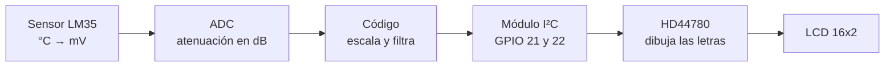
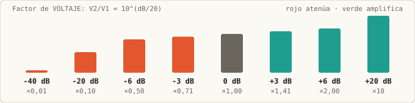
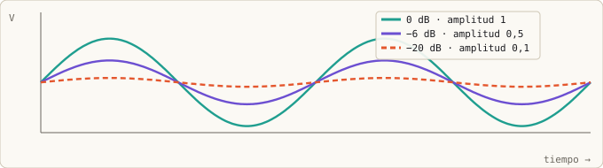
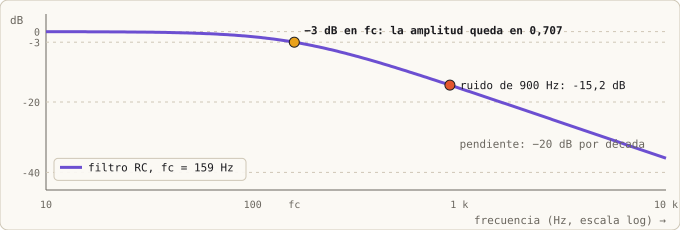
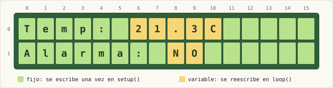
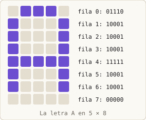
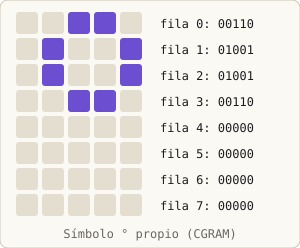
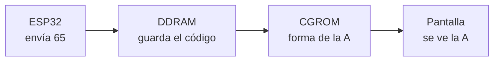
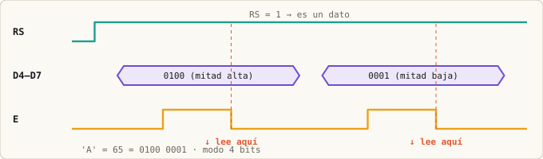

# Clase del 25 de noviembre — Decibeles y pantallas LCD 16x2

> Unidad 2 · Fuentes: tema de clase (decibeles) y diapositivas *S5 Pantallas LCD ESP32*. · [Notas originales](notas-originales.txt) · [Guía PDF](decibeles-y-pantallas-lcd.pdf)

[← Volver a los apuntes](../README.md)

## Idea central

El **decibel (dB)** compara dos valores con una escala logarítmica. En sistemas digitales aparece en la **atenuación del ADC**, en los **filtros** y en la medición del **ruido**. La **LCD 16x2** le da al ESP32 su propia pantalla: el ESP32 envía códigos ASCII y el controlador **HD44780** dibuja las letras. Se conecta directa (6 pines) o con un **módulo I²C** (solo GPIO 21 y 22).



## Glosario

| Término | Significado |
| --- | --- |
| **Decibel (dB)** | Razón entre dos valores en escala logarítmica. No es una cantidad absoluta. |
| **dBm** | Potencia comparada contra 1 mW. Sí es un valor absoluto (por ejemplo, la señal Wi-Fi). |
| **Atenuar** | Achicar una señal. En dB da un número negativo. |
| **SNR** | Relación señal/ruido: cuánto más grande es la señal que el ruido, en dB. |
| **LCD 16x2** | Pantalla de 16 columnas y 2 filas de caracteres. |
| **HD44780** | Controlador de la LCD: recibe códigos y enciende los puntos de cada letra. |
| **ASCII** | Código numérico de cada carácter: `'A'` = 65. |
| **PCF8574** | Expansor de E/S del módulo I²C: recibe órdenes por 2 cables y maneja 8 salidas hacia la LCD. |

---

# Parte A — Decibeles

## 1. Qué es un decibel

| Para | Fórmula |
| --- | --- |
| Voltaje (o amplitud) | `dB = 20 · log10(V2 / V1)` |
| Potencia | `dB = 10 · log10(P2 / P1)` |
| De dB a factor de voltaje | `V2 / V1 = 10^(dB / 20)` |

Se usa 20 con voltaje y 10 con potencia porque la potencia es proporcional al voltaje al cuadrado.



*Cada barra es el factor de voltaje de un valor en dB. Negativo: la señal se achica; positivo: crece.*

## 2. Valores que conviene saber de memoria

| dB | Voltaje | Potencia | Dónde aparece |
| --- | --- | --- | --- |
| 0 dB | ×1 | ×1 | Sin cambio |
| −3 dB | ×0,707 | ×0,5 | Frecuencia de corte de un filtro |
| −6 dB | ×0,5 | ×0,25 | La amplitud se reduce a la mitad |
| −20 dB | ×0,1 | ×0,01 | Filtro RC una década después de fc |
| +6 dB | ×2 | ×4 | Atenuación de 6 dB del ADC |
| +11 dB | ×3,55 | ×12,6 | Atenuación por defecto del ADC (`ADC_11db`) |

Las sumas en dB son multiplicaciones en el factor: −6 dB y otros −6 dB dan −12 dB, que es ×0,5 × 0,5 = ×0,25 de voltaje.



*La misma senoidal a 0 dB, −6 dB y −20 dB: restar 6 dB es dividir la amplitud a la mitad.*

## 3. dB en el ADC del ESP32

La atenuación del ADC (clase del 24-nov) se expresa en dB.

| Paso | Qué pasa | Valor |
| --- | --- | --- |
| 1 | El conversor mide directamente alrededor de 1,1 V | base ≈ 1,1 V |
| 2 | El atenuador divide la entrada: 11 dB = ÷ 3,55 | `10^(11/20) ≈ 3,55` |
| 3 | Rango nominal: 1,1 V × 3,55 ≈ 3,9 V; en la práctica, hasta ~3,1 V | 0 a ~3,1 V |

| Atenuación | Factor | Rango útil (Espressif) |
| --- | --- | --- |
| 0 dB | ×1 | 0,1 – 0,95 V |
| 2,5 dB | ×1,33 | 0,1 – 1,25 V |
| 6 dB | ×2 | 0,15 – 1,75 V |
| 11 dB | ×3,55 | 0,15 – 2,45 V |

## 4. dB en los filtros

Un filtro RC pasa bajos de primer orden:

```text
|H(f)| = 1 / √(1 + (f / fc)²)        en dB: 20 · log10(|H(f)|)
```

- En `f = fc` la salida cae **3 dB** (amplitud × 0,707).
- Después de fc cae **20 dB por década**: a 10 · fc la amplitud es ×0,1.

**Ejemplo** con el RC de la clase anterior (10 kΩ y 100 nF, fc ≈ 159 Hz) y ruido de 900 Hz:
`(900/159)² ≈ 32` → `|H| = 1/√33 ≈ 0,174` → **≈ −15,2 dB**.



*En fc la señal cae 3 dB; el ruido de 900 Hz queda unos 15 dB abajo.*

## 5. dB para medir el ruido

| Qué | Fórmula |
| --- | --- |
| Relación señal/ruido | `SNR = 20 · log10(V señal / V ruido)` |
| SNR ideal de un ADC de N bits | `SNR ≈ 6,02 · N + 1,76 dB` |
| Mejora con media móvil de N muestras (ruido aleatorio) | `≈ 10 · log10(N) dB` |

| Caso | Cálculo | Resultado |
| --- | --- | --- |
| ADC del ESP32 (12 bits) | 6,02 · 12 + 1,76 | ≈ 74 dB ideal |
| ADC del Arduino Uno (10 bits) | 6,02 · 10 + 1,76 | ≈ 62 dB ideal |
| Media móvil con N = 10 | 10 · log10(10) | +10 dB de SNR, a cambio de retardo |
| Wi-Fi: `WiFi.RSSI()` | dBm = 10 · log10(P / 1 mW) | −50 dBm muy buena · −80 dBm débil |

> **Ojo**
> - Cada bit extra del ADC suma ≈ 6 dB de rango.
> - El ESP32 real rinde menos que el ideal por su propio ruido: por eso se filtra.
> - **dB** compara dos valores; **dBm** compara contra 1 mW.

---

# Parte B — Pantallas LCD 16x2

## 6. La pantalla

- **16 columnas × 2 filas = 32 casillas.**
- Posición = **(columna, fila)**, contando desde 0: de (0,0) arriba a la izquierda a (15,1) abajo a la derecha.
- Cada casilla es una **matriz de 5 × 8 puntos**; la última fila queda libre para el cursor.



| La letra A | Símbolo ° propio |
| --- | --- |
|  |  |

## 7. El controlador HD44780

El ESP32 **no dibuja punto por punto**: envía el código ASCII del carácter y el HD44780 enciende los puntos.



| Memoria | Qué guarda |
| --- | --- |
| **CGROM** | Formas de las letras, grabadas de fábrica |
| **DDRAM** | El código de cada casilla (lo que se ve) |
| **CGRAM** | Hasta 8 caracteres propios (códigos 0 a 7) |

| Carácter | ASCII | Binario |
| --- | --- | --- |
| `A` | 65 | 0100 0001 |
| `B` | 66 | 0100 0010 |
| `a` | 97 | 0110 0001 |
| `0` | 48 | 0011 0000 |
| espacio | 32 | 0010 0000 |

> **Ojo:** el carácter `'5'` tiene código 53; no es el número 5.

## 8. Conexión directa: los 16 pines

| Grupo | Pines | Función |
| --- | --- | --- |
| Alimentación | 1 VSS · 2 VDD | GND y 5 V |
| Contraste | 3 V0 | Potenciómetro |
| Control | 4 RS · 5 R/W · 6 E | Comando o dato · leer o escribir · "leer ahora" |
| Datos | 7 a 14: D0 a D7 | El byte (código de la letra o del comando) |
| Luz de fondo | 15 A · 16 K | LED de fondo (+ y −) |

- **RS = 0 → comando** (borrar, mover el cursor). **RS = 1 → dato** (un carácter).
- **R/W a GND**: siempre se escribe y se ahorra un pin.
- **E (Enable)**: el HD44780 lee los datos en el **flanco de bajada** de E.

### Escribir una letra en modo 4 bits

1. RS = 1 (es un dato).
2. Mitad alta del código en D4–D7 + pulso en E.
3. Mitad baja en D4–D7 + pulso en E.
4. El cursor avanza solo a la casilla siguiente.



*'A' = 65 = 0100 0001: primero 0100, después 0001; cada mitad se lee en el flanco de bajada de E. D0–D3 quedan libres: se ahorran 4 pines.*

## 9. Directa o con módulo I²C

| | Conexión directa | Módulo I²C (PCF8574) |
| --- | --- | --- |
| Pines del ESP32 | 6 (RS, E, D4–D7) | **2** (GPIO 21 SDA, GPIO 22 SCL) |
| Cables | ≈ 12 + potenciómetro | 4 |
| Contraste | Potenciómetro externo | Tornillo del módulo |
| Velocidad | Más rápida | Suficiente para texto |
| Dirección | — | `0x27` (PCF8574T) o `0x3F` (PCF8574AT) |

- Cableado del módulo: GND → GND · VCC → VIN (5 V) · SDA → GPIO 21 · SCL → GPIO 22.
- Si no se conoce la dirección, un **escáner I²C** prueba todas y muestra la que responde.
- Si no se ve nada, se ajusta el **tornillo de contraste** del módulo.
- **5 V con un ESP32 de 3,3 V:** la LCD reconoce un "1" desde 2,2 V, así que 3,3 V alcanzan. Los pull-ups del módulo van a 5 V, pero la corriente que entra al ESP32 es ≈ 0,2 mA. Lo ideal es un conversor de nivel 3,3 V ↔ 5 V; para el curso se acepta la conexión directa.

## 10. Programar con LiquidCrystal I2C

Se instala desde el Administrador de librerías ("LiquidCrystal I2C", Frank de Brabander). El aviso "puede ser incompatible con ESP32" se ignora: funciona.

| Función | Qué hace |
| --- | --- |
| `LiquidCrystal_I2C lcd(0x27, 16, 2);` | Crea la pantalla: dirección, columnas, filas |
| `lcd.init();` | Prepara el HD44780 en modo 4 bits |
| `lcd.backlight();` / `lcd.noBacklight();` | Enciende o apaga la luz de fondo |
| `lcd.setCursor(col, fila);` | Mueve el cursor (cuenta desde 0) |
| `lcd.print("T: 21.3");` | Escribe texto o números |
| `lcd.clear();` | Borra todo (lento, ≈ 2 ms) |
| `lcd.createChar(0, grados);` / `lcd.write(0);` | Guarda y muestra un carácter propio |

### Planificar la pantalla y actualizar sin parpadeo

| Problema | Causa | Efecto |
| --- | --- | --- |
| Parpadeo | `clear()` en cada vuelta | La pantalla queda en blanco un instante |
| Restos | Antes "25.10", ahora "9.5" | Se lee "9.510" |

**Solución:** lo fijo ("Temp:", "Alarma:") se escribe una vez en `setup()`; en `loop()` se sobrescribe **solo el valor**, desde su columna y con **ancho fijo** (rellenando con espacios).

```cpp
#include <Wire.h>
#include <LiquidCrystal_I2C.h>

LiquidCrystal_I2C lcd(0x27, 16, 2);              // 0x3F si el escáner dice eso
byte degree[8] = {0b00110, 0b01001, 0b01001, 0b00110, 0, 0, 0, 0};
const int LM35_PIN = 34;                         // ADC1, solo entrada

void setup() {
  Wire.begin(21, 22);                            // SDA, SCL
  lcd.init();
  lcd.backlight();
  lcd.createChar(0, degree);                     // símbolo ° en la CGRAM
  lcd.setCursor(0, 0); lcd.print("Temp:");      // texto fijo
  lcd.setCursor(0, 1); lcd.print("Alarma:");
}

void loop() {
  float tempC = analogReadMilliVolts(LM35_PIN) / 10.0;   // LM35: 10 mV por °C
  char text[7];
  snprintf(text, sizeof(text), "%5.1f", tempC);          // ancho fijo de 5
  lcd.setCursor(6, 0); lcd.print(text); lcd.write(0); lcd.print("C");
  lcd.setCursor(8, 1); lcd.print(tempC > 30 ? "SI" : "NO");
  delay(500);
}
```

> **Luz de fondo:** es lo que más consume. `lcd.noBacklight()` cuando nadie mira; encenderla solo con alarma o al tocar un botón.

## Ideas para recordar

| Tema | Idea |
| --- | --- |
| dB | Razón logarítmica: 20·log10 para voltaje, 10·log10 para potencia. |
| −3 dB | Amplitud ×0,707, potencia a la mitad: frecuencia de corte. |
| −6 dB / −20 dB | Amplitud a la mitad / a la décima parte. |
| ADC | 11 dB de atenuación = ÷3,55: así se miden hasta ~3,1 V. |
| Filtro RC | −20 dB por década después de fc. |
| Ruido | SNR ideal ≈ 6,02·N + 1,76 dB; la media móvil de N suma ≈ 10·log10(N) dB. |
| LCD | 16 × 2 casillas de 5 × 8 puntos; posición (columna, fila) desde 0. |
| HD44780 | Recibe códigos ASCII; CGROM formas, DDRAM lo que se ve, CGRAM 8 propios. |
| Control | RS 0 comando / 1 dato; E lee en el flanco de bajada; R/W a GND. |
| I²C | Módulo PCF8574, dirección 0x27 o 0x3F, GPIO 21 SDA y GPIO 22 SCL. |
| Sin parpadeo | Fijo en `setup()`, solo el valor en `loop()` con ancho fijo. |
